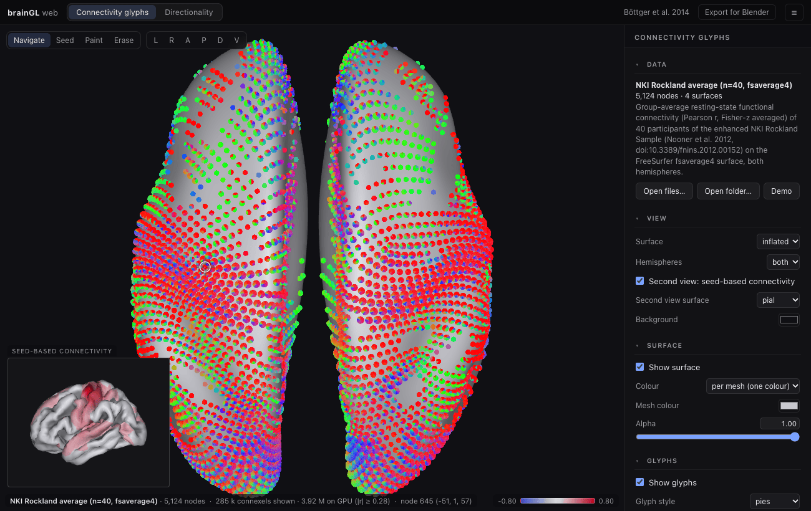
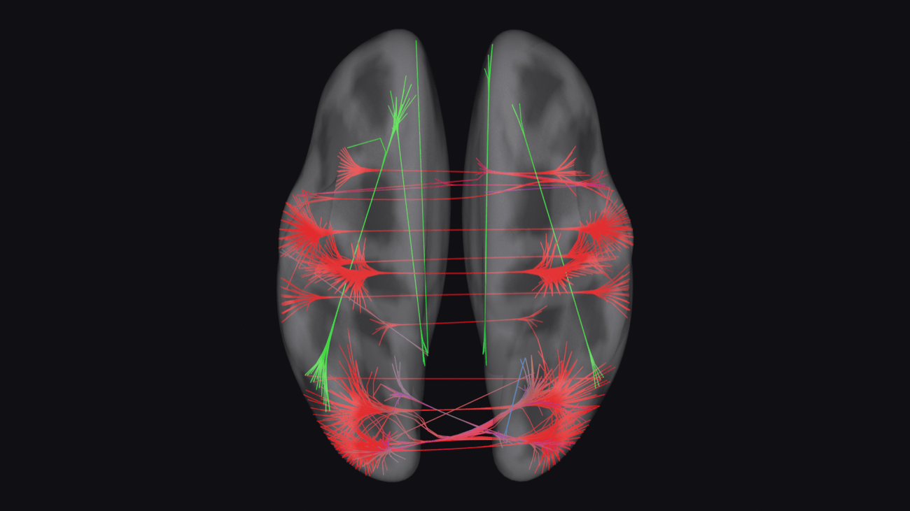

# brainGL web

[](https://github.com/NeuroanatomyAndConnectivity/braingl-web/actions/workflows/ci.yml)

**[Open the app](https://neuroanatomyandconnectivity.github.io/braingl-web/)** ·
**[Documentation and tutorials](https://neuroanatomyandconnectivity.github.io/braingl-web/docs/)**

brainGL web shows dense brain connectivity on cortical surfaces in the browser. Given surface
meshes and a node-by-node connectivity matrix, it draws a glyph at every node that summarises
all connections of that node, so that changes of the connectivity profile across the cortex
become visible. It is a WebGL2 / TypeScript port of the connectivity-glyph part of
[brainGL](https://code.google.com/archive/p/braingl/), the program by Ralph Schurade and
Joachim Böttger described in Böttger, Schurade, Jakobsen, Schaefer & Margulies (2014). Data are
read by the browser and never leave your computer.



## Credits

brainGL was written by **Ralph Schurade**. The connexel, connectivity-glyph and edge-bundling
methods and code are by **Joachim Böttger**. The Directionality workspace is a port of
DirectionalityIndicator by **Sebastian Eichelbaum**. The methods are theirs; please cite their
papers ([Citing](#citing)). Daniel S. Margulies refactored the software for the web browser
using Claude. Details are in [NOTICE.md](NOTICE.md).

## Features

- Glyph styles: points, vectors, pies, difference glyphs, and anatomical background glyphs ("little brains")
- Glyph geometry from any surface or a polar projection of the sphere; colour by connection orientation or by value
- Independent choice of the displayed surface, the glyph geometry, the surface for glyph colours and the surface for the minimum-length test
- Live threshold, sign, upper threshold and minimum connection length; a connexel budget instead of brainGL's load-time threshold
- Second, coupled view with the seed-based connectivity of the selected node
- Painted regions: glyphs restricted to a region, mean connectivity, load and save of ROIs
- "Make connections" and mean-shift edge bundling; save `.cxls` and `.fib`
- Screenshots at a multiple of the screen resolution, scene files, scripting from the browser console
- A second workspace, Directionality: arrows and line integral convolution on a parcellated surface, fed with painted regions or surface maps from the glyph workspace
- Export of either workspace for Blender, from the browser or from the command line
- A Python tool that converts surfaces and matrices or time series to compact glyphsets

## Quick start

Use the [hosted app](https://neuroanatomyandconnectivity.github.io/braingl-web/), or run it
locally. This requires Node.js 20 or newer and a browser with WebGL2.

```bash
git clone https://github.com/NeuroanatomyAndConnectivity/braingl-web.git
cd braingl-web
npm install
npm run dev
# open http://localhost:5173
```

The demo data load automatically. `npm run build` writes a static site to `dist/`.

## Two workspaces

- **Connectivity glyphs**: surfaces and a dense connectivity matrix as glyphs, connections and bundles.
- **Directionality**: the vendored
  [directionality-indicator-webgl](https://github.com/NeuroanatomyAndConnectivity/directionality-indicator-webgl)
  app (arrows and line integral convolution on a parcellated surface). Painted regions and
  surface maps can be sent to it from the glyph workspace.

## Documentation

The documentation is published at
<https://neuroanatomyandconnectivity.github.io/braingl-web/docs/> and lives in
[`docs/`](docs/index.md) (MkDocs Material; `pip install mkdocs-material`, then `mkdocs serve`).
Start with the [quick start](docs/getting-started/quickstart.md), the
[glyph tutorial](docs/tutorials/glyphs.md) and [your own data](docs/tutorials/own-data.md).

## Data it accepts

Open files, open a folder, or drag and drop:

1. a web glyphset: `glyphset.json` plus binary files, written by `tools/make_glyphset.py`;
2. an original brainGL glyphset: `.glyphset`, `.set`, FreeSurfer `.asc` surfaces and a float32 matrix;
3. loose files: surfaces (GIFTI `.surf.gii`, FreeSurfer binary or `.asc`) per hemisphere and a
   square matrix (`.npy` or raw float32), optionally per-node scalars (`.func.gii`,
   `.shape.gii`, FreeSurfer `sulc` / `curv`, `.1D`).

At most 65,535 nodes; in practice about 16,000, because the matrix is held in memory as int16
(2·n² bytes: 52 MB at 5,124 nodes, 210 MB at 10,242, about 0.5 GB at 16,384). No volumes, fibre
tracts or direct CIFTI input. See [data formats](docs/reference/data-formats.md) and
[limits](docs/reference/limits.md).

## Demo data

The bundled glyphset `public/data/nki_fsaverage4/` is the group-average resting-state
functional connectivity (Pearson r, averaged in Fisher z) of 40 participants of the enhanced
Nathan Kline Institute Rockland Sample (Nooner et al. 2012,
[doi:10.3389/fnins.2012.00152](https://doi.org/10.3389/fnins.2012.00152);
<http://fcon_1000.projects.nitrc.org/indi/enhanced/>) on the FreeSurfer fsaverage4 surfaces:
5,124 nodes on both hemispheres. It contains no individual-level data and was built with
`python tools/make_glyphset.py nki-demo`. If you use it, credit the enhanced NKI Rockland
Sample as its source.

## Blender export

**Export for Blender** downloads a zip with `scene.json`, one PLY per layer and
`import_braingl.py`. Run `blender --python import_braingl.py` in the unzipped folder, or export
the example scenes without a browser:

```bash
npm run export:blender -- --all --out examples/blender
```

See the [Blender tutorial](docs/tutorials/blender.md).



## Tests

```bash
npm run typecheck                    # TypeScript, strict mode
npm test                             # unit and integration tests (vitest)
npm run test:e2e                     # build, then a smoke test in headless Chrome
python -m pytest tests/python -q     # the data tool (numpy, scipy, nibabel, pytest)
blender --background --python tests/blender/test_import.py   # the Blender importer
```

See [testing](docs/development/testing.md), [tests/README.md](tests/README.md) and
[CONTRIBUTING.md](CONTRIBUTING.md).

## Citing

- Böttger J, Schurade R, Jakobsen E, Schaefer A, Margulies DS (2014). Connexel visualization: a
  software implementation of glyphs and edge-bundling for dense connectivity data using brainGL.
  *Front. Neurosci.* 8:15. [doi:10.3389/fnins.2014.00015](https://doi.org/10.3389/fnins.2014.00015)
- Böttger J, Schurade R, Margulies DS (2013). Functional connectivity glyphs for brain
  visualization. *EuroVis VMLS*. [doi:10.2312/PE.VMLS.VMLS2013.001-005](https://doi.org/10.2312/PE.VMLS.VMLS2013.001-005)
- Böttger J, Schäfer A, Lohmann G, Villringer A, Margulies DS (2014). Three-dimensional
  mean-shift edge bundling for the visualization of functional connectivity in the brain.
  *IEEE TVCG* 20(3):471-480. [doi:10.1109/TVCG.2013.114](https://doi.org/10.1109/TVCG.2013.114)
- Jakobsen E et al. (2016). Subdivision of Broca's region based on individual-level functional
  connectivity. *Eur. J. Neurosci.* 43(4):561-571. [doi:10.1111/ejn.13140](https://doi.org/10.1111/ejn.13140)
- Margulies DS et al. (2013). Visualizing the human connectome. *NeuroImage* 80:445-461.
  [doi:10.1016/j.neuroimage.2013.04.111](https://doi.org/10.1016/j.neuroimage.2013.04.111)
- Demo data: Nooner KB et al. (2012). The NKI-Rockland sample: a model for accelerating the pace
  of discovery science in psychiatry. *Front. Neurosci.* 6:152.
  [doi:10.3389/fnins.2012.00152](https://doi.org/10.3389/fnins.2012.00152)

See also [CITATION.cff](CITATION.cff).

## Licence

The code is under the MIT licence, the licence of the original brainGL, except
`src/directionality/`, which is LGPL-3.0-or-later. See [LICENSE](LICENSE) and
[NOTICE.md](NOTICE.md).
