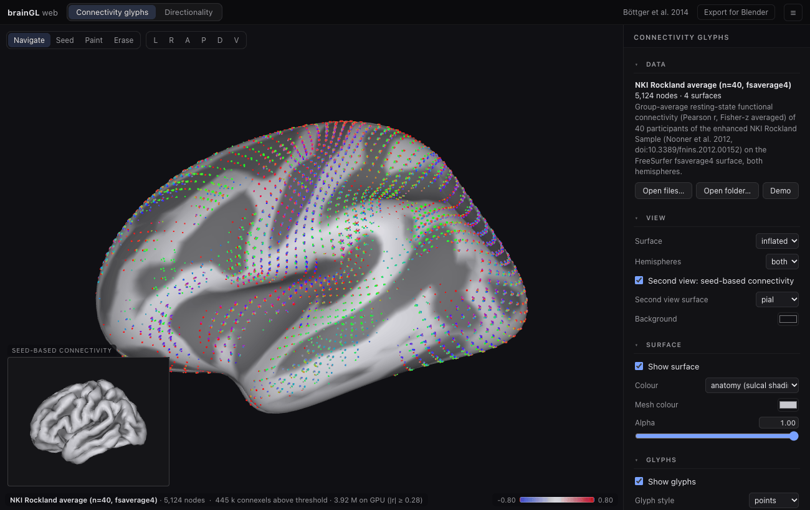
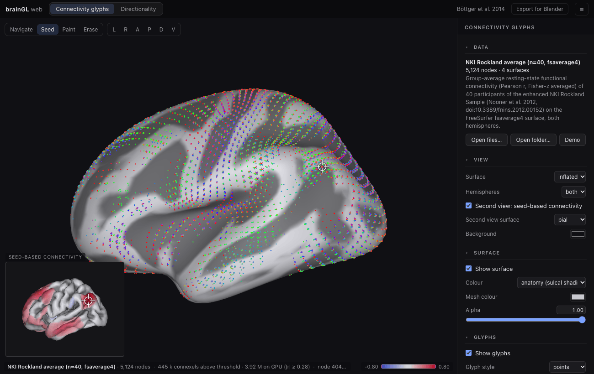
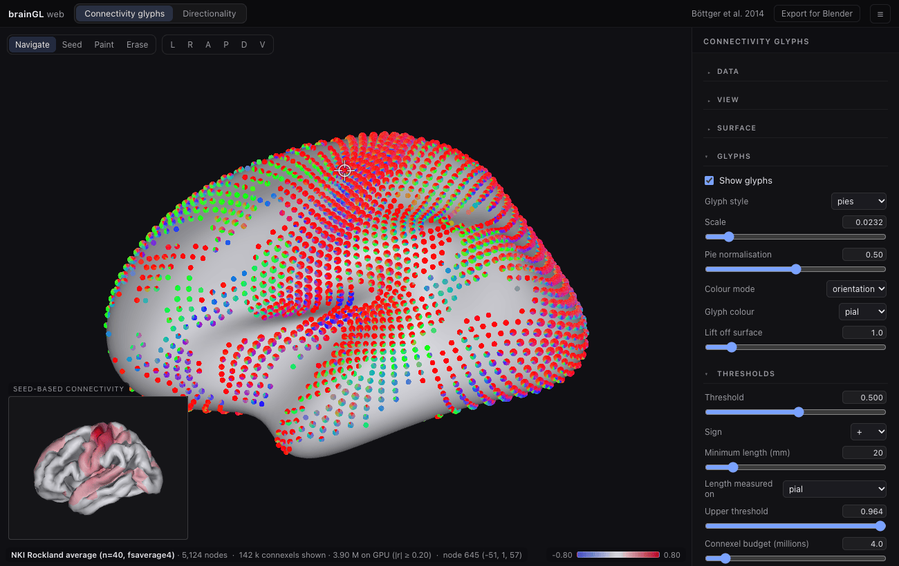

# Quick start

**Goal:** get to know the app in about five minutes, with the bundled demo data.
**You need:** a browser with WebGL2 and either the hosted app at
<https://neuroanatomyandconnectivity.github.io/braingl-web/> or your own copy ([Installation](installation.md)).
**Result:** you can move around the brain, select a node, change the glyph style and the
threshold, and save a picture.

## 1. Open the app

Open <https://neuroanatomyandconnectivity.github.io/braingl-web/>, or <http://localhost:5173>
if you run your own copy. The demo glyphset (about 13.5 MB) loads by itself; a progress box
shows the download.

What you see:

- **Top bar**: the two workspace tabs (*Connectivity glyphs* and *Directionality*), a **Docs**
  link to this documentation (in a built copy such as the hosted app; the development server
  does not show it), a link to the 2014 paper, **Export for Blender**, and the ☰ button that
  hides or shows the side panel.
- **Main view**: the inflated cortical surface with one glyph at every node. With the default
  style *points*, every glyph is a tiny map of the brain: one coloured point for every
  connection of that node that is stronger than the threshold.
- **Second view** (bottom left, labelled *seed-based connectivity*): the pial surface. It shows
  the connectivity map of the node you select.
- **Toolbar** (top left of the view): the tools *Navigate*, *Seed*, *Paint*, *Erase*, and the view
  buttons **L R A P D V** (left, right, anterior, posterior, dorsal, ventral).
- **Status line** (bottom): the name of the data, the number of nodes, how many connexels pass
  the threshold and how many were sent to the graphics card.
- **Side panel**: all settings, in sections that fold when you click their heading.

The demo is the group-average resting-state functional connectivity of 40 participants of the
enhanced NKI Rockland sample (Nooner et al. 2012,
[doi:10.3389/fnins.2012.00152](https://doi.org/10.3389/fnins.2012.00152)) on the FreeSurfer
fsaverage4 mesh: 5,124 nodes on both hemispheres.

## 2. Move around

| Action | Mouse |
|---|---|
| Rotate | drag |
| Pan | Shift + drag, or drag with the middle button |
| Zoom | scroll (the zoom centres on the pointer) |
| Standard views | the buttons **L R A P D V**; Shift + click sets the second view instead |

The second view has its own camera: drag and scroll inside it to move it.

## 3. Select a node

Right-click anywhere on the surface. On a Mac trackpad, click with two fingers or hold
++ctrl++ and click; a double-click also works everywhere. You can also choose the **Seed** tool
(key ++s++) and click or drag with the left button.

A cross-hair marks the node in both views (it is hidden in a view where the node itself cannot be seen, for example on the far side of the brain), the second view shows the node's connectivity map
through the colour map in the legend at the bottom right, and the status line gives the node
number and its coordinates. Press ++n++ to return to the *Navigate* tool.

## 4. Change the glyph style

Press the keys ++1++ to ++4++ for *points*, *vectors*, *pies* and *diffpoints*, and ++0++ to
switch the glyphs off, or use **Glyphs → Glyph style** in the panel. Try ++3++:

A pie glyph shows which directions the connections of a node run in. The colour is the
orientation of a connection: red for left–right, green for anterior–posterior, blue for
superior–inferior. The [glyph tutorial](../tutorials/glyphs.md) explains how to read this picture.

## 5. Change what is shown

In the panel:

1. **View → Hemispheres → left** shows and computes the left hemisphere only.
2. **Thresholds → Threshold**: drag the slider. Only connections stronger than this value are
   drawn; the picture follows while you drag. The status line reports how many connexels remain.
3. **Thresholds → Minimum length (mm)** removes short connections. Raise it to see where the
   long-range connections are.
4. **Glyphs → Scale** changes the size of all glyphs.

If the status line says *threshold limited to … by the connexel budget*, the threshold cannot go
lower with the current **Connexel budget**; see [Limits](../reference/limits.md).

## 6. Save a picture

Open the **Export** section at the bottom of the panel and click **Screenshot**. The browser
downloads a PNG of the view at twice the screen resolution (change **Screenshot scale** for
more). [Make publication figures](../how-to/figures.md) has the details.

## 7. Start again

**Export → Reset to defaults** restores all settings. The **Demo** button in the **Data**
section reloads the demo data after you have opened something else.

## Next steps

- [Connectivity glyphs tutorial](../tutorials/glyphs.md): the glyph styles and what they show.
- [Manual parcellation](../tutorials/parcellation.md) and
  [Connections and bundling](../tutorials/bundling.md): regions, lines and bundles.
- [Your own data](../tutorials/own-data.md): open your surfaces and matrices.
- [Directionality](../tutorials/directionality.md) and [Blender export](../tutorials/blender.md):
  the second workspace and rendered figures.
- [Mouse and keyboard](../reference/mouse-keyboard.md): every gesture and key.
