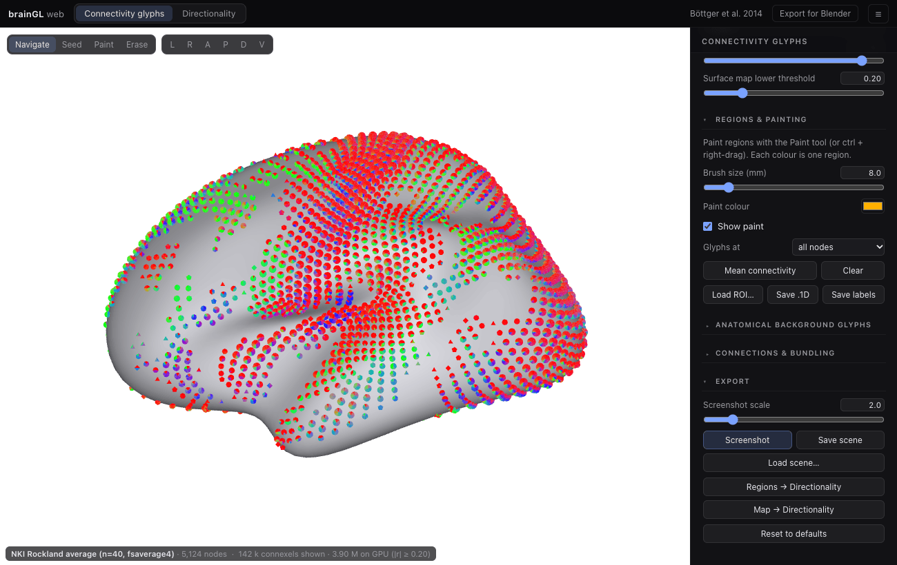
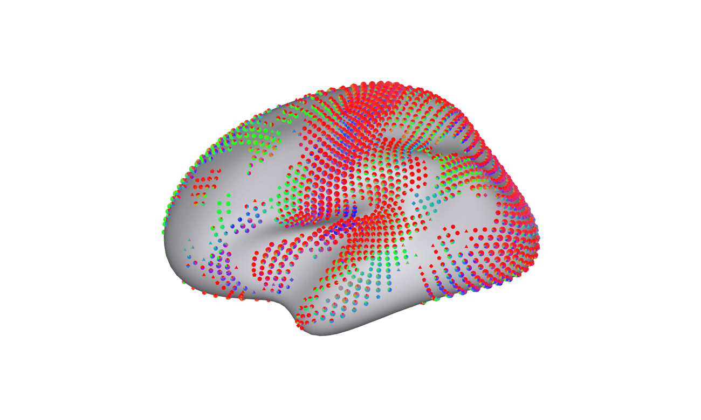
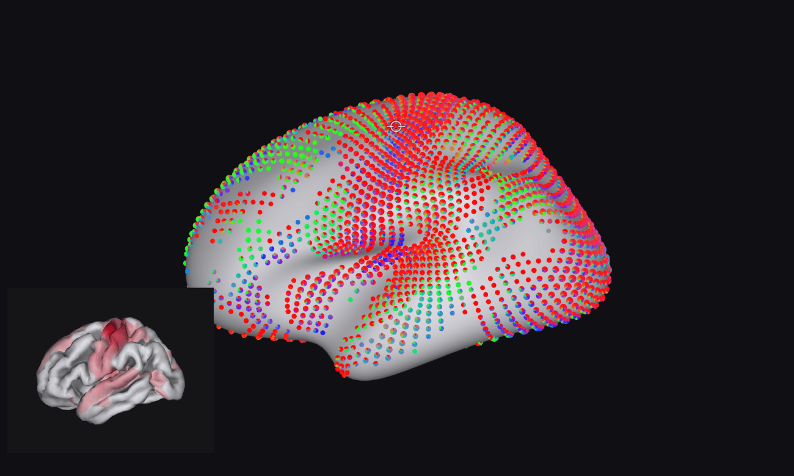

# Make publication figures

## Screenshot

1. Arrange the view. Hide what you do not want: untick **View → Second view** unless you want
   the inset in the picture.
2. Set **View → Background** (for example white).
3. In **Export**, set **Screenshot scale** (1 to 8, a multiple of the screen resolution) and
   click **Screenshot**.

The PNG `braingl-<style>-<date and time, UTC>.png` contains the 3-D view only: no toolbar,
status line, legend or panel.

- The second view, if on, is part of the image (without its label), and so is the cross-hair
  of a selected node. There is no switch for the cross-hair; reload the page or the data to clear the selection.

- The image size is the size of the view times the scale; enlarge the browser window or hide
  the panel (☰) for a different aspect ratio. The scale is reduced automatically if the image
  would exceed what the graphics card allows.
- There is no colour bar in the image; note **Colour map → Min / Max** for the legend of your figure.

## Scenes

**Export → Save scene** writes a `.scn.json` file with all settings, both cameras, the selected
node and the painted regions. **Load scene…** restores them; the regions are restored only if
the loaded data have the same number of nodes. Scenes do not contain the data.

A scene is checked when it is loaded, in the same way as the settings are checked when a
dataset is loaded: a surface that the current data do not have falls back to a default, and
thresholds and colour ranges are limited to the range of the current matrix. A scene saved with
one dataset can therefore be applied to another without leaving the view empty, but it may not
look identical.

## The Directionality workspace

The Directionality workspace has its own **Screenshot** section at the bottom of its panel:
**Current view** saves the view as a PNG with a transparent background, cropped to the brain,
and **All canonical views** saves six of them, one per standard view. **Resolution (DPI)** sets
the size: 96 is the size on screen and the default of 600 is 6.25 times that; the image is
limited to 50 megapixels.

## Rendered figures

For shadows, depth of field or very large images, use [Blender export](../tutorials/blender.md).
**Export for Blender** works in both workspaces, and both exports carry a camera: the glyph
workspace exports the view you see, the Directionality workspace a left lateral view that
frames the whole surface. For a series of images, see [Script the viewer](scripting.md).
