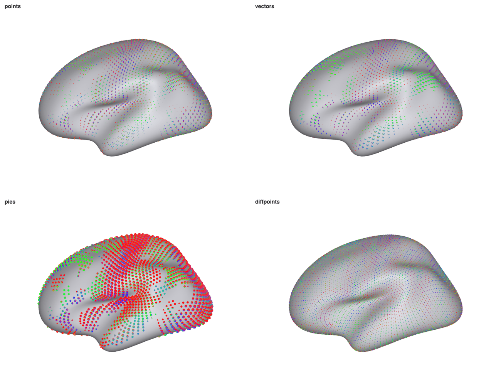

# Script the viewer

The app exposes a small API as `window.braingl`. Use it from the browser's developer console
(F12 or Cmd+Option+I, tab *Console*).

| Call | Effect |
|---|---|
| `braingl.glyphs.setParams({ ... })` | change settings; the names are those of [Parameters](../reference/parameters.md) (`src/glyphs/params.ts`) |
| `braingl.glyphs.params` | the current settings |
| `braingl.glyphs.setView(name, view, zoom)` | `name`: `"left"`, `"right"`, `"anterior"`, `"posterior"`, `"dorsal"`, `"ventral"`; `view`: 0 main, 1 second; `zoom`: 1 fits the brain |
| `braingl.glyphs.selectNode(i)` | select node `i` |
| `braingl.glyphs.focusNode(i, zoom)` | centre the main view on node `i` |
| `braingl.glyphs.screenshot()` | download a PNG, as the **Screenshot** button |
| `braingl.show("glyphs")`, `braingl.show("directionality")` | switch workspace |
| `braingl.exportForBlender()` | as the **Export for Blender** button, for the workspace in front |
| `braingl.glyphs.loadDemo("data/local/my_set/")` | load a web glyphset hosted next to the app (a folder with `glyphset.json`, relative to the page) |

## Example: one image per glyph style

Paste into the console:

```js
const g = braingl.glyphs;
const sleep = (ms) => new Promise((resolve) => setTimeout(resolve, ms));

g.setParams({ hemi: 1, secondView: false, background: "#ffffff", surfaceColorMode: "solid", screenshotScale: 2 });
g.setView("left");

const styles = {
  points: { threshold: 0.5, minLength: 20 },
  vectors: { threshold: 0.5, minLength: 40 },
  pies: { threshold: 0.5, minLength: 20 },
  diffpoints: { threshold: 0.3, minLength: 0 },
};

for (const [style, settings] of Object.entries(styles)) {
  g.setParams({ glyphStyle: style, ...settings });
  await sleep(1500);   // let the glyphs build and the frame draw
  g.screenshot();      // downloads braingl-<style>-<time>.png
  await sleep(1000);   // give the browser time to save the file
}
```

The browser may ask once whether the page may download several files. The result:



## Notes

- `screenshot()` returns before the file is written, hence the pauses.
- Settings changed by script are stored like those changed in the panel; **Export → Reset to
  defaults** restores the defaults.
- Painting, "Make connections" and bundling have no public scripting calls yet.
- Painting with the mouse depends on the platform: Option + right-drag on macOS, Ctrl +
  right-drag elsewhere, or the **Paint** tool everywhere
  ([Mouse and keyboard](../reference/mouse-keyboard.md)).
- The address parameters `?data=<folder>` and `?workspace=directionality` set the starting
  state without the console; `?data=` accepts only folders on the same origin as the app
  ([Deploy your own copy](deploy.md)).
- For batch export to Blender without a browser use `npm run export:blender`
  ([Command-line tools](../reference/cli.md)).
