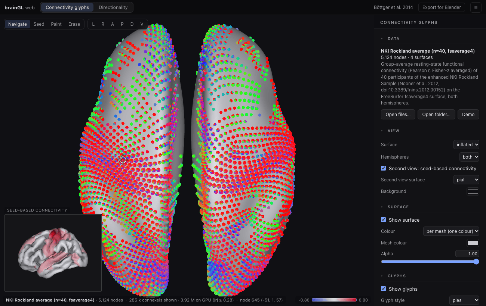

# brainGL web

brainGL web shows dense brain connectivity on cortical surfaces in a web browser. You give it
surface meshes and a node-by-node connectivity matrix (for example the correlation between the
resting-state time series of every pair of surface nodes), and it draws a small **glyph** at
every node that summarises all connections of that node. You can then see where connectivity
profiles change across the cortex, paint regions, turn the strongest connections into lines and
bundle them, and export the picture for Blender.

[Open the app](https://neuroanatomyandconnectivity.github.io/braingl-web/){ .md-button .md-button--primary }
[Source code](https://github.com/NeuroanatomyAndConnectivity/braingl-web){ .md-button }

It is a WebGL2 and TypeScript port of the connectivity-glyph part of
[brainGL](https://code.google.com/archive/p/braingl/), the C++/Qt program by Ralph Schurade and
Joachim Böttger described in Böttger, Schurade, Jakobsen, Schaefer and Margulies (2014),
[doi:10.3389/fnins.2014.00015](https://doi.org/10.3389/fnins.2014.00015). Nothing is installed
on the computer of the person who looks at the data, and no data leave that computer: files you
open are read by the browser and stay there.

*The connectivity glyphs workspace with the bundled demo data: pie glyphs on the inflated
surface, seed-based connectivity of the selected node in the second view (bottom left), controls
in the side panel.*

## Two workspaces

The page has two workspaces, selected with the tabs in the top bar.

**Connectivity glyphs** is the port of brainGL's glyphs:

- glyph styles *points*, *vectors*, *pies* and *diffpoints*, and anatomical background glyphs
  ("little brains");
- glyph geometry taken from any surface, or a polar projection of the sphere;
- colour by connection orientation or by connection strength;
- live threshold, sign, upper threshold and minimum connection length;
- a second, coupled view with the seed-based connectivity of the selected node;
- painting of regions, glyphs restricted to painted regions, mean connectivity of a region,
  loading and saving of regions;
- "Make connections" and mean-shift edge bundling;
- screenshots at a multiple of the screen resolution, scene files, export for Blender.

**Directionality** is the
[directionality-indicator-webgl](https://github.com/NeuroanatomyAndConnectivity/directionality-indicator-webgl)
application, a web port of Sebastian Eichelbaum's DirectionalityIndicator, included as a
vendored copy: arrows and line integral convolution on a parcellated surface. Painted regions and surface maps
can be sent to it from the glyph workspace.

## Where to start

| You want to | Read |
|---|---|
| Install and run the app | [Installation](getting-started/installation.md) |
| See what it does in five minutes | [Quick start](getting-started/quickstart.md) |
| Learn the glyphs step by step | [Connectivity glyphs tutorial](tutorials/glyphs.md) |
| Find a border between two areas by hand | [Manual parcellation tutorial](tutorials/parcellation.md) |
| Draw and bundle connections | [Connections and bundling tutorial](tutorials/bundling.md) |
| Look at your own data | [Your own data](tutorials/own-data.md) |
| Show the direction of a gradient or between regions | [Directionality tutorial](tutorials/directionality.md) |
| Open a glyphset made for the original brainGL | [Load a brainGL glyphset](how-to/load-braingl-glyphset.md) |
| Make a figure | [Make publication figures](how-to/figures.md) and [Blender export](tutorials/blender.md) |
| Look up a control, a file format or a limit | [Parameters](reference/parameters.md), [Data formats](reference/data-formats.md), [Limits](reference/limits.md) |
| Understand how it differs from the original | [Differences from brainGL](explanation/differences-from-braingl.md) |

## What it does not do

brainGL web covers the surface-connectivity part of brainGL only. It does not show volumes or
slices (no NIfTI input), fibre tracts, tensors or the other data types of brainGL. A glyphset
can have at most 65,535 nodes, and because the matrix is kept in memory as 16-bit integers
(2·n² bytes) about 16,000 nodes is the practical size. CIFTI dense connectomes are not read
directly; convert them to a `.npy` matrix first ([Your own data](tutorials/own-data.md)). See
[Limits](reference/limits.md).

## Credits

brainGL was written by Ralph Schurade. The connexel, connectivity-glyph and edge-bundling
methods and code are by Joachim Böttger. The Directionality workspace is a port of
DirectionalityIndicator by Sebastian Eichelbaum. Daniel S. Margulies refactored the software
for the web browser using Claude.

The demo data are the group-average resting-state functional connectivity of 40 participants of
the enhanced Nathan Kline Institute Rockland Sample (Nooner et al. 2012,
[doi:10.3389/fnins.2012.00152](https://doi.org/10.3389/fnins.2012.00152);
<http://fcon_1000.projects.nitrc.org/indi/enhanced/>) on the FreeSurfer fsaverage4 surfaces.

## Citing and licence

If you use brainGL web, please cite the 2014 paper above; the related papers on the glyphs, the
bundling and the application to manual parcellation are listed in [Citing](about/citing.md).
The code is under the MIT licence, the licence of the original brainGL, except the
Directionality workspace, which is LGPL-3.0-or-later. See [License](about/license.md).
