# Blender export

**What you will learn:** the whole way from a view in the browser to a rendered image in
[Blender](https://www.blender.org/): exporting from either workspace, what the exported zip
contains, three ways to run the import script, what the script creates in Blender, its
command-line options, exporting and rendering all example scenes without a browser, and how
to restyle the result.

**Time:** about 30 minutes.

**Prerequisites:**

- the app with the demo data ([Quick start](../getting-started/quickstart.md));
- Blender 3.6 or newer. Nothing else has to be installed: the import script uses only what
  Blender ships with;
- for step 6, a local copy of the repository with its dependencies installed
  ([Installation](../getting-started/installation.md)).

!!! note "How the commands on this page were tested"
    All command lines were run with the `bpy` 5.0.1 Python module (Blender as a Python package,
    `pip install bpy`), in which `python import_braingl.py -- …` takes the place of
    `blender --background --python import_braingl.py -- …`. The figures were rendered at 1300
    pixels width with 32 samples (`--resolution 1300 --samples 32`) and reduced to a palette of at
    most 256 colours to keep the pages light; otherwise they are not edited. The `blender` forms
    of the commands were not run for this page.

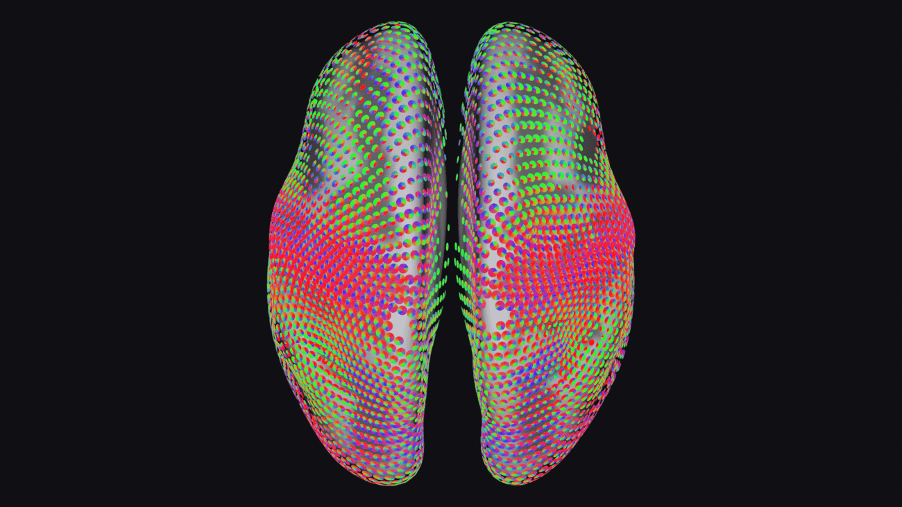

## 1. Export from a workspace

**Export for Blender** in the top bar exports the workspace that is in front.

1. In the **Connectivity glyphs** workspace, arrange the view you want: surface, glyph style,
   thresholds, camera. The example uses pie glyphs (key ++3++) with **Threshold** 0.4 and
   **Minimum length (mm)** 20 in the dorsal view (**D**), with the side panel hidden (☰).
2. Click **Export for Blender**.

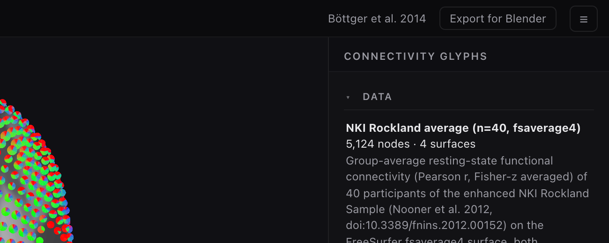

The browser downloads `braingl-<style>-blender.zip`, here `braingl-pies-blender.zip`. What it
contains from each workspace:

| Workspace | File name | Layers | Camera |
|---|---|---|---|
| Connectivity glyphs | `braingl-<style>-blender.zip` | the displayed surface with its colours (sulcal shading, seed map, overlay, paint); the glyphs of the current style; anatomical background glyphs if shown; connections or bundles if shown | the main view as you see it, with the aspect ratio of the view |
| Directionality | `braingl-directionality-blender.zip` | the surface with its colours; the arrows | a left lateral view that frames the whole surface at 16:9, independent of the view on screen |

In the Directionality workspace the steps are the same: bring the workspace to the front, set
up the arrows in its panel, click **Export for Blender**
([Directionality](directionality.md#9-export-to-blender)).

## 2. Look into the zip

Unzip the file. The pies example contains:

```text
braingl-pies-blender/
  scene.json             camera, background colour and the list of layers
  surface_inflated.ply   layer "surface inflated": the surface with its colours
  glyphs_pies.ply        layer "glyphs pies": the wedges of all pies
  import_braingl.py      the import script
  README.txt             these instructions in short
```

Each layer is one binary PLY file with a colour per vertex, named after the layer.
`scene.json` says for every layer what it is (a triangle mesh, points, or line segments),
whether it is anatomy (*lit*) or data (*flat*), and how thick points and lines are in
millimetres. Coordinates are in millimetres, in the coordinate system of your surfaces. The
PLY files can also be opened by MeshLab or ParaView. The format is specified in
[Blender scene format](../reference/blender-scene-format.md).

## 3. Run the import script

There are three ways. In each, the script looks for `scene.json` next to itself unless you
name another folder.

**In Blender's window**

1. Start Blender and switch to the **Scripting** workspace (the tab at the top).
2. In the text editor, choose **Text → Open** and select `import_braingl.py` in the unzipped
   folder.
3. Click **Run Script** (the triangle), or press ++alt+p++.
4. Press ++num0++ to look through the camera and ++f12++ to render.

**From a terminal, opening Blender**

```bash
blender --python braingl-pies-blender/import_braingl.py
```

Blender opens with the scene imported. Options for the script go after a `--`:

```bash
blender --python braingl-pies-blender/import_braingl.py -- braingl-pies-blender --points mesh
```

**Without a window**

```bash
blender --background --python braingl-pies-blender/import_braingl.py -- \
  braingl-pies-blender --render pies.png --resolution 1920
```

```text
brainGL: surface inflated: 5,124 mesh vertices
brainGL: glyphs pies: 585,906 mesh vertices
brainGL: imported 'NKI Rockland average (n=40, fsaverage4) (pies)' with 2 layer(s)
brainGL: rendered /home/you/pies.png
```

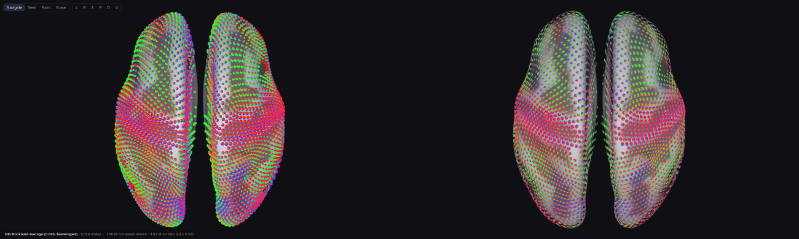

On macOS the program is inside the application bundle:
`/Applications/Blender.app/Contents/MacOS/Blender`.

## 4. What the script creates

The script removes the objects already in the scene (the default cube, camera and lamp, or an
earlier import; `--keep` prevents this) and creates:

| In Blender | What |
|---|---|
| Collection **brainGL: *title*** | everything the script makes |
| One mesh object per layer, named after the layer | `surface inflated`, `glyphs points`, `glyphs vectors`, `glyphs pies`, `glyphs diffpoints`, `little brains`, `connections`; for Directionality `parcellated surface` and `arrows` |
| Colour attribute **Col** on every object | the data colours, one per vertex, converted from sRGB to Blender's linear colours |
| Material **brainGL *layer*** per object | *flat* layers (glyphs, connections, arrows): an Emission shader fed by `Col`, so that lamps and shadows do not change colours that encode data. *Lit* layers (the surface, little brains): a Principled BSDF with `Col` as base colour and roughness 0.65; transparent if the surface was transparent in the browser |
| Modifier **brainGL points** on point layers | a geometry-nodes group that turns the vertices into a point cloud with a radius in millimetres (*Mesh to Points*, then *Set Material*) |
| Tubes | line layers (`glyphs vectors`, `connections`) become three-sided tubes of real geometry |
| **brainGL camera** | orthographic, with the position, direction, scale and aspect ratio from `scene.json` |
| **brainGL headlight** | a sun lamp (strength 3) parented to the camera, so that the light comes from the viewer as in the browser |
| Scene settings | unit system metric with unit scale 0.001 and length in millimetres, so 1 Blender unit is 1 mm; view transform **Standard**, so colours are not altered by a film look; world colour = the background of the app; EEVEE as render engine; the render height follows from the width and the aspect ratio |

Flat layers are also hidden from shadows and reflections, so that glowing glyphs do not light
the anatomy when you render with Cycles. If `scene.json` has no camera (scenes written by older
versions), the script frames everything in a left lateral view for a 16:9 image.

## 5. Options of the import script

Options go after the `--` that separates Blender's own arguments from the script's.

| Option | Default | Effect |
|---|---|---|
| *scene folder* (first argument) | the folder of the script | folder that contains `scene.json` |
| `--render FILE` | none | render a still image to FILE |
| `--save FILE` | none | save the result as a `.blend` file |
| `--engine eevee` or `--engine cycles` | `eevee` | render engine |
| `--samples N` | 64 | render samples |
| `--resolution W` | 1920 | image width in pixels; the height follows the aspect ratio of the scene |
| `--points nodes` or `--points mesh` | `nodes` | point glyphs as a point cloud (light) or as small octahedra of real geometry (works everywhere, heavier) |
| `--keep` | off | keep the objects that are already in the file |

`--cycles` is accepted as another spelling of `--engine cycles` only when the script is run
with the `bpy` Python module. The Blender application reads the arguments after `--` for its
own Cycles options and stops at `--cycles` with "ambiguous option"; use `--engine cycles`.

Examples:

```bash
# a .blend file to continue working in, point glyphs as real geometry
blender --background --python scene/import_braingl.py -- scene --points mesh --save scene.blend

# render with Cycles
blender --background --python scene/import_braingl.py -- scene --engine cycles --samples 128 --render cycles.png
```

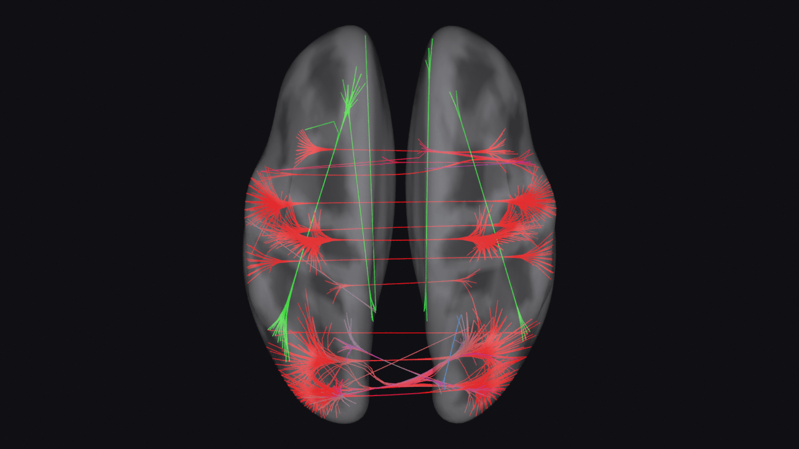

## 6. Export and render every example without a browser

The repository can write the example scenes of this documentation from the command line, with
the same code that the button uses.

```bash
npm run export:blender -- --all --out examples/blender
```

After npm's own line with the command, the tool prints one line per scene:

```text
/home/you/braingl-web/examples/blender/points: surface inflated [5,124], glyphs points [285,386] (290,510 vertices)
/home/you/braingl-web/examples/blender/vectors: surface inflated [5,124], glyphs vectors [725,542, subsampled] (730,666 vertices)
/home/you/braingl-web/examples/blender/pies: surface inflated [5,124], glyphs pies [585,906] (591,030 vertices)
/home/you/braingl-web/examples/blender/polar: surface inflated [5,124], glyphs points [339,585, subsampled] (344,709 vertices)
/home/you/braingl-web/examples/blender/diffpoints: surface inflated [5,124], glyphs diffpoints [78,776] (83,900 vertices)
/home/you/braingl-web/examples/blender/littlebrains: surface inflated [5,124], little brains [307,440, subsampled], glyphs points [39,676] (352,240 vertices)
/home/you/braingl-web/examples/blender/bundles: surface inflated [5,124], connections [72,000] (77,124 vertices)
/home/you/braingl-web/examples/blender/directionality-label34: parcellated surface [32,492], arrows [36,148] (68,640 vertices)
/home/you/braingl-web/examples/blender/directionality-seed-map: parcellated surface [5,124], arrows [24,276] (29,400 vertices)
```

The lines list the layers of each scene with their vertex counts; "subsampled" marks a layer
that was thinned to stay under the primitive limit.

Each folder holds `scene.json`, the PLY layers and a copy of `import_braingl.py`
(`examples/` is ignored by git). Render them all:

```bash
mkdir -p renders
for scene in examples/blender/*/; do
  name=$(basename "$scene")
  blender --background --python "$scene/import_braingl.py" -- "$scene" \
    --render "renders/$name.png" --resolution 1920 > "renders/$name.log" 2>&1 \
    || echo "failed: $name (see renders/$name.log)"
done
ls renders/*.png
```

```text
renders/bundles.png                  renders/littlebrains.png
renders/diffpoints.png               renders/pies.png
renders/directionality-label34.png   renders/points.png
renders/directionality-seed-map.png  renders/polar.png
renders/vectors.png
```

With EEVEE each scene takes a few seconds. The results:

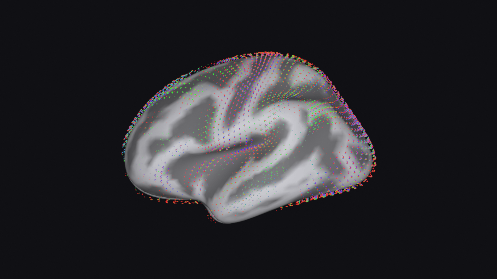

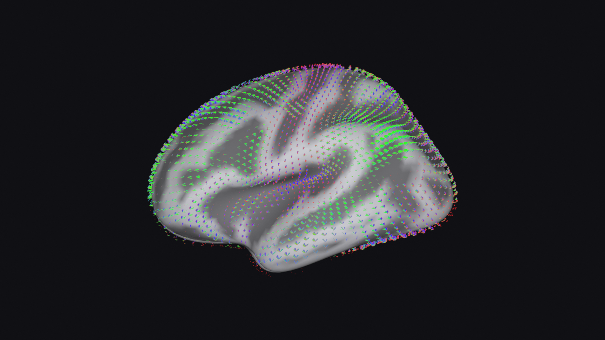

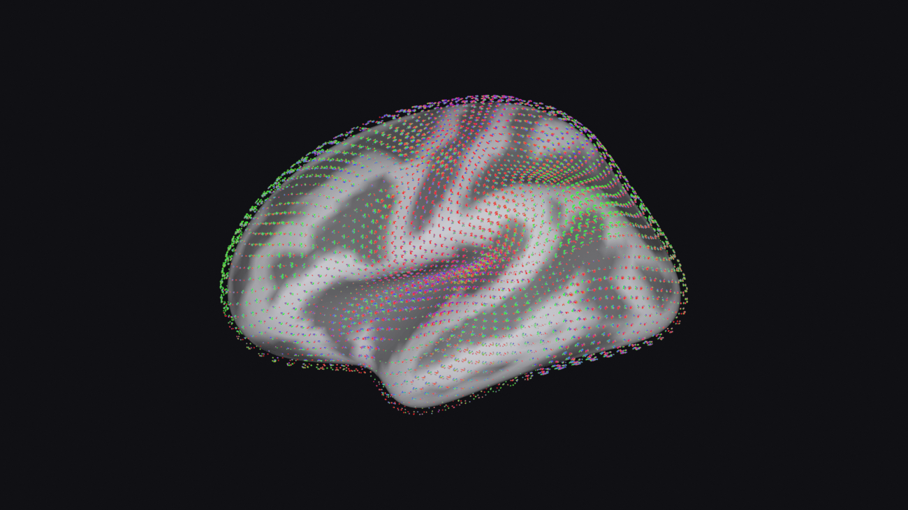

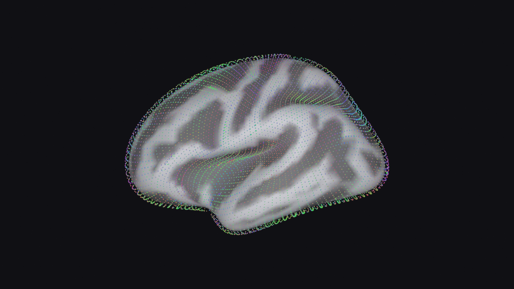


To export one scene with your own settings or data:

```bash
npm run export:blender -- --preset pies --params '{"threshold":0.6,"hemi":1}' --out examples/my-pies
npm run export:blender -- --preset points --glyphset public/data/local/my_set --out examples/my-points
npm run export:blender -- --directionality public/directionality/label18 --out examples/label18
```

The presets and all options are listed in
[Command-line tools](../reference/cli.md#npm-run-exportblender).

## 7. Restyle in Blender

Everything the script makes is ordinary Blender data. The recipes below say where each setting
is in Blender's interface and how to change it from Python.

**Point radius.** Select the object `glyphs points`, open the **Modifiers** tab, and in the
modifier **brainGL points** open the node group (the **Geometry Nodes** workspace shows it).
The **Radius** of the *Mesh to Points* node is the radius of every point in millimetres.

```python
nodes = bpy.data.objects["glyphs points"].modifiers["brainGL points"].node_group.nodes
nodes["Mesh to Points"].inputs["Radius"].default_value = 0.6      # mm
```

**Tube thickness.** Tubes are built once, on import, from the `radius` of the layer in
`scene.json` (in millimetres). Change the number there and run the import again:

```python
import json

path = "examples/blender/bundles/scene.json"
spec = json.load(open(path))
for layer in spec["layers"]:
    if layer["kind"] == "segments":          # glyphs vectors, connections
        layer["radius"] = 0.8                # mm
json.dump(spec, open(path, "w"), indent=1)
```

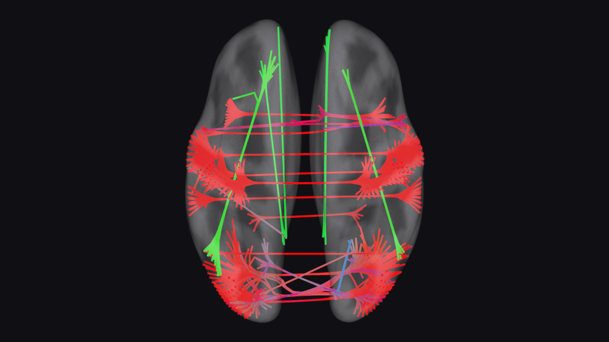

**Swap a material.** Each object has one material, **brainGL *layer***. To keep the data
colours, keep its *Attribute* node `Col` as the colour input of whatever shader you use. This
replaces the flat shader of the point glyphs with a shaded one:

```python
tree = bpy.data.materials["brainGL glyphs points"].node_tree
bsdf = tree.nodes.new("ShaderNodeBsdfPrincipled")
tree.links.new(tree.nodes["Attribute"].outputs["Color"], bsdf.inputs["Base Color"])
tree.links.new(bsdf.outputs["BSDF"], tree.nodes["Material Output"].inputs["Surface"])
```

To make the surface matt or shiny, change the roughness of its material:
`bpy.data.materials["brainGL surface inflated"].node_tree.nodes["Principled BSDF"].inputs["Roughness"].default_value = 0.9`.

**Transparent background.** In **Render properties → Film**, tick **Transparent**, and in
**Output properties** set the colour to **RGBA**:

```python
scene = bpy.context.scene
scene.render.film_transparent = True
scene.render.image_settings.color_mode = "RGBA"
```

**Framing.** The camera is orthographic: **Orthographic Scale** in the camera's data
properties is the width of the picture in millimetres. Lower it to zoom in
(`scene.camera.data.ortho_scale *= 0.7`).

The following script applies these recipes to the points example. Save it as `restyle.py`:

```python
"""Import a brainGL-web scene, restyle it, render it.

blender --background --python restyle.py -- <scene folder> <output.png>
"""
import os
import sys

import bpy

scene_dir, out = sys.argv[sys.argv.index("--") + 1:][:2]
sys.path.insert(0, scene_dir)            # import_braingl.py lies in the scene folder
import import_braingl

import_braingl.main([scene_dir, "--resolution", "1300", "--samples", "32"])
scene = bpy.context.scene

# thicker glyph points: the radius (in mm) is in the geometry-nodes modifier
points = bpy.data.objects.get("glyphs points")
if points:
    nodes = points.modifiers["brainGL points"].node_group.nodes
    nodes["Mesh to Points"].inputs["Radius"].default_value = 0.6

# a shaded material for the glyphs instead of the flat one, keeping the data colours
mat = bpy.data.materials.get("brainGL glyphs points")
if mat:
    tree = mat.node_tree
    bsdf = tree.nodes.new("ShaderNodeBsdfPrincipled")
    tree.links.new(tree.nodes["Attribute"].outputs["Color"], bsdf.inputs["Base Color"])
    tree.links.new(bsdf.outputs["BSDF"], tree.nodes["Material Output"].inputs["Surface"])

# a less glossy surface
surface = bpy.data.materials.get("brainGL surface inflated")
if surface:
    surface.node_tree.nodes["Principled BSDF"].inputs["Roughness"].default_value = 0.9

# transparent background: only the brain is opaque in the PNG
scene.render.film_transparent = True
scene.render.image_settings.color_mode = "RGBA"

scene.camera.data.ortho_scale *= 0.7     # zoom in

scene.render.filepath = os.path.abspath(out)   # Blender wants an absolute path
bpy.ops.render.render(write_still=True)
```

```bash
blender --background --python restyle.py -- examples/blender/points restyled.png
```

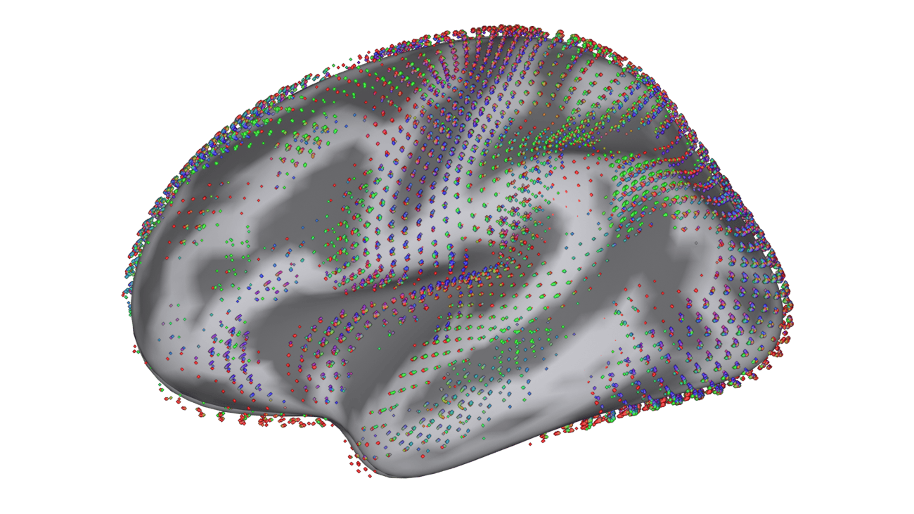

**Turntable animation.** Parent the camera to an empty object at the centre of the brain and
rotate the empty. The headlight follows, because it is parented to the camera. Save as
`turntable.py`:

```python
"""Turntable animation of a brainGL-web scene: the camera circles the brain once.

blender --background --python turntable.py -- <scene folder> <output folder>
"""
import math
import os
import sys

import bpy
from mathutils import Vector

scene_dir, out = sys.argv[sys.argv.index("--") + 1:][:2]
sys.path.insert(0, scene_dir)
import import_braingl

objects = import_braingl.main([scene_dir, "--resolution", "960", "--samples", "16"])
scene = bpy.context.scene

# an empty at the centre of the first layer (the surface); the camera becomes its child
centre = sum((Vector(corner) for corner in objects[0].bound_box), Vector()) / 8
pivot = bpy.data.objects.new("turntable", None)
pivot.location = centre
scene.collection.objects.link(pivot)
bpy.context.view_layer.update()
camera = scene.camera
camera.parent = pivot
camera.matrix_parent_inverse = pivot.matrix_world.inverted()

# one turn about the superior-inferior axis in 120 frames, at constant speed
frames = 120
bpy.context.preferences.edit.keyframe_new_interpolation_type = "LINEAR"
pivot.rotation_euler = (0, 0, 0)
pivot.keyframe_insert("rotation_euler", frame=1)
pivot.rotation_euler = (0, 0, math.radians(360))
pivot.keyframe_insert("rotation_euler", frame=frames + 1)
scene.frame_start, scene.frame_end = 1, frames

scene.render.filepath = os.path.join(os.path.abspath(out), "frame_")   # frame_0001.png, ...
bpy.ops.render.render(animation=True)
```

```bash
blender --background --python turntable.py -- examples/blender/vectors turntable
```

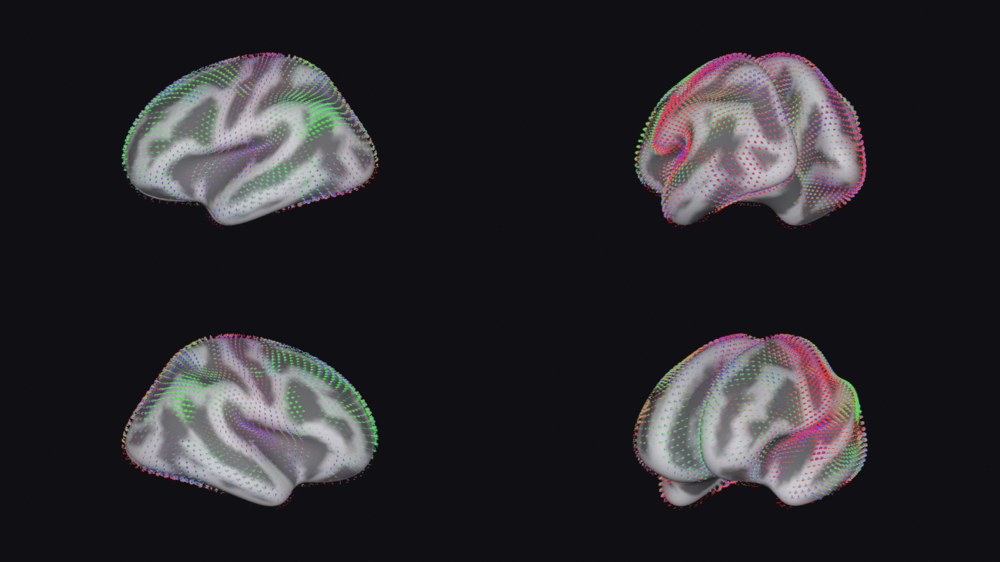

The script writes 120 PNG files. Join them into a film with Blender's video editor or with
`ffmpeg -framerate 30 -i turntable/frame_%04d.png -pix_fmt yuv420p turntable.mp4`.

## Differences from the browser view

The export turns a picture that is drawn for one camera into geometry that can be seen from
anywhere. Some things therefore differ:

- **Glyphs are lifted along the surface normal.** On screen, glyphs are moved towards the viewer
  (**Glyphs → Lift off surface**) so that they are not buried in the surface. There is no fixed
  viewer in a 3-D scene, so the export moves each glyph outwards along the normal of its node
  by the same amount.
- **Flat glyph types lie in the tangent plane.** Pies and polar-projection discs face the
  viewer on screen. In the export they lie in the plane tangent to the surface at their node,
  with "up" pointing to the superior side. Seen from the export camera they look the same on
  surfaces that face the viewer and foreshortened near the edge of the brain.
- **Pies are resampled to at most 48 wedges.** A pie can have thousands of slices; each
  exported wedge has the mean colour of the slices it covers. A pie of one or two slices (a full
  or a half disc) is cut into 24 wedges, so that it stays round.
- **Glyph alpha is not exported.** All exported glyph primitives are opaque, also when
  **Glyphs → Glyph alpha** is below 1. Surface transparency (**Surface → Alpha**) is exported.
- **Points and lines have a size in millimetres.** On screen their size is in pixels. The
  export converts **Point / line size** at the current zoom into a radius, which then stays
  fixed when you move the Blender camera.
- **At most 400,000 primitives per layer.** Larger layers are sub-sampled evenly. The export
  marks them (`"truncated": true` in `scene.json`, "subsampled" in the output of the
  command-line export and of the import script). Raise the threshold or restrict the glyphs to
  a region to stay below the limit.
- **LIC streaks are not exported.** They are computed on the screen and have no 3-D form. A
  Directionality export contains the surface and the arrows; each arrow is a flat shape laid
  into the plane tangent to the surface at its position. **Borders only** and the arrow
  **Opacity** of that workspace are not applied either.
- **The second view is not exported.** The cross-hair of the selected node is not exported
  either; the paint colours on the surface are.

## Troubleshooting

| Problem | Remedy |
|---|---|
| "scene.json is not a brainGL-web Blender scene", or "No such file … scene.json" | Give the script the unzipped folder that contains `scene.json`, after the `--`. |
| "ambiguous option: --cycles could match --cycles-print-stats, --cycles-device" | Use `--engine cycles`. The Blender application reads `--cycles…` options itself. |
| The options have no effect, or Blender reports an unknown argument | The script's options must come after a `--`. Before it, Blender reads them as its own. |
| "Render error … cannot save" in your own script | Give Blender an absolute output path (`os.path.abspath`), as the recipes above do. |
| Point glyphs are missing in the render | The point cloud needs a recent Blender. Import with `--points mesh` for real geometry. |
| The viewport is slow | Point layers with several hundred thousand points are heavy as real geometry; keep `--points nodes`, or export fewer primitives. |
| Colours look washed out or too contrasty | Keep the view transform **Standard** (**Render properties → Color Management**). *Filmic* and *AgX* change data colours. |
| Glyphs look dim in Cycles | Flat layers emit their colour with strength 1; raise **Strength** of the *Emission* node if you add strong lamps. |
| The brain is cut off or small in the frame | Change the camera's **Orthographic Scale**; the export uses the browser view, which may have another aspect ratio than you expect. |
| The surface hides connections inside the brain | Lower **Surface → Alpha** in the browser before exporting, or set **Alpha** of the surface's Principled BSDF in Blender. |
| A second import adds to the first | That happens only with `--keep`. Without it the previous import is removed. |

## Where next

- [Blender scene format](../reference/blender-scene-format.md): `scene.json` and the PLY layout,
  for writing your own importer.
- [Command-line tools](../reference/cli.md): presets and options of `npm run export:blender` and
  of the import script.
- [Make publication figures](../how-to/figures.md): screenshots, when a render is more than you
  need.
- [Directionality](directionality.md): the arrows that the last two example scenes show.
