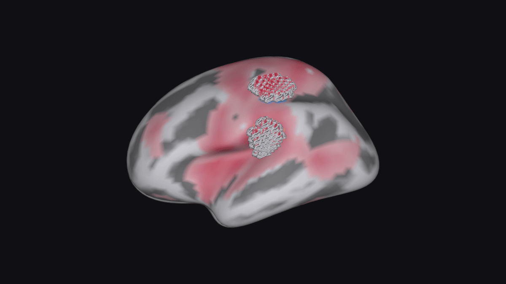
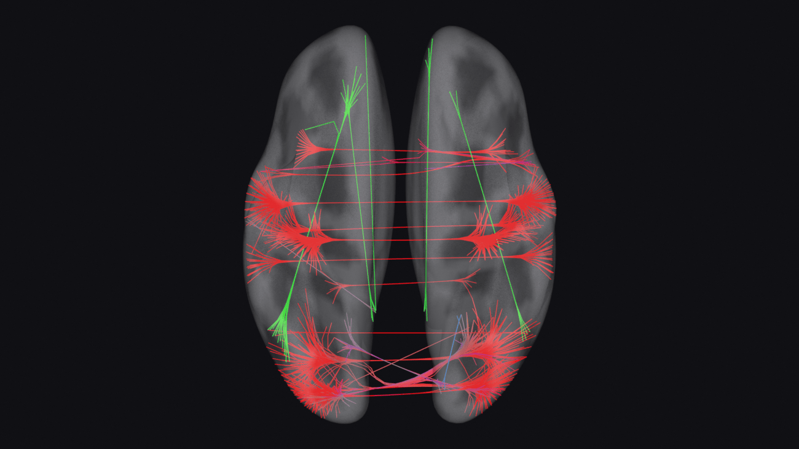
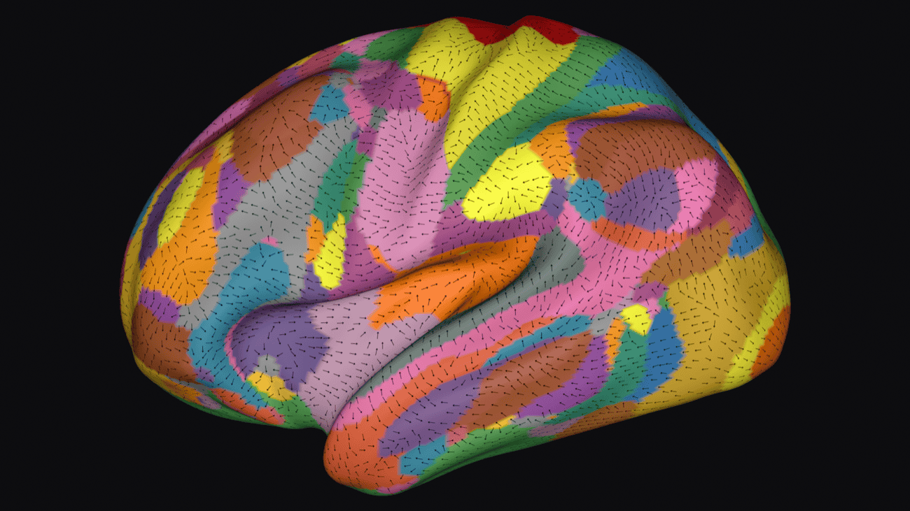

# Blender export

<!-- TODO(restart): expand; the blender command lines were verified with the bpy 5.0.1 Python module, not with a Blender binary -->

**Goal:** take the current picture to Blender for rendering.
**You need:** [Blender](https://www.blender.org/) 3.6 or newer.
**Result:** a Blender scene with the surface, glyphs, connections or arrows as coloured geometry, and a rendered image.


## 1. Export

Click **Export for Blender** in the top bar. It exports the workspace that is in front: the
glyph scene as you see it (surface, glyphs of the current style, little brains, connections)
or the Directionality scene (surface and arrows).


The browser downloads a zip (`braingl-<style>-blender.zip` or
`braingl-directionality-blender.zip`). Unzip it. It contains `scene.json`, one `.ply` file per
layer, `import_braingl.py` and a `README.txt` ([Blender scene format](../reference/blender-scene-format.md)).

## 2. Import

Three ways to run `import_braingl.py`:

1. In Blender: **Scripting** workspace → **Open** → `import_braingl.py` → **Run Script**.
   It loads the `scene.json` next to the script.
2. From a terminal, opening Blender: `blender --python import_braingl.py -- /path/to/scene`
3. Without a window: `blender --background --python import_braingl.py -- /path/to/scene --render out.png`

The script removes the objects already in the file (unless `--keep`) and creates:

- a collection "brainGL: *title*" with one mesh object per layer, named after the layer
  (`surface inflated`, `glyphs points`, `little brains`, `connections`, `arrows`, …);
- the data colours in the colour attribute **Col** of every object;
- materials "brainGL *layer*": *flat* layers (glyphs, connections, arrows) use an emission
  shader so that lighting does not change colours that encode data; *lit* layers (anatomy) use a
  Principled BSDF, with transparency if the surface was transparent;
- point glyphs as a geometry-nodes point cloud (modifier "brainGL points"); vectors and
  connections as thin tubes;
- an orthographic "brainGL camera" with the view of the browser, and a "brainGL headlight"
  sun lamp parented to it;
- units in millimetres, the *Standard* view transform, the background colour of the app.

Options after the `--`:

| Option | Effect |
|---|---|
| `--render FILE` | render a still image to FILE |
| `--save FILE` | save a `.blend` file |
| `--resolution W` | width of the render in pixels (default 1920) |
| `--samples N` | render samples (default 64) |
| `--points nodes` or `mesh` | point glyphs as a point cloud (default) or as octahedra |
| `--cycles` | render with Cycles instead of EEVEE (see Troubleshooting) |
| `--keep` | keep the objects already in the file |

## 3. Batch export without a browser

```bash
npm run export:blender -- --all --out examples/blender
```

writes one scene folder per example (`points`, `vectors`, `pies`, `polar`, `diffpoints`,
`littlebrains`, `bundles`, `directionality-label34`, `directionality-seed-map`). Render them all:

```bash
mkdir -p renders
for scene in examples/blender/*/; do
  blender --background --python "$scene/import_braingl.py" -- "$scene" \
    --render "renders/$(basename "$scene").png" --resolution 1920
done
```

Single scenes: `npm run export:blender -- --preset pies --params '{"threshold":0.6,"hemi":1}' --out /tmp/pies`;
see [Command-line tools](../reference/cli.md).






## 4. Restyle

- **Point size**: select the glyph object → Modifiers → "brainGL points" → in the node group,
  the **Radius** of the *Mesh to Points* node (millimetres).
- **Materials**: replace a "brainGL …" material, or change its shader; keep the *Attribute*
  node "Col" as the colour input to keep the data colours.
- **From a script** (also the way to use Cycles or to change the framing):

```python
import sys
import bpy

scene_dir, out = sys.argv[sys.argv.index("--") + 1:][:2]
sys.path.insert(0, scene_dir)            # import_braingl.py lies in the scene folder
import import_braingl

import_braingl.main([scene_dir, "--resolution", "1200", "--samples", "16"])

scene = bpy.context.scene
scene.camera.data.ortho_scale *= 1.5     # zoom out

points = bpy.data.objects.get("glyphs points")
if points:                               # thicker glyph points
    nodes = points.modifiers["brainGL points"].node_group.nodes
    nodes["Mesh to Points"].inputs["Radius"].default_value *= 2

scene.render.filepath = out
bpy.ops.render.render(write_still=True)
```

Run it with `blender --background --python render_custom.py -- <scene folder> <output.png>`.

## Differences from the browser view

- On screen, glyphs are lifted towards the viewer. In the export they are lifted along the surface normal.
- Pies and polar-projection discs face the viewer on screen; in the export they lie in the
  plane tangent to the surface at their node.
- Each pie is resampled to at most 48 wedges with averaged colours.
- **Glyph alpha** is not exported; all exported glyph primitives are opaque.
- At most 400,000 glyph primitives are exported; beyond that they are sub-sampled and the layer is marked as such.
- The LIC streaks of the Directionality workspace are not exported, only the surface and the arrows.
- The second view is not exported; the paint colours on the surface are.

## Troubleshooting

| Problem | Remedy |
|---|---|
| `--cycles` stops with "ambiguous option: --cycles could match --cycles-print-stats, --cycles-device" | Seen with Blender 5.0: Cycles reads the arguments after `--` itself. Omit `--cycles` and choose Cycles in the Render properties, or set `scene.render.engine = "CYCLES"` in a script as above. |
| A Directionality scene is cut off at the top and bottom | These scenes carry no camera; the script frames a left lateral view that is too tight for a 16:9 image. Increase the camera's Orthographic Scale, or use the script above. |
| "scene.json is not a brainGL-web Blender scene" | Point the script at the unzipped folder that contains `scene.json`. |
| Points do not render | Use `--points mesh` to get real geometry. |
| Colours look washed out | Keep the view transform *Standard* (Render properties → Color Management). |
