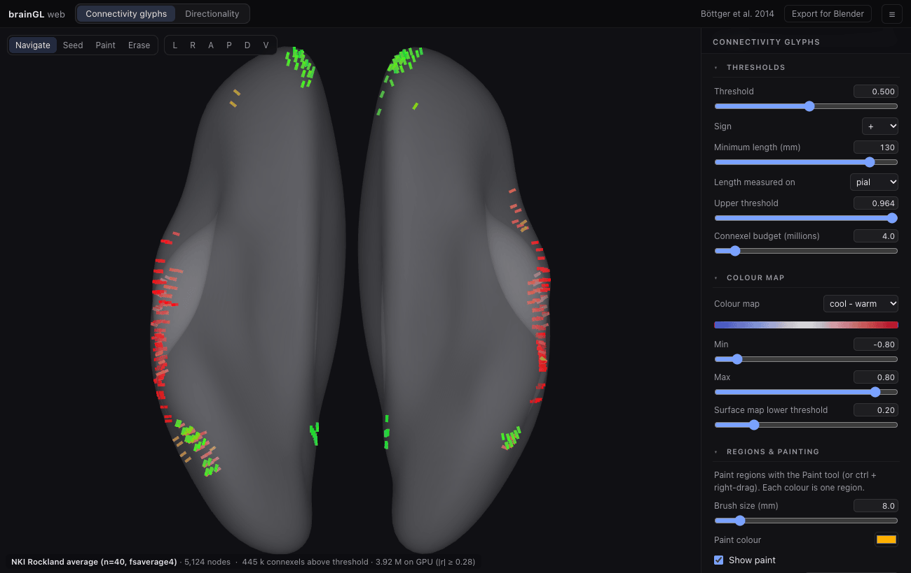
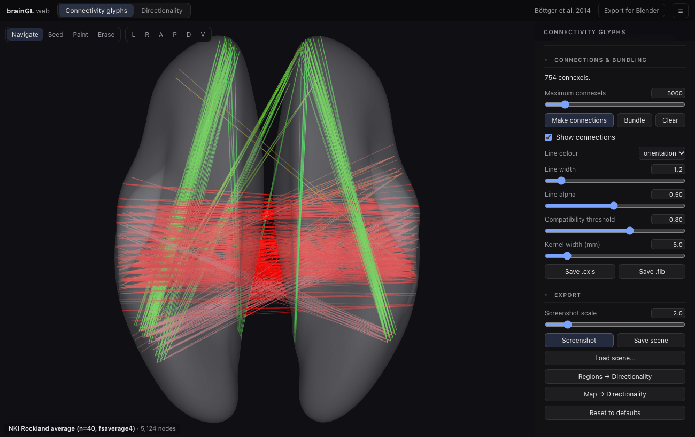
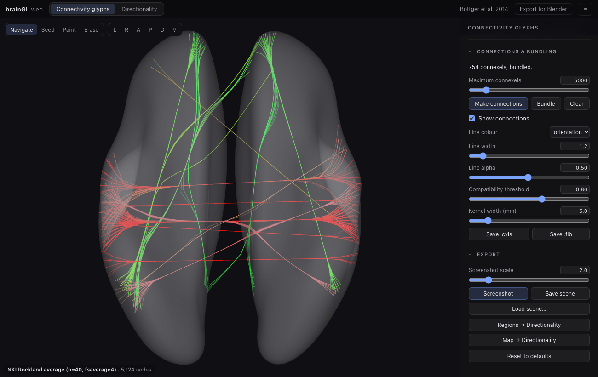
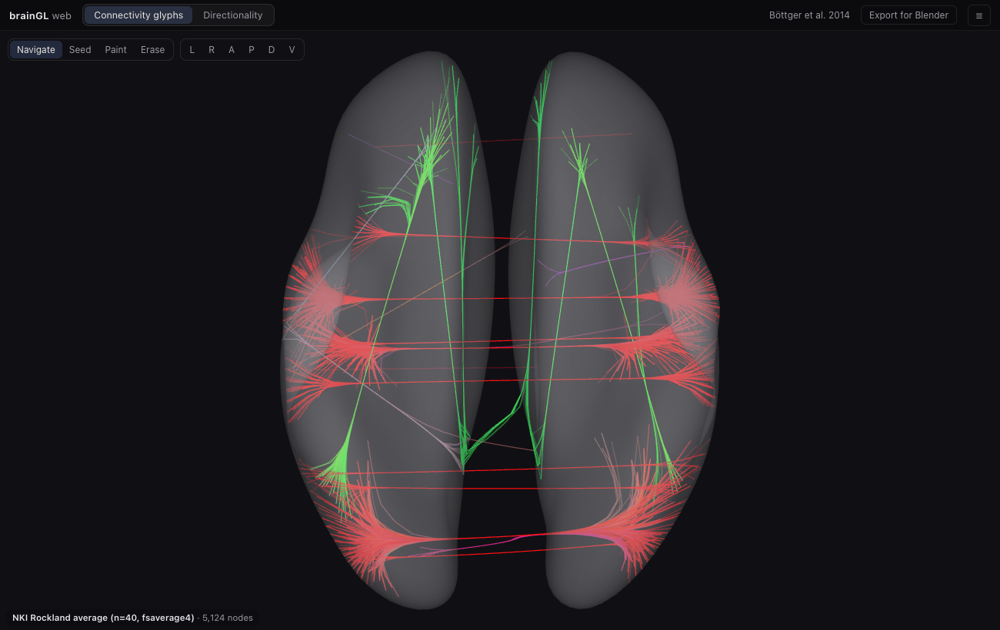

# Connections and bundling

<!-- TODO(restart): expand, add more detail per step -->

**Goal:** turn the strongest long connections into lines and bundle them. This is the web
equivalent of brainGL's "Creating and bundling connections tutorial".
**You need:** the demo data.
**Result:** bundled connections inside a transparent surface, saved as `.cxls` and `.fib`.

## 1. Reduce the number of connections

1. Keep both hemispheres (**View → Hemispheres → both**) and click **D** for the dorsal view.
2. In **Thresholds** set **Threshold** to 0.5 and type 130 into **Minimum length (mm)**.

Few glyph points remain, and most lie inside the surface; lower **Surface → Alpha** to see them.

The status line still counts all connexels above the threshold; the minimum length is not part
of that count.

## 2. Make connections

Open **Connections & bundling** and click **Make connections**. Every connection that passes
the threshold, sign and minimum length becomes a straight line between its two nodes on the
displayed surface (754 with the settings above). If more than **Maximum connexels** pass, the
strongest are kept and the panel says so. Unlike brainGL, the app makes the surface transparent
for you (**Surface → Alpha** 0.25) because the lines run inside the brain. Switch the glyphs off
(key ++0++) for a clear view.

## 3. Bundle

Click **Bundle**. Mean-shift edge bundling (Böttger et al. 2014,
[doi:10.1109/TVCG.2013.114](https://doi.org/10.1109/TVCG.2013.114)) runs in the background;
a progress bar is shown. Geometrically similar connections are pulled together.

Parameters:

| Control | Meaning |
|---|---|
| **Compatibility threshold** | how similar two connections must be to attract each other (default 0.8) |
| **Kernel width (mm)** | radius of the mean-shift kernel (default 5 mm) |
| **Line colour** | *orientation* or *value* (through the colour map) |
| **Line width**, **Line alpha** | appearance |

Changing a parameter does not re-bundle: click **Make connections** and **Bundle** again.
More connections take longer; 5,000 took about four seconds on the development machine.

## 4. Save

- **Save .cxls**: the unbundled connections as text, `x1 y1 z1 x2 y2 z2 value` per line.
- **Save .fib**: the lines (bundled if you bundled) as binary VTK polydata, readable by brainGL,
  TrackVis and DSI Studio.

Loading `.cxls` or `.fib` files back into the app is not implemented. **Clear** removes the lines.
For a rendered figure see [Blender export](blender.md).
