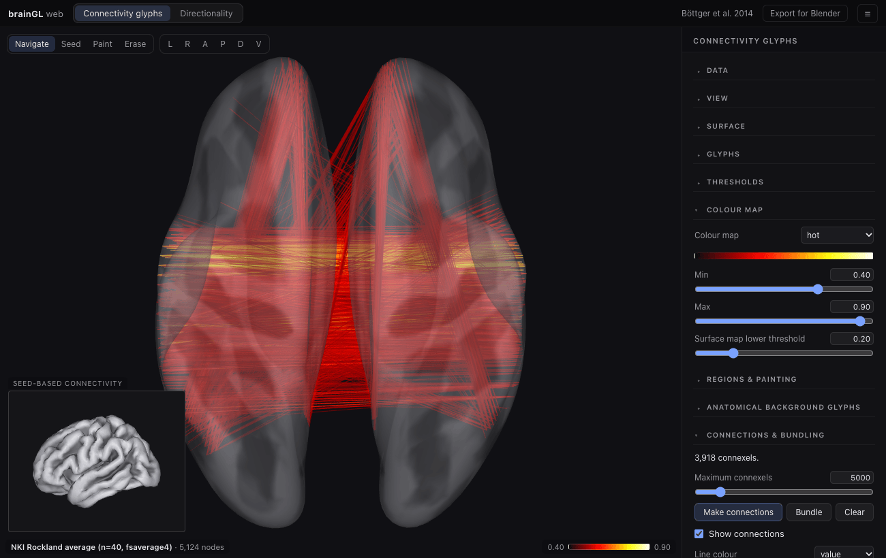
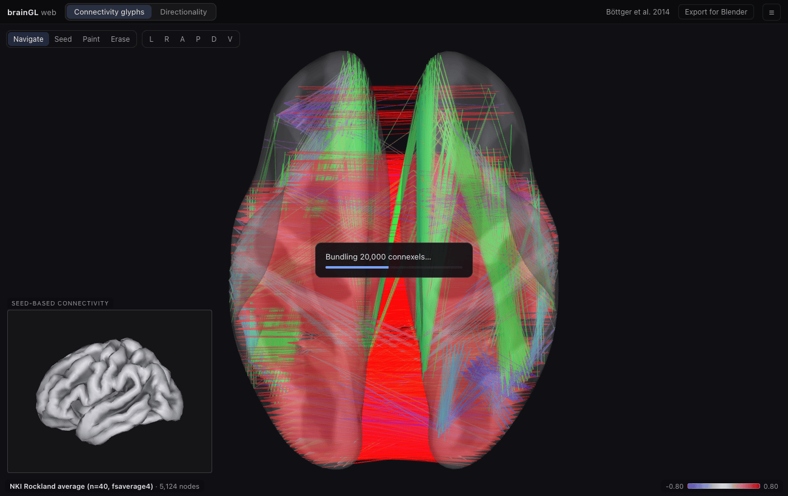
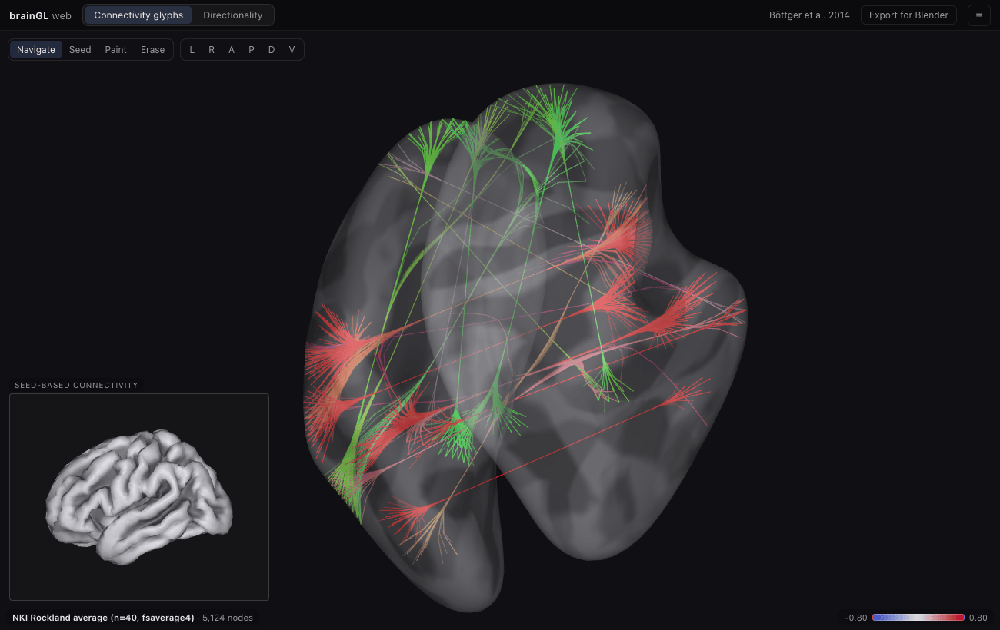
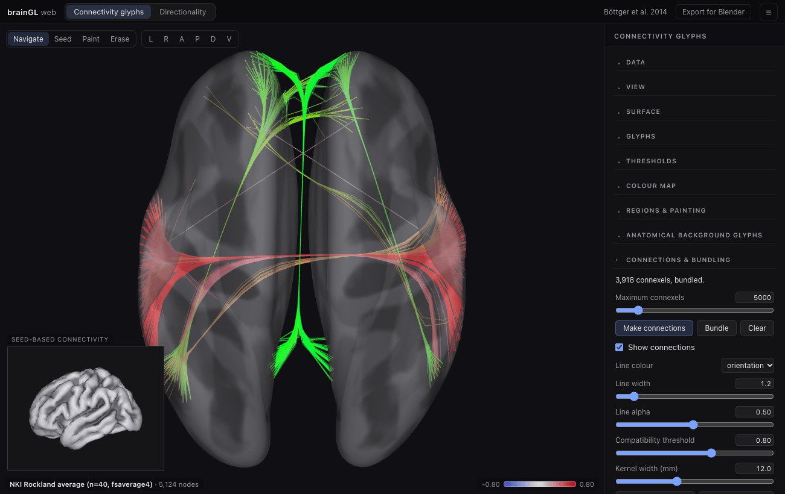
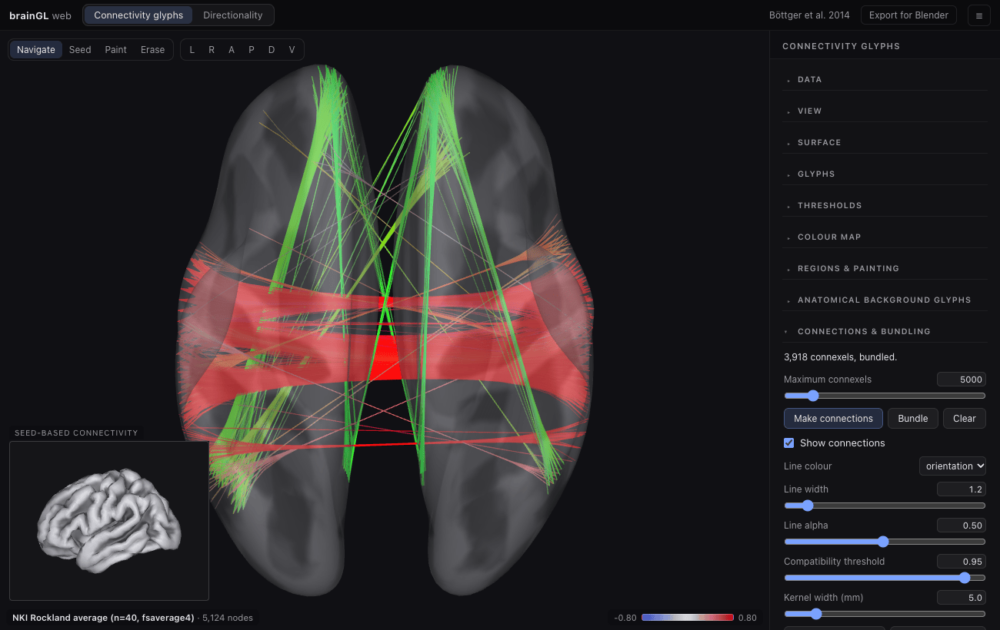
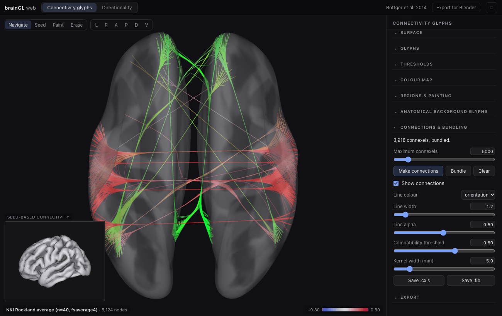

# Connections and bundling

This tutorial is the web counterpart of brainGL's "Creating and bundling connections
tutorial". Glyphs show connections at their end points. Here the strongest long connections
become lines through the brain, and edge bundling turns the tangle of lines into a readable
picture.

**What you will learn**

- choosing a threshold and a minimum length that leave a few thousand long connections;
- **Make connections**, the transparent surface and the line colour modes;
- **Bundle** with the default parameters, and what the two parameters do;
- saving `.cxls` and `.fib` files, the limits, and the way to Blender.

**Time needed:** about 15 minutes.

**Prerequisites:** the app with the demo data. The [glyph tutorial](glyphs.md) explains the
thresholds used here.

**Expected result:** bundled connections inside a transparent brain, saved as two files.

## 1. Choose the connections

1. Click **Export → Reset to defaults** if you changed settings before. Keep both hemispheres.
2. Click **D** in the toolbar for the dorsal view (anterior is up, the left hemisphere on the left).
3. Set **Glyphs → Glyph style** to *vectors* (key ++2++).
4. In **Thresholds** keep **Threshold** at 0.5 and type 120 into **Minimum length (mm)**.
5. Set **Surface → Alpha** to 0.3.

**Expected result.** Glyphs remain at the lateral edges of both hemispheres (red), at the
frontal pole and in the posterior parietal cortex (green).

**Why these values.** Every connection that passes the filters will become a line, and
bundling compares every line with every other, so the number has to be small. A high
threshold keeps the strong connections; a long minimum length keeps those that cross the
brain. The original tutorial used 130 mm on a finer surface; on the demo that leaves 754
connections and 120 mm leaves 3,918. The status line does not help here: it counts connexels
above the threshold without the length test.

## 2. Make connections

1. Open **Connections & bundling** and click **Make connections**.
2. Press ++0++ to switch the glyphs off.

**Expected result.** The panel reports `3,918 connexels.` Straight lines join the two nodes
of each connection on the displayed surface. Red sheets run between the hemispheres, green
fans from front to back.

What the button does:

- It takes every pair of nodes that passes the threshold in effect on screen, the sign, the
  upper threshold and the minimum length (measured on the surface chosen in
  **Length measured on**).
- If more than **Maximum connexels** (default 5,000) pass, the strongest are kept and the panel
  says `(strongest kept)`.
- It makes the surface transparent (**Surface → Alpha** 0.25) if it was nearly opaque, because
  the lines run inside the brain. brainGL left this to you. Lower the alpha further if you like.

**Line colour** is *orientation* by default: red for left–right, green for anterior–posterior,
blue for superior–inferior, from the direction between the two ends. Set it to *value* to
colour each line by its strength through the colour map (here *hot*, **Min** 0.4, **Max** 0.9):

**Line width** and **Line alpha** change the appearance; **Show connections** hides the lines
without deleting them.

**Why the picture is hard to read.** Of the 3,918 connections, 3,321 join the two hemispheres
and 597 run within one. Drawn as straight lines they form sheets in which single pathways
cannot be told apart, the clutter that dense connexels always produce.

## 3. Bundle

Set **Line colour** back to *orientation* and the colour map back to *cool - warm* (**Min**
−0.8, **Max** 0.8), then click **Bundle**. A box with a progress bar
appears in the view; the app stays usable.

**Expected result.** After about three seconds the panel reports `3,918 connexels, bundled.`
The sheets have contracted into a few bundles that fan out at their ends.

**How to read it.** Compare with the picture of step 2: the same connections, the same end
points. The red bundles are the connections between corresponding regions of the two
hemispheres, around the Sylvian fissure and in the temporal and parietal cortex. The green
bundles join the medial prefrontal cortex with the posterior cingulate cortex and the angular
gyrus: the long-range connections of the default-mode network. Rotate the view to see their
course:

**Why this works.** Mean-shift edge bundling (Böttger et al. 2014,
[doi:10.1109/TVCG.2013.114](https://doi.org/10.1109/TVCG.2013.114)) first measures how
compatible two connections are, from their length, angle, distance and overlap. It then
subdivides every line and moves the points of compatible lines towards their common mean,
several times over. Geometrically similar connections end up in one bundle. The bundles are
a drawing aid: they show which connections belong together, not the course of fibres.

## 4. The two parameters

| Control | Default | Effect |
|---|---|---|
| **Compatibility threshold** | 0.8 | How similar two connections must be to attract each other. Higher: fewer partners, less bundling. Lower: more lines merge. |
| **Kernel width (mm)** | 5 | Width of the Gaussian kernel of the mean shift. Larger: points are pulled together over longer distances, giving fewer and tighter bundles. |

Change a value and click **Bundle** again; bundling always starts from the straight lines.
(**Make connections** is needed again only when the threshold or minimum length changed.)

The defaults are those of the original and work for most data, because the mean shift treats
dense and sparse groups of lines alike.

With a minimum length of 80 mm more than 5,000 connections pass, and the strongest 5,000 are kept:

## 5. Save

The two buttons are at the end of the section.

| Button | File | Content |
|---|---|---|
| **Save .cxls** | `connections.cxls` | the straight connections as text, one per line: `x1 y1 z1 x2 y2 z2 value` |
| **Save .fib** | `bundles.fib` (or `connections.fib` before bundling) | the lines as binary VTK polydata, readable by brainGL, TrackVis and DSI Studio |

Loading `.cxls` or `.fib` files back into the app is not implemented. **Clear** removes the
lines. Formats: [Data formats](../reference/data-formats.md#cxls).

## 6. Export the bundles to Blender

With the lines on screen, click **Export for Blender** in the top bar. The zip contains the
surface and the lines (bundled if you bundled) as a `connections` layer, with their colours.
[Blender export](blender.md) explains how to import and render it.

## Limits

- **Maximum connexels** goes up to 40,000. Bundling time grows faster than the number of
  lines. On the development machine: 3,918 lines took 3 s, 5,000 took 4 s, 10,000 took 10 s,
  20,000 took 29 s and 40,000 took 57 s.
- Bundling runs in the background; **Clear** stops it.
- The lines are computed for the surface that is displayed when you click **Make connections**.
  They do not follow a later change of **View → Surface**: make them again.

## Troubleshooting

| Symptom | Cause and remedy |
|---|---|
| **Make connections** gives 0 connexels | Nothing passes the filters: lower the minimum length or the threshold. |
| The lines are invisible | They are inside the brain: lower **Surface → Alpha**, and check **Show connections**. |
| **Bundle** does nothing | There are no connections yet. Click **Make connections** first. |
| More connections than expected | With *painted nodes only*, a connection counts if either end is painted. The threshold is never lower than the one the status line reports. |
| The bundles look the same after changing a parameter | Click **Bundle** again. |

## Where next

- [Blender export](blender.md): render the bundles.
- [Make publication figures](../how-to/figures.md): screenshots at high resolution.
- [Background](../explanation/background.md#why-bundling): the reasoning behind bundling.
- [Parameters](../reference/parameters.md#connections-bundling): every control of the section.
