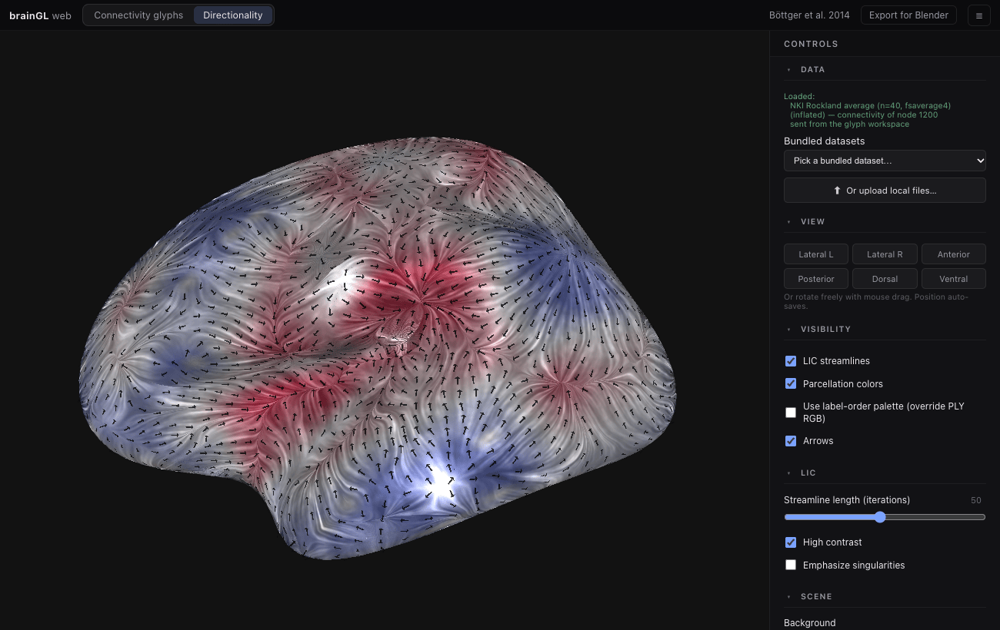

# Directionality

<!-- TODO(restart): expand, add more detail per step -->

**Goal:** use the Directionality workspace and send regions or maps to it from the glyph workspace.
**You need:** the demo data; for the bridges, the [glyph](glyphs.md) and [parcellation](parcellation.md) tutorials.
**Result:** arrows on a surface that show the direction between ordered regions or along a map.

The workspace is the unmodified
[directionality-indicator-webgl](https://github.com/NeuroanatomyAndConnectivity/directionality-indicator-webgl)
application (LGPL-3.0-or-later), a port of Sebastian Eichelbaum's DirectionalityIndicator. It
takes a surface (`.ply`), one region number per node (`.labels`) and the order of the regions
(`.labelorder`). From these it derives a direction field: at borders the direction follows the
region order and it is spread into the regions. It draws the field as arrows and, optionally,
as line integral convolution (LIC) streaks.

## 1. The workspace

Click the **Directionality** tab. A bundled example loads on first use.

- **Data**: pick a **Bundled dataset** or upload a `.ply` + `.labels` + `.labelorder` triple.
- **View**: six standard views; drag rotates, Shift + drag pans, the wheel zooms.
- **Visibility**: **LIC streamlines** (off at first), **Parcellation colors**, **Arrows**.
- **LIC**, **Arrows**, **Surface shading**, **Scene**: appearance; arrow density, size and
  "Borders only" re-sample the arrows.
- **Screenshot**: PNG of the current view or of all six standard views.
- **Reset to defaults** clears the settings and the cached dataset.

## 2. Regions → Directionality

1. In the glyph workspace, paint at least two regions in different colours that **touch each
   other**. The order in which the colours were first used is the order of the regions.
2. Open **Export** and click **Regions → Directionality**.

The displayed surface is sent with the regions as the parcellation. Arrows appear only inside
painted regions that border another painted region; an isolated region gets none. With fewer
than two regions the status line says "Paint at least two regions…".

## 3. Map → Directionality

1. Select a node (right-click), or choose an overlay as **Surface → Colour**.
2. Click **Export → Map → Directionality**.

The current surface map (connectivity of the selected node, mean connectivity of the painted
nodes, or the overlay) is cut into 12 bins with equal numbers of nodes, ordered by value. The
arrows therefore follow the gradient of the map. Nodes with the value 0 (for example the medial
wall) are left out; values below the display threshold of the map are included. Without a map
the status line says "There is no surface map to send…".

Both hemispheres are sent even when only one is displayed. The result can be exported with
**Export for Blender** (see [Blender export](blender.md)).
