# Directionality

**What you will learn:** what the Directionality workspace shows and where it comes from, how
to load the bundled examples and your own files, how to send a surface map or painted regions
from the glyph workspace to it, how to read the arrows, how to switch on the line integral
convolution (LIC), and how to export the result to Blender.

**Time:** about 20 minutes.

**Prerequisites:** the app running with the demo data
([Quick start](../getting-started/quickstart.md)). For steps 4 to 6 you should know how to
select a node and how to paint a region ([Connectivity glyphs](glyphs.md),
[Manual parcellation](parcellation.md)). Step 3 needs Python 3 with `numpy`, `nibabel` and
`nilearn`.

## What the workspace shows

The workspace takes a surface that is divided into **regions** and an **order** of those
regions. Wherever two regions share a border, it assigns a direction that points across the
border from the region that comes earlier in the order to the region that comes later. These
directions are then spread into the interior of the regions along the surface, which gives a
direction at every node. The field is drawn in two ways:

- **arrows**, spaced evenly over the surface, and
- **LIC streamlines**, a texture of fine streaks that follow the field everywhere, with the
  region colours underneath.

The picture answers the question "which way does the sequence of regions run across the
cortex?". The regions can be the areas of a parcellation with a meaningful order, the steps
of a hierarchy, or bands of a continuous map; in the last case the arrows follow the gradient
of the map.

The method and the original program are **DirectionalityIndicator** by Sebastian Eichelbaum
and the Max Planck Research Group "Neuroanatomy and Connectivity" (C++/Qt/OpenGL,
<https://github.com/NeuroanatomyAndConnectivity/DirectionalityIndicator>). The workspace is
its web port,
[directionality-indicator-webgl](https://github.com/NeuroanatomyAndConnectivity/directionality-indicator-webgl),
included in brainGL web as a vendored copy under the LGPL-3.0-or-later licence
([Vendored Directionality](../development/vendored-directionality.md)). brainGL web adds the
two bridges from the glyph workspace and the Blender export.

## 1. Open the workspace

1. Click the **Directionality** tab in the top bar. The workspace is loaded on first use, which
   takes a few seconds.
2. The bundled example `label18` appears: one hemisphere with 18 regions.

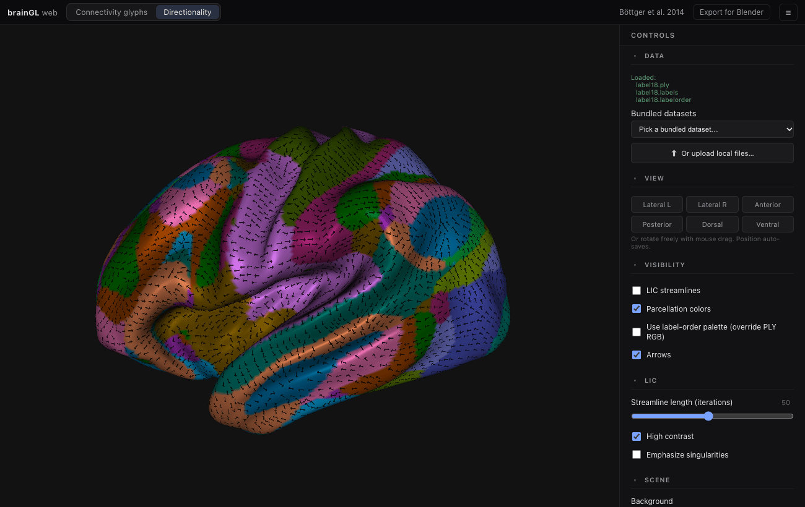

Move around as in the other workspace: drag rotates, ++shift++ + drag pans, the wheel zooms.
The view is in perspective here, not orthographic. The camera position, the settings and the
last dataset are remembered by the browser.

## 2. The panel in brief

| Section | Controls |
|---|---|
| **Data** | The names of the loaded files; **Bundled datasets** to pick an example; **Or upload local files…** for your own. |
| **View** | **Lateral L**, **Lateral R**, **Anterior**, **Posterior**, **Dorsal**, **Ventral**. |
| **Visibility** | **LIC streamlines** (off at first), **Parcellation colors**, **Use label-order palette (override PLY RGB)**, **Arrows**. |
| **LIC** | **Streamline length (iterations)**, **High contrast**, **Emphasize singularities**. |
| **Scene** | **Background** colour. |
| **Surface shading** | **Ambient**, **Diffuse**, **Specular (glare)**, **Shininess (sharpness)**. |
| **Glyphs** | Placement of the arrows: **Borders only**, **Density (smaller = denser)**, **Size**, **Distance from surface**. Below, the *Glyph designer* with a preview: **Length**, **Head/body ratio**, **Head width**, **Body width (fraction of head)**, **Opacity**, **Flip direction**, **Color**. |
| **Screenshot** | **Resolution (DPI)**, **Current view**, **All canonical views**: PNG files with a transparent background, cropped to the brain. |
| **Reset to defaults** | Clears the settings, the camera and the remembered dataset, then reloads the page. |

Every control has a tooltip. Changing **Borders only**, **Density**, **Size** or **Length**
places the arrows anew, which takes a moment.

Try the bundled sets:

1. In **Data → Bundled datasets**, choose `label34`, a parcellation with 34 regions.
2. In **Visibility**, tick **LIC streamlines**.

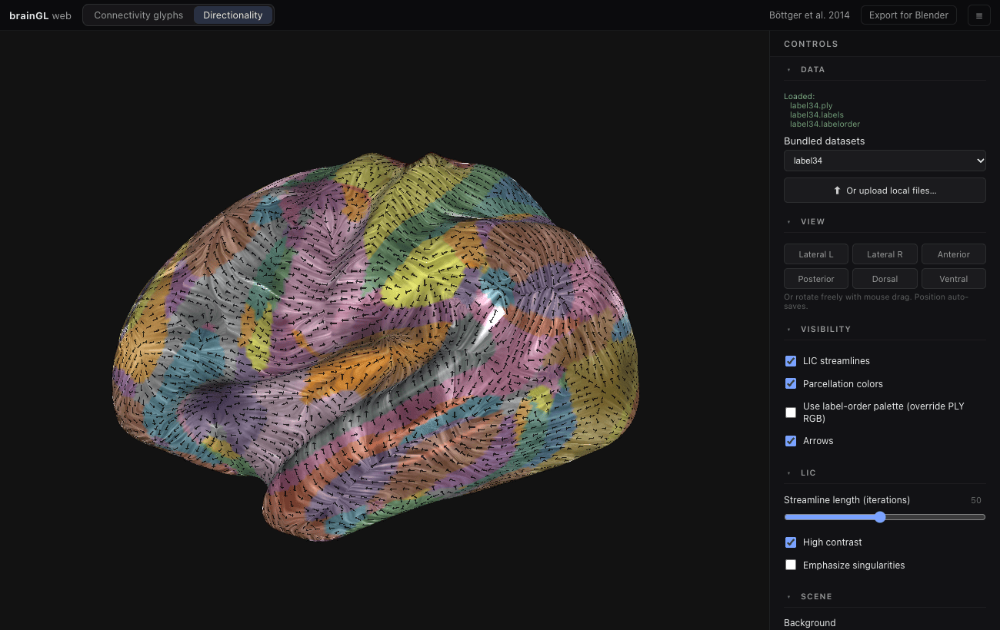

The other sets are `label200` (200 regions) and `emb` (185 regions). All four are single
hemispheres with 32,492 nodes.

## 3. Load your own files

A dataset consists of three text files that refer to the same mesh by node order:

| File | Content |
|---|---|
| `.ply` | the surface as an **ASCII** PLY file with triangles; per-node colours (`red green blue`) are optional and, if present, colour the surface |
| `.labels` | one integer per node: the number of the region the node belongs to |
| `.labelorder` | the region numbers in sequence, one per line; regions that are not listed are ignored and get no direction |

The exact rules are in [Data formats](../reference/data-formats.md#directionality-inputs).
The following script writes the three files with `numpy` and `nibabel`. As an example it cuts
the sulcal depth of the left fsaverage5 hemisphere (bundled with nilearn, no download) into
eight bands, ordered from the crowns of the gyri to the depths of the sulci:

```python
"""Write the three files of the Directionality workspace: .ply, .labels, .labelorder.

Example: the left inflated fsaverage5 surface, parcellated into eight bands of
sulcal depth, ordered from the gyral crowns to the depths of the sulci.
"""
import nibabel as nib
import numpy as np
from nilearn import datasets


def write_directionality(prefix, xyz, triangles, labels, order):
    """xyz [n, 3], triangles [m, 3], labels [n] integers, order: region numbers in sequence."""
    with open(prefix + ".ply", "w") as f:               # ASCII PLY, triangles only
        f.write("ply\nformat ascii 1.0\n")
        f.write(f"element vertex {len(xyz)}\nproperty float x\nproperty float y\nproperty float z\n")
        f.write(f"element face {len(triangles)}\nproperty list uchar int vertex_indices\nend_header\n")
        np.savetxt(f, xyz, fmt="%.4f")
        np.savetxt(f, np.c_[np.full(len(triangles), 3), triangles], fmt="%d")
    np.savetxt(prefix + ".labels", labels, fmt="%d")     # one region number per node
    np.savetxt(prefix + ".labelorder", order, fmt="%d")  # the regions, in order


fs5 = datasets.fetch_surf_fsaverage("fsaverage5")
xyz, triangles = nib.load(fs5["infl_left"]).agg_data(("pointset", "triangle"))
sulc = nib.load(fs5["sulc_left"]).agg_data()

n_bands = 8
edges = np.quantile(sulc, np.linspace(0, 1, n_bands + 1)[1:-1])
labels = np.digitize(sulc, edges) + 1                    # 1 (gyral crown) ... 8 (deepest)
write_directionality("sulc_bands", xyz, triangles, labels, np.arange(1, n_bands + 1))
print(len(xyz), "nodes,", len(triangles), "triangles, regions", np.unique(labels))
```

```text
10242 nodes, 20480 triangles, regions [1 2 3 4 5 6 7 8]
```

1. Run the script. It writes `sulc_bands.ply`, `sulc_bands.labels` and `sulc_bands.labelorder`.
2. In the workspace, click **Data → Or upload local files…** and select the three files
   together.

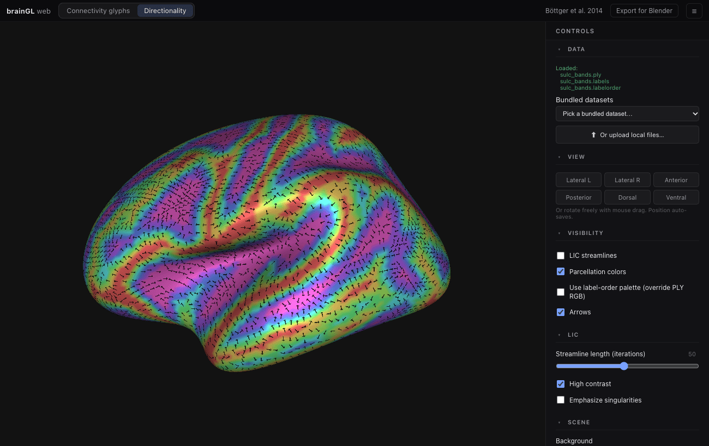

Expected result: the **Data** section lists the three file names. Because this PLY file has no
colours, the regions are coloured by their position in the order (a rainbow palette), and the
arrows point from band 1 towards band 8, that is, down into the sulci. If you select fewer or
more than the three files, the panel says "Need exactly one .ply, .labels, and .labelorder".

## 4. Map → Directionality from a seed-connectivity map

The first bridge sends the surface map that the glyph workspace currently shows.

1. Switch to the **Connectivity glyphs** tab.
2. Set **View → Hemispheres** to *left*, set **Surface → Colour** to
   *vertex data (seed connectivity)* and untick **Glyphs → Show glyphs**, so that the map is
   visible on the main surface.
3. Right-click a node to select it. The example uses node 1200 of the demo, in the inferior
   parietal cortex. Its connectivity map appears on the surface.
4. Open the **Export** section at the bottom of the panel and click **Map → Directionality**.

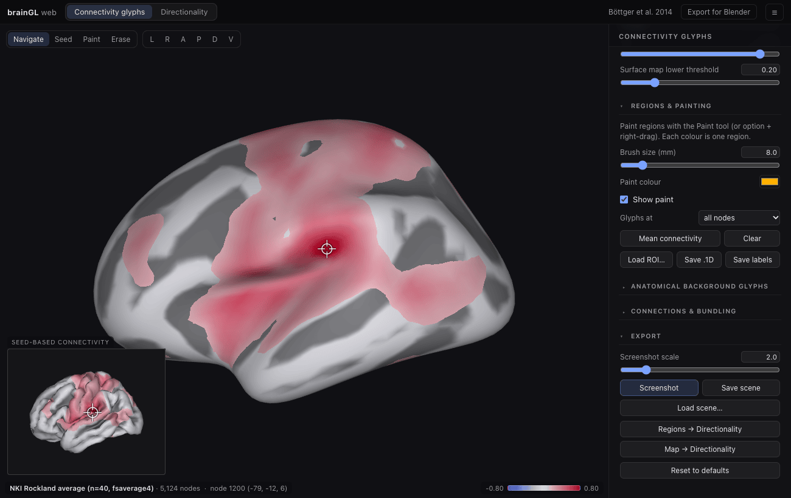

The app switches to the Directionality workspace and shows the same surface:


What happened: the values of the map were sorted and cut into **12 bins with equal numbers of
nodes**. Bin 1 holds the lowest values, bin 12 the highest, and the bins are the regions, in
this order. The surface keeps the colours of the map (the current colour map, scaled from the
2nd to the 98th percentile). Details:

- The map that is sent is the one on screen: the connectivity of the selected node, or the mean
  connectivity of the painted nodes after **Regions & painting → Mean connectivity**.
- The displayed surface is sent, with both hemispheres, also when only one is shown.
- Nodes with the value 0 (the medial wall) belong to no bin and get no arrows. Values below
  **Surface map lower threshold** are included: the threshold affects the display only.
- If no node is selected and no overlay is chosen, the status line of the glyph workspace says
  "There is no surface map to send: select a seed node or choose an overlay as the surface
  colour." Error messages stay in the status line for 8 seconds.

## 5. Map → Directionality from an overlay

Any per-node overlay of the dataset can be sent in the same way. An overlay takes precedence
over a seed map.

1. In the glyph workspace, set **Surface → Colour** to *overlay: sulc* (sulcal depth; the demo
   also has *overlay: curv*).

    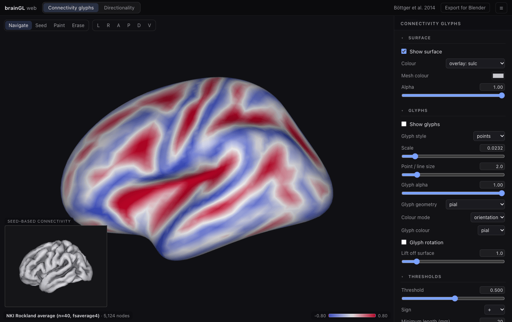

2. Click **Export → Map → Directionality**.

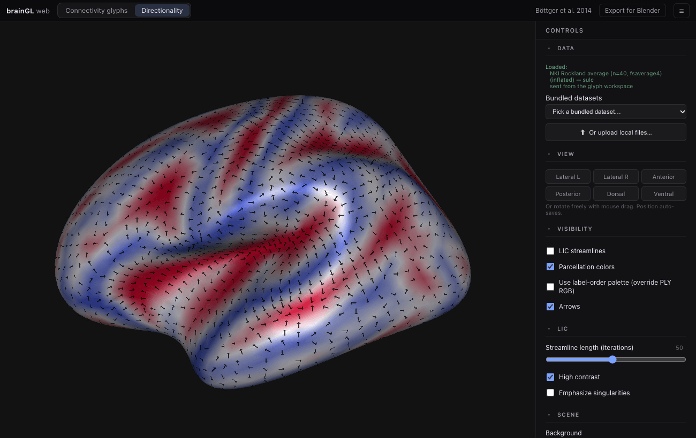

This is how you show a gradient of your own, for example a principal connectivity gradient or
a myelin map: add it as an overlay when you make the glyphset
(`--overlay name=left,right`, see [Your own data](own-data.md)), choose it as the surface
colour, and send it.

## 6. Regions → Directionality from painted regions

The second bridge sends painted regions as the parcellation. The order of the regions is the
order in which their paint colours were first used.

1. In the glyph workspace, set **Surface → Colour** to *per mesh (one colour)* and untick
   **Glyphs → Show glyphs** to see the paint clearly.
2. Choose the **Paint** tool (key ++p++). Pick a **Paint colour** in **Regions & painting** and
   paint a first region.
3. Pick a second colour and paint a region that **touches** the first. Continue with a third
   and a fourth colour if you like; each colour is one region.
4. Open **Export** and click **Regions → Directionality**.

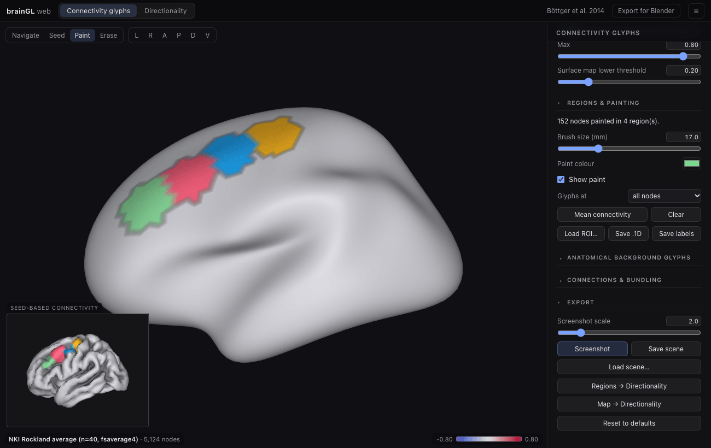

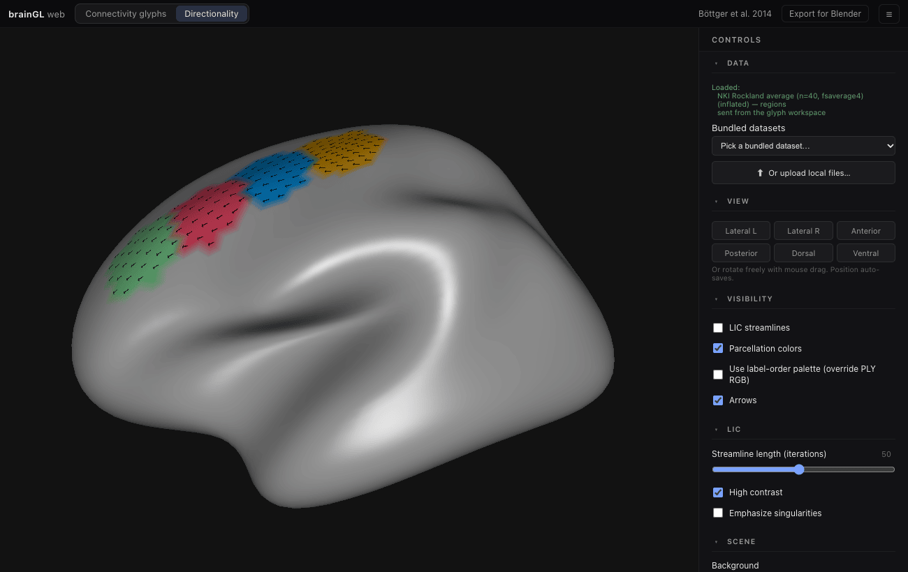

Expected result: arrows appear inside the painted regions and point from the region painted
first (orange) through the second (blue) and third (red) to the last (green). The unpainted
surface is grey, belongs to no region and has no arrows.

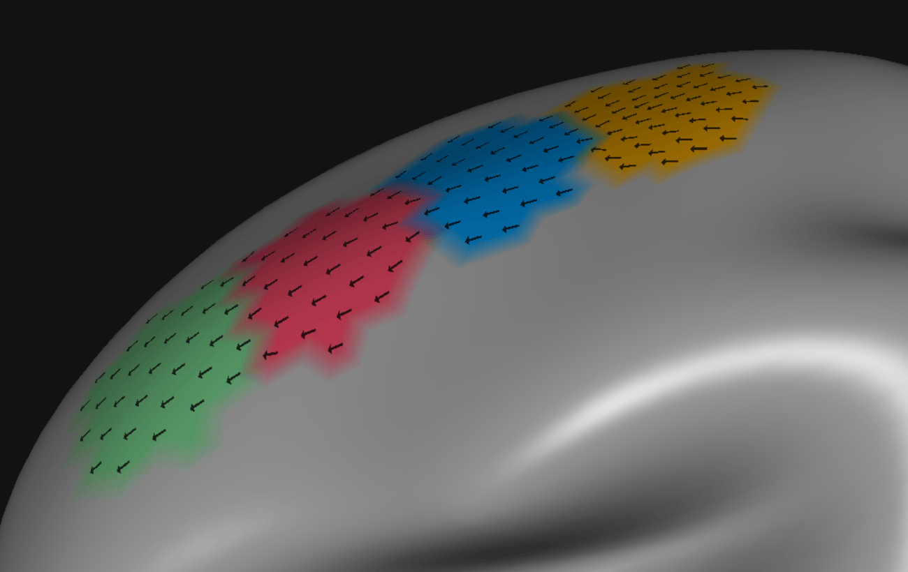

Directions exist only where regions **touch**, because they are derived at shared borders:

- A painted region that touches no other painted region gets no arrows.
- If none of the regions touch, nothing is sent and the status line says "The painted regions
  do not touch. Directions are derived at the borders regions share: paint at least two
  adjacent regions."
- With fewer than two regions it says "Paint at least two regions (two different paint
  colours) to derive a direction between them."

To change the order, clear the paint (**Regions & painting → Clear**) and paint the regions in
the order you want, or untick **Glyphs → Flip direction** in the Directionality panel to
reverse it.

## 7. Read the arrows

- **An arrow points from earlier to later in the order.** For a map, that is from lower to
  higher values: the arrows climb the gradient and converge on the peaks. For painted regions
  it is from the first-painted to the last-painted region. **Glyphs → Flip direction** (ticked
  by default) decides this; untick it for the opposite convention.

    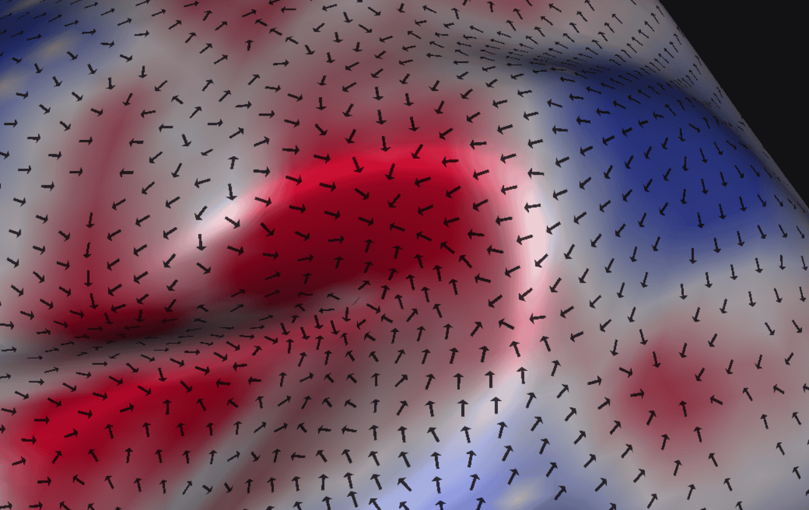

- **The direction comes from the borders, not from the values.** Inside a region the direction
  is interpolated from the region's borders. The arrows say "towards the next region", not how
  steep the map is. A map cut into 12 bins shows the gradient only as finely as the bins allow.
- **Arrows meet or part at extremes.** Where arrows converge the map has a maximum (or the last
  region lies there); where they diverge it has a minimum. **LIC → Emphasize singularities**
  marks places where the field has no clear direction.
- **Only the order is used.** The arrows do not change if you relabel the regions with other
  numbers in the same order, and they carry no information about the size of the difference
  between neighbouring regions.
- **Density and size are for display only.** **Glyphs → Density** and **Size** change how many
  arrows are drawn and how large, not the field.

## 8. Switch on the LIC

Arrows sample the field at a few places. The LIC shows it everywhere.

1. In the Directionality workspace, tick **Visibility → LIC streamlines**.
2. Adjust **LIC → Streamline length (iterations)** for longer or shorter streaks. Untick
   **Parcellation colors** to see the streaks alone, or **Arrows** to remove the arrows.


The streaks run along the direction field: read them like the grain of wood. They have no
arrowheads, so keep the arrows on if the sense of direction matters. The LIC is computed on the
screen for the current view and is redrawn when you move the camera.

## 9. Export to Blender

1. With the Directionality workspace in front, click **Export for Blender** in the top bar.
2. Unzip `braingl-directionality-blender.zip` and run `import_braingl.py` as described in
   [Blender export](blender.md).

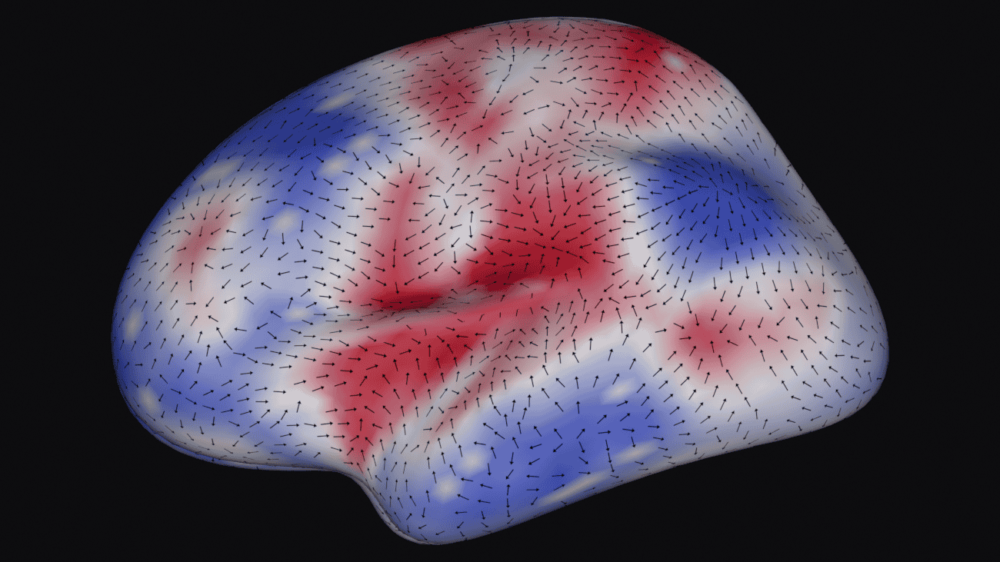

The export contains the surface with its colours, the arrows as flat geometry just above the
surface with the size, shape, density, direction and colour set in the panel (**Borders only**
and **Opacity** are not applied), and a camera: a left lateral
orthographic view that frames the whole surface, independent of the view on screen. The LIC
streaks are a screen effect and are not exported. For a PNG of the workspace as you see it,
with LIC, use the **Screenshot** section of the panel instead.

## Troubleshooting

| Problem | Remedy |
|---|---|
| "Your browser does not support EXT_color_buffer_float; LIC requires it." | The workspace cannot start in this browser. Use a current desktop version of Chrome, Edge, Firefox or Safari ([Limits](../reference/limits.md)). |
| "The painted regions do not touch. …" | Paint the regions so that they share a border, without a gap of unpainted nodes between them. |
| "Paint at least two regions …" | All paint has one colour. Change **Paint colour** before painting the second region. |
| "There is no surface map to send: …" | Select a node, or choose an overlay under **Surface → Colour**. |
| "The surface map has too few non-zero values." | The map has fewer than 24 non-zero values; choose another seed or overlay. |
| "The bins of the surface map do not share a border on this surface, …" | No two of the 12 bins are adjacent anywhere on the mesh, so there is no border to derive a direction from. Choose another map. |
| "Need exactly one .ply, .labels, and .labelorder" | Select the three files together in the file dialogue. |
| "Error: Not a PLY file (missing 'ply' magic)", "Only ASCII PLY is supported …" or "only triangle faces supported" | The surface must be an ASCII PLY file with triangles; write it as in step 3. |
| No arrows after loading your own files | The numbers in `.labelorder` do not occur in `.labels`, or the regions do not touch. |
| Arrows point the wrong way for your convention | Tick or untick **Glyphs → Flip direction**. |
| The workspace shows the last dataset after a reload | That is intended. **Reset to defaults** clears it and returns to `label18`. |

## Where next

- [Blender export](blender.md): render the arrows.
- [Your own data](own-data.md): add your own overlays, which you can then send with
  **Map → Directionality**.
- [Make publication figures](../how-to/figures.md): screenshots of both workspaces.
- [Vendored Directionality](../development/vendored-directionality.md): how the workspace is
  included and updated.
