# Connectivity glyphs

This tutorial is the web counterpart of brainGL's "Surface connectivity and glyph tutorial".
It walks through every glyph style and every control that changes a glyph, on the demo data
that load with the app.

**What you will learn**

- how the two coupled views work and how to select a seed node;
- how to read pie, point, vector, difference and anatomical background glyphs;
- what the colours mean, and why the motor, visual and default-mode systems look the way they do;
- which control changes what: scale, point size, the three glyph surfaces, thresholds, sign,
  the connexel budget, colour maps, alpha, rotation and the polar projection.

**Time needed:** about 40 minutes.

**Prerequisites:** the app is running ([Installation](../getting-started/installation.md)), in
a browser with WebGL2. No data of your own. The [Quick start](../getting-started/quickstart.md)
is a shorter first contact, but it is not required.

**Expected result:** you can produce each of the pictures below and say which anatomical
fact each one shows.

!!! note "Where the web version differs from the original tutorial"
    - **No NIfTI volume.** brainGL needed an anatomical volume to be opened first, to set up the
      coordinate system. The web version reads surfaces and a matrix only.
    - **Glyphs for all nodes by default.** In brainGL you painted a region and pressed "create
      glyphs". Here every node has a glyph as soon as the data are loaded. Restricting them to a
      painted region is an option (**Regions & painting → Glyphs at**).
    - **Live thresholds for pies.** brainGL rebuilt the pie charts when the threshold changed.
      Here the threshold, minimum length, sign and upper threshold act on pies while you drag.
    - **An automatic budget instead of editing the `.glyphset` file.** brainGL limited memory with
      a minimum threshold written into the third line of the `.glyphset` file. Here the
      **Connexel budget** keeps the strongest connections that fit and the status line tells you
      which limit applies (step 11).
    - The second view is an inset in the same window, the anatomical background glyphs update by
      themselves, the minimum length is measured on a fixed anatomical surface unless you choose
      otherwise, and the polar projection is new.

    The complete list is in [Differences from brainGL](../explanation/differences-from-braingl.md).

Two conventions are used below. Controls are written as **Section → Control**, with the
names shown in the panel on the right. Nodes are given by their number so that you can reach
the same place as the screenshots: open the browser console (++f12++) and type, for example,
`braingl.glyphs.selectNode(645)`. Right-clicking near the place in the picture works just as well.

The app remembers your settings between visits. If your screen does not look like the first
picture, click **Export → Reset to defaults**.

## 1. The demo data

1. Open the app. The demo loads by itself; **Data → Demo** loads it again at any time.
2. Read the **Data** section of the panel: name, number of nodes and surfaces, and the source.

**Expected result.** Small coloured point glyphs cover an inflated brain seen from the left.
The status line at the bottom reads
`NKI Rockland average (n=40, fsaverage4) · 5,124 nodes · 445 k connexels above threshold · 3.92 M on GPU (|r| ≥ 0.28)`.

**What the data are.** The demo is the group average of resting-state functional connectivity
(Pearson correlation, averaged after Fisher's z transformation) of 40 participants of the
enhanced Nathan Kline Institute Rockland Sample, on the FreeSurfer `fsaverage4` surface: 2,562
nodes per hemisphere, with the surfaces *pial*, *inflated*, *sphere* and *white*. Please credit
the data when you show them: Nooner et al. 2012
([doi:10.3389/fnins.2012.00152](https://doi.org/10.3389/fnins.2012.00152)), distributed by the
1000 Functional Connectomes Project / INDI
(<http://fcon_1000.projects.nitrc.org/indi/enhanced/>); surfaces from FreeSurfer. The original
brainGL tutorial used the same sample at a higher resolution (65 participants, `fsaverage5`), so
the pictures correspond but are not identical. See [Citing](../about/citing.md).

A **connexel** is one entry of the connectivity matrix, the connection between two nodes. A
glyph shows all connexels of one node that pass the filters.

## 2. The two coupled views and a seed

1. Right-click on the upper part of the precentral gyrus, the hand area of the motor cortex
   (node 645). On a trackpad, a two-finger click is a right-click; on macOS ++ctrl++ + click
   also selects a node. The **Seed** tool (key ++s++) does the same with a plain click.
2. Look at the second view at the lower left. It shows the connectivity map of the node you
   selected, on the surface chosen in **View → Second view surface** (*pial*).
3. Right-click in the second view. The cross-hair moves in both views.

**Expected result.** A cross-hair marks the node in both views and the status line ends with
`node 645 (-51, 1, 57)`, the node number and its position on the displayed surface in
millimetres. The second view shows a red band along the central sulcus.

Each view has its own camera. Drag rotates, ++shift++ + drag pans and the wheel zooms about
the pointer, in whichever view the pointer is over. The buttons **L R A P D V** in the toolbar
snap the main view to a standard direction; ++shift++ + click snaps the second view.

4. Open **Colour map**. Set **Min** to −0.5 and **Max** to 0.5 to increase the contrast of the
   map, and **Surface map lower threshold** to 0.3 to hide weak values.

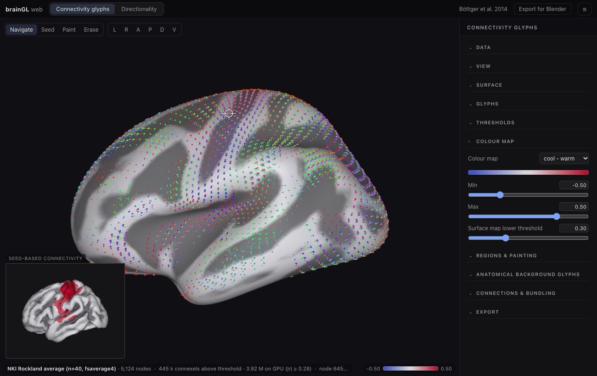

**Expected result.** The map shrinks to the precentral and postcentral gyri and a few patches
around the Sylvian fissure.
Set the three values back (−0.8, 0.8, 0.2) before you continue.

**Why this works.** The main view answers "what does every node connect to?" with one glyph
per node; the second view answers the opposite question, "what does *this* node connect to?",
with a classical seed-based map. brainGL had the same pair as two windows, *main gl* and
*main gl 2*. Keeping both in sight lets you check any glyph against the map it summarises.

## 3. Hemisphere and surface

1. Set **View → Hemispheres** to *left*.
2. Set **Surface → Colour** to *per mesh (one colour)*.

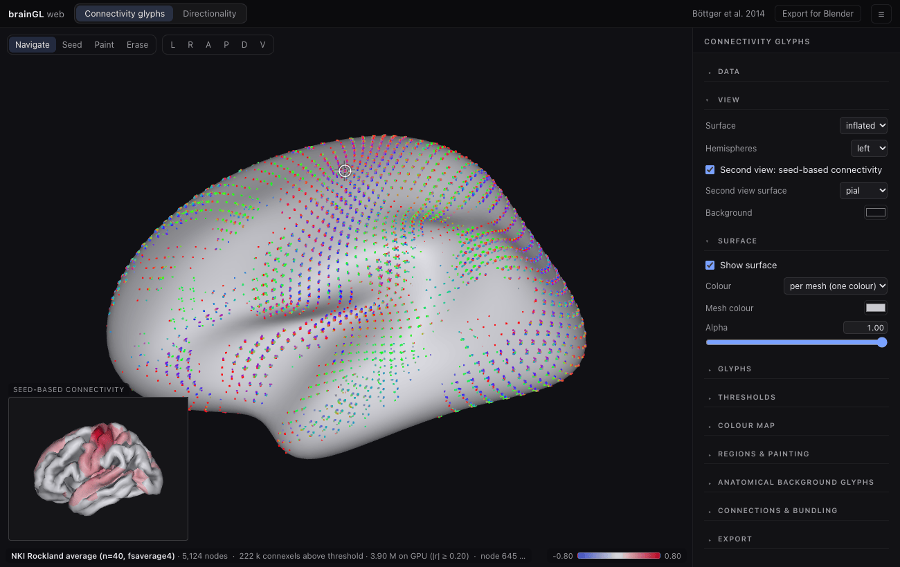

**Expected result.** Only the left hemisphere is drawn, in a plain grey on which the glyph
colours stand out. The status line now reads `222 k connexels above threshold · 3.90 M on GPU (|r| ≥ 0.20)`:
only the glyphs of the left hemisphere are built, so the same budget reaches a lower
threshold (0.20 instead of 0.28). The glyphs still show connections *to* both hemispheres.

3. Set **View → Surface** to *pial*, look, and set it back to *inflated*.

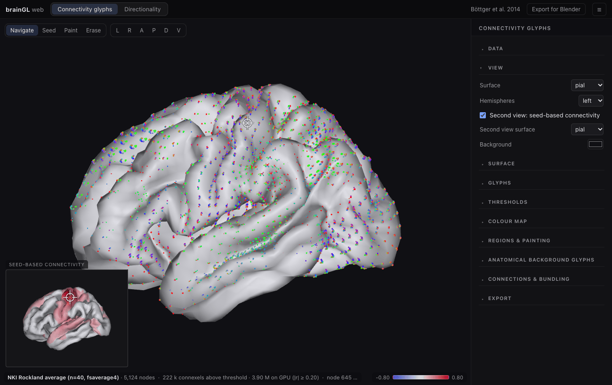

**Why the inflated surface.** Two thirds of the cortex lie inside sulci. On the pial surface
the glyphs of those nodes are hidden or crowded; on the inflated surface every node is visible
and the nodes are evenly spaced. The surface you look at is only where the glyphs are *placed*.
The shape and colour of each glyph are taken from other surfaces, which you choose
independently (step 8).

## 4. Pies for the overview

1. Set **Glyphs → Glyph style** to *pies*, or press ++3++ while the pointer is over the view.

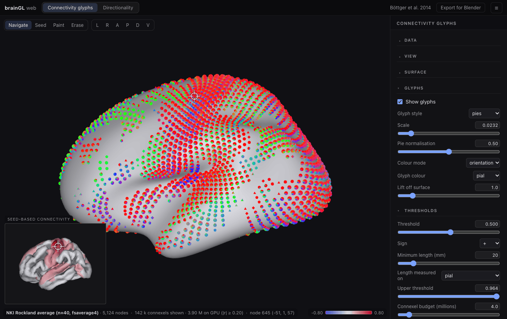

**Expected result.** Every node carries a small pie chart; the status line says
`142 k connexels shown`. A broad red belt runs from the top of the hemisphere down along the
central sulcus.

**How to read a pie.** Each connection of the node that passes the filters is one slice, and
all slices have the same angle. The colour of a slice is the orientation of the connection,
the convention known from diffusion imaging:

| Colour | Orientation of the connection |
|---|---|
| red | left–right |
| green | anterior–posterior |
| blue | superior–inferior |

Mixed colours are oblique connections. The slices are sorted by hue, so a pie shows the
*proportion* of connections of each orientation, not where they end.

2. Click **P** in the toolbar for the posterior view, then **R** to look at the medial side of
   the left hemisphere, then **L** to return.

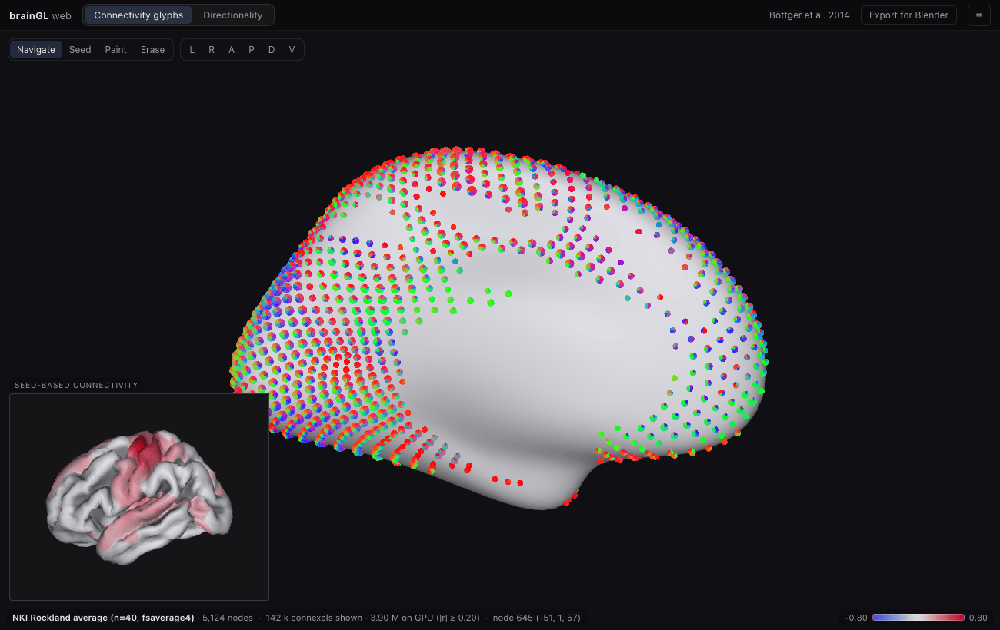

**Why the picture looks like this.** With the default filters (correlation above 0.5, longer
than 20 mm) only the strongest long connections remain, and for much of the cortex these are
the connections to the same area of the other hemisphere.

- **The red belt is the somatomotor network.** Its strongest long connections are
  interhemispheric: for node 645, 80 % of the connections that pass the filters end in the
  right hemisphere. A connection from the left to the right hemisphere runs left–right, hence red.
- **The occipital pies are red and blue.** The visual cortex also has strong interhemispheric
  connections (red), together with connections between its upper and lower parts (blue), which
  mix to purple.
- **Green pies mark anterior–posterior association systems.** On the medial wall, the
  posterior cingulate cortex and the medial prefrontal cortex are connected with each other
  along the length of the hemisphere. These are the long-range connections of the default-mode
  network. You will see them as lines in step 9.

Where the surface is bare, no connection of the node passes the filters.

## 5. Pie normalisation

1. Set **Glyphs → Pie normalisation** to 0.

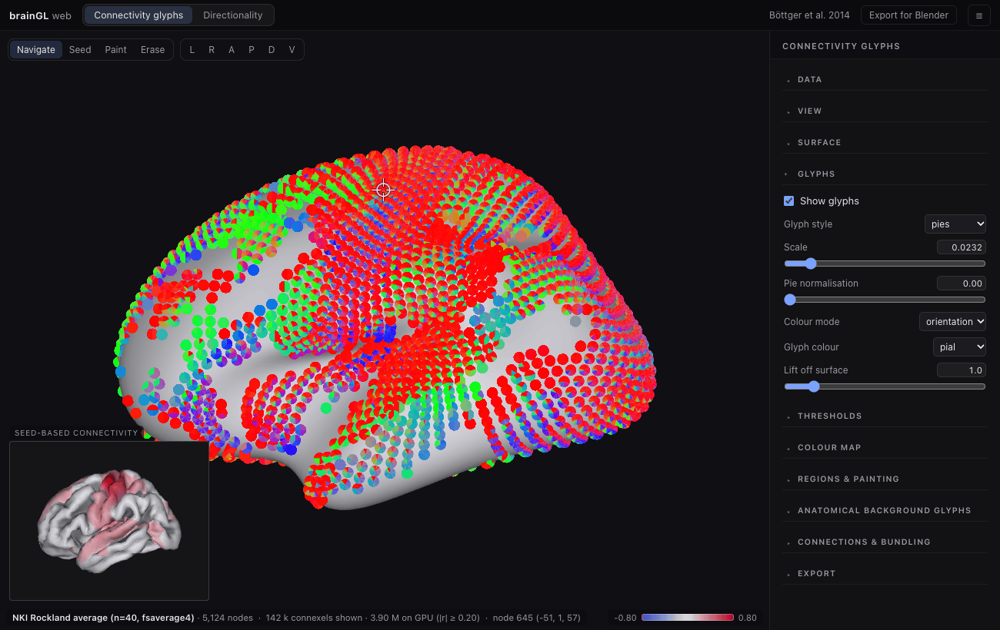

2. Set **Pie normalisation** to 1 and **Glyphs → Scale** to 0.04.

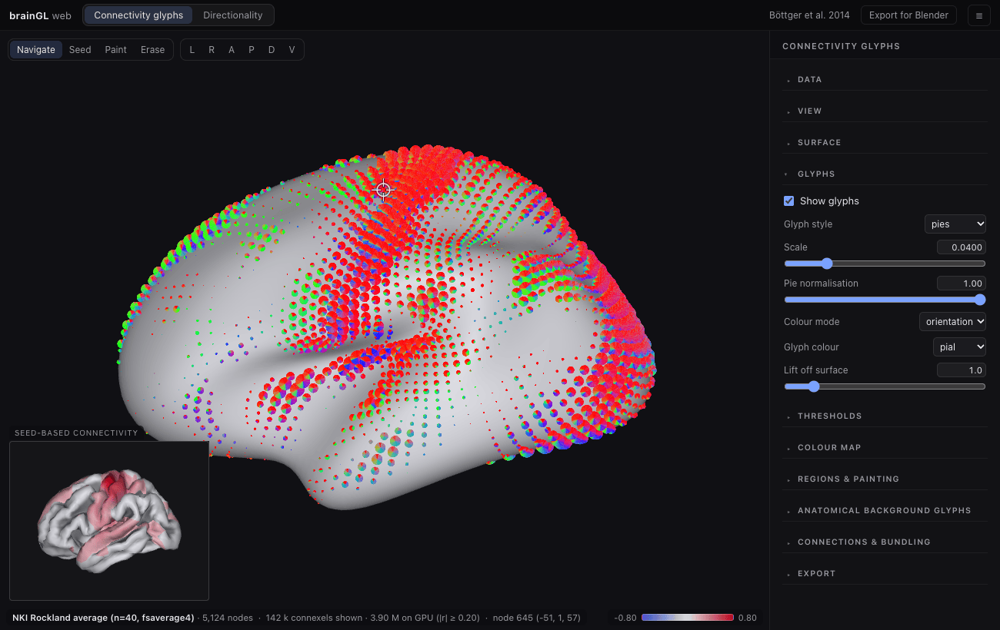

**Expected result.** At 0 all pies have the same radius and only the colours differ. At 1 the
*area* of a pie is proportional to the number of connections of its node: the motor belt, the
visual cortex and the auditory cortex swell, and weakly connected nodes shrink to dots.

**Why two settings.** The normalisation decides what the picture emphasises: 0 compares the
*composition* of the profiles, 1 adds how *many* strong connections a node has. The default 0.5
is a compromise. Set **Pie normalisation** back to 0.5 and **Scale** to 0.0232 (type the number
into the field) before you continue.

## 6. Zoom to a border and switch to points

1. Right-click on the anterior edge of the red belt, in front of the upper part of the central
   sulcus (node 1809).
2. Set **Glyph style** to *points* (key ++1++).
3. Put the pointer on the cross-hair and scroll to zoom in until single glyphs are separate.
   From the console: `braingl.glyphs.focusNode(1809, 5)`.

**How to read a point glyph.** A point glyph is a miniature map of the brain centred on its
node. Every point is one connection, drawn where its target lies relative to the node, at the
scale of the glyph. The colour is again the orientation of the connection.

**Expected result.** In this view anterior is to the left. The glyphs towards the central
sulcus (right) are large and dominated by red and blue points. Those further anterior (left)
are small and contain green points instead.

**Why this is a border.** Neighbouring nodes inside one cortical area have nearly the same
connections, so their glyphs look alike. Where the glyphs of neighbours differ, the
connectivity profile changes, which is the functional definition of a border between two
areas. Here it is the border between the motor cortex, with its interhemispheric (red)
connections, and the premotor and prefrontal cortex in front of it, whose strong connections
run anterior–posterior (green). [Manual parcellation](parcellation.md) turns this
observation into a procedure.

## 7. Glyph scale and point size

1. Set **Glyphs → Scale** to 0.03.
2. Set **Glyphs → Point / line size** to 3.

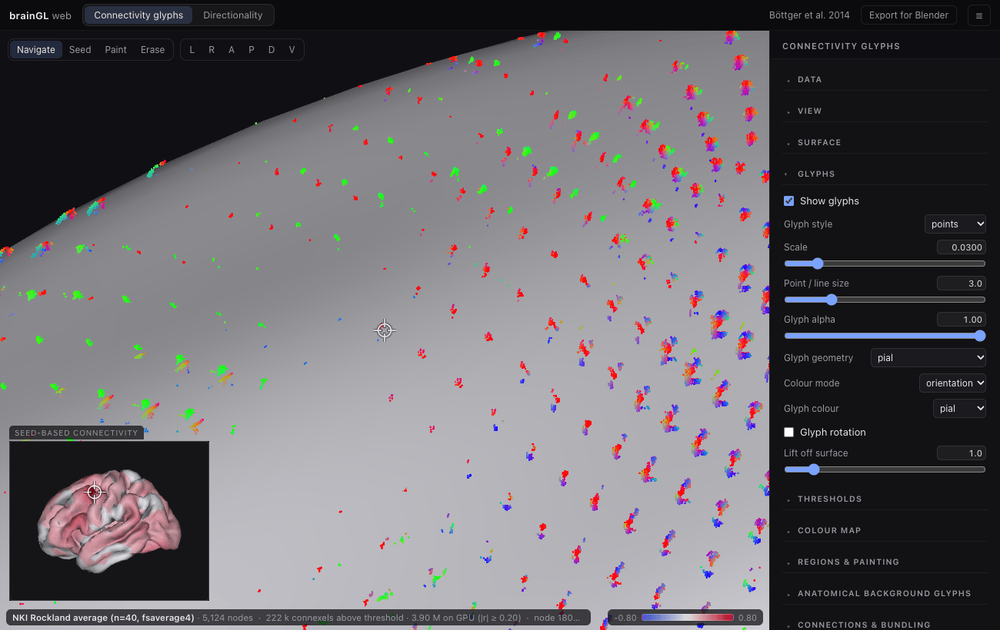

**Expected result.** The glyphs are larger and their points are thicker.

**What the two controls do.** **Scale** is the size of a glyph relative to the brain: at 0.03
a glyph is a copy of the brain at 3 % of its size. **Point / line size** is the size in pixels
of each point (or the width of each line of a vector glyph); it does not change when you zoom.
Raise the scale until neighbouring glyphs almost touch, and the point size until the glyphs
look filled without losing detail. Both depend on the zoom, so expect to adjust them often.

## 8. Three surfaces for one glyph

A glyph uses up to four surfaces, which you choose independently:

| Control | Decides |
|---|---|
| **View → Surface** | where the glyphs are placed (step 3) |
| **Glyphs → Glyph geometry** | the shape of the miniature map inside each glyph |
| **Glyphs → Glyph colour** | the surface in which the orientation of a connection, and so its colour, is measured |
| **Thresholds → Length measured on** | the surface in which the length of a connection is measured for **Minimum length** |

1. Set **Glyph colour** to *sphere*.

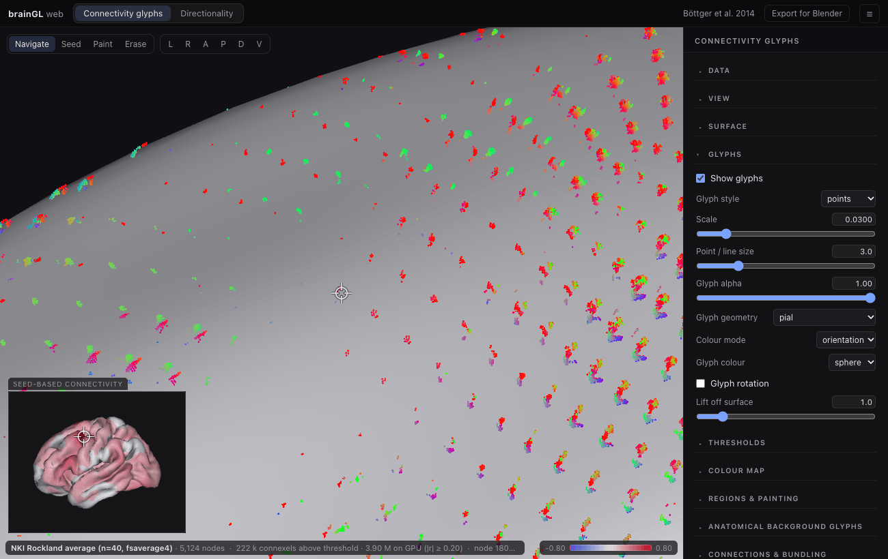

**Expected result.** The glyphs keep their shape but show more distinct colours, for example
orange and yellow-green points that were plain red before.

2. Set **Glyph geometry** to *sphere* as well.

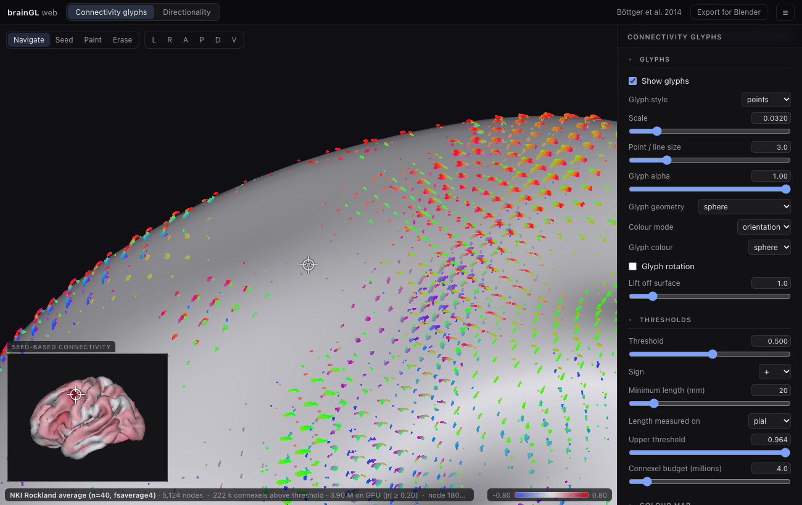

**Expected result.** Each glyph is now a small map of the spherical surface. The glyphs are
more regular, because the folding of the cortex no longer shapes them.

3. Set both back to *pial*. Open **Thresholds** and set **Length measured on** to
   *displayed surface (as in brainGL)*. Look, then set it back to *pial*.

**Expected result.** Some glyphs gain points. On the inflated surface nodes lie further apart,
so the same number keeps more connections: about 10 % more at 20 mm and 40 % more at 40 mm
for the left hemisphere of the demo.

**Why the choices matter.**

- *Glyph geometry.* With *pial*, a glyph is a faithful miniature of the folded brain, which is
  what you want with anatomical background glyphs (step 16). With *sphere* or *inflated*,
  targets hidden in sulci spread out.
- *Glyph colour.* On the sphere, directions cover the whole range, so the colours of
  neighbouring target regions differ most. On the pial surface the colour is the true
  anatomical direction, which keeps "red means the other hemisphere" valid.
- *Length measured on.* The minimum length removes short connections. Measured on the pial
  (or white) surface it is an anatomical distance in millimetres and stays the same whichever
  surface you look at. brainGL measured it on the displayed surface, so the same number
  selected different connections on the pial, inflated and spherical surfaces. Choose
  *displayed surface (as in brainGL)* to reproduce a picture made with brainGL.

Pie glyphs have no geometry, so **Glyph geometry** is hidden for them.

## 9. Vectors and minimum length

1. Click **L** in the toolbar to see the whole hemisphere again, and select node 645.
2. Set **Glyph style** to *vectors* (key ++2++).
3. Set **Thresholds → Minimum length (mm)** to 40.
4. Set **Glyphs → Scale** to 0.05 and **Point / line size** to 1.5.

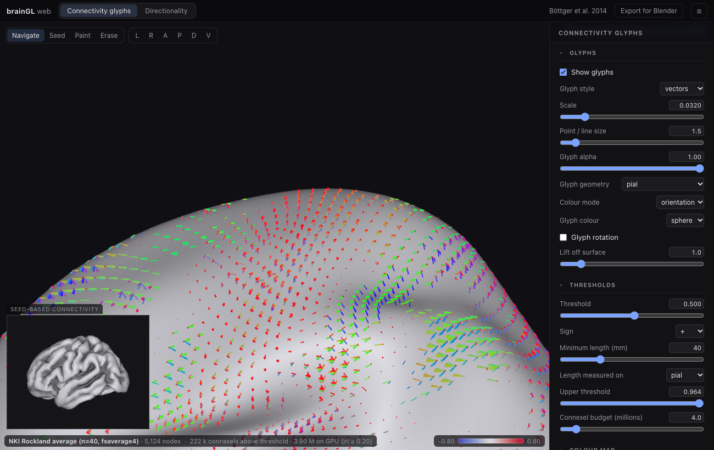

**How to read a vector glyph.** It is a point glyph with a line from the node to every point.
A distant target gives a long line, so vectors emphasise long-range connections and their
direction.

**Expected result.** Green lines fan out in the lateral prefrontal, parietal and temporal
cortex. The motor belt shows red dots, not lines: its connections run left–right, straight
away from you in a lateral view. Click **D** (dorsal) to see them as lines, then **L** again.

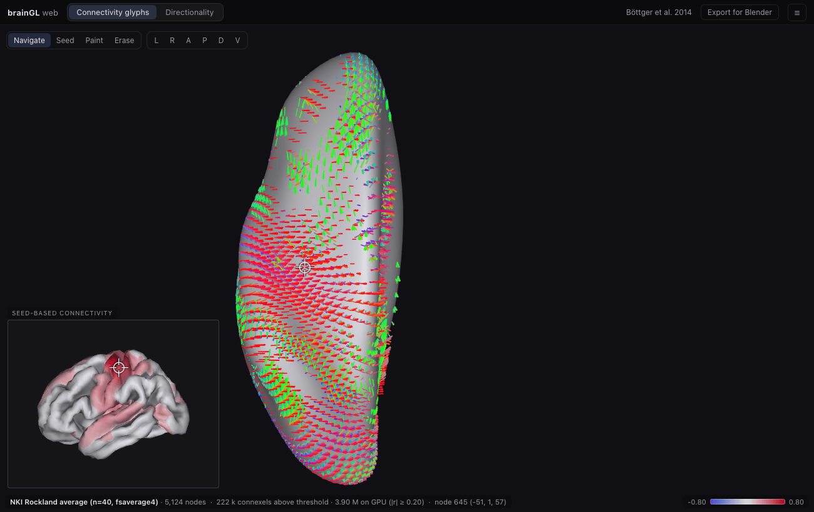

5. Set **Minimum length (mm)** to 60 and **Scale** to 0.06. Click **R** to look at the medial
   side and right-click on the posterior cingulate cortex (node 1298). ++shift++ + click **R**
   turns the second view the same way.

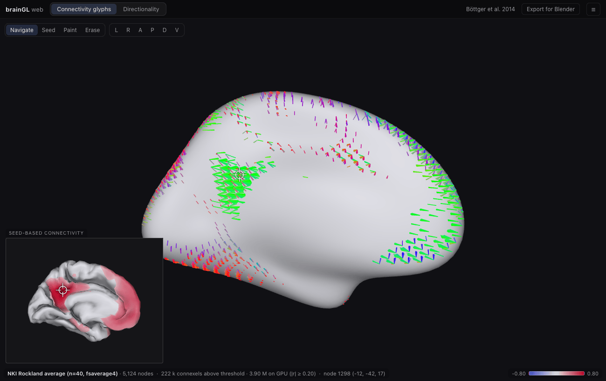

**Expected result.** Two patches of long green vectors remain on the medial wall: in the
posterior cingulate cortex and precuneus, pointing forward, and in the medial prefrontal
cortex, pointing backward. The second view shows the map of the selected node: posterior
cingulate, medial prefrontal and angular gyrus, the default-mode network.

**Why this works.** Raising the minimum length strips away the short connections that every
node has with its surroundings. What stays are the systems held together over long distances.
The default-mode network is the clearest case: its medial posterior and medial anterior parts
are about 10 cm apart and strongly correlated, so their glyphs become bundles of long
anterior–posterior (green) lines. In the 2014 paper, a minimum length of up to 20 mm added
detail, and larger values progressively removed known networks until only the longest
connections were left; explore the range with the slider.

Set **Minimum length** back to 20 and click **L**.

## 10. Sign and upper threshold

1. Set **Thresholds → Sign** to *−*.
2. Set **Threshold** to 0.15. Keep the vectors, with **Scale** 0.04, and select a node in the
   angular gyrus (node 64).

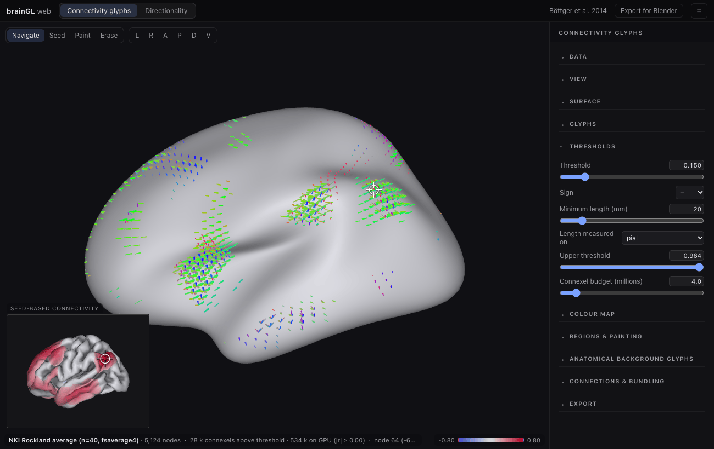

**Expected result.** Glyphs remain in a few places only. In the lateral view these are the
angular gyrus and the superior frontal cortex on the one hand, and the frontal operculum with
the anterior insula and the supramarginal gyrus on the other. The status line reads `28 k connexels above threshold · 534 k on GPU (|r| ≥ 0.00)`.

**Why this works.** **Sign** chooses positive correlations (*+*), negative ones (*−*) or both
(*+ / −*); the **Threshold** always applies to the absolute value. Negative correlations in
these data are weak (the strongest is −0.36), so the threshold has to come down. They link
the default-mode network with the attention and control regions that are active when it is
not. Because there are few negative connexels, all of them fit into the budget (`|r| ≥ 0.00`).

3. Set **Sign** back to *+*, **Glyph style** to *pies* and **Scale** to 0.0232. Set
   **Threshold** to 0.3 and **Upper threshold** to 0.5.

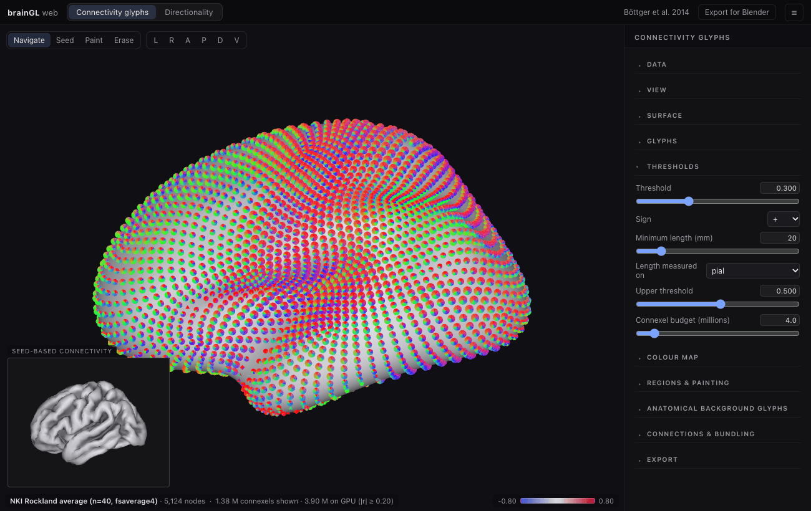

**Expected result.** Every node has a pie, and the pies are more mixed in colour than in step 4.

**Why this works.** The **Upper threshold** removes connections *stronger* than its value.
Together with the threshold it selects a band, here the moderately strong connections between
0.3 and 0.5. The strongest connections of most nodes are homotopic or local; without them the
remaining profile shows the wider network of each node. Set **Upper threshold** back to its
maximum (0.964, the largest value in the matrix) and **Threshold** to 0.5.

## 11. The connexel budget and the status line

A matrix of 5,124 nodes has 26 million entries, and larger data sets have many more. The
graphics card receives only the strongest connexels, up to the **Connexel budget**.

1. Set **View → Hemispheres** to *both* and **Glyph style** to *points*.
2. Set **Thresholds → Threshold** to 0.1.

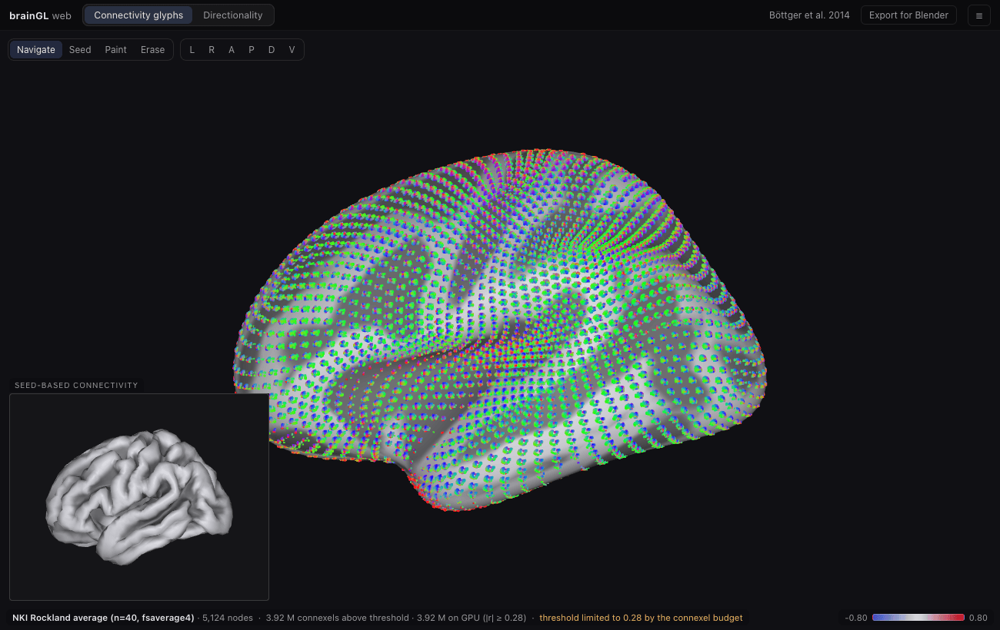

**Expected result.** The status line reads
`3.92 M connexels above threshold · 3.92 M on GPU (|r| ≥ 0.28) · threshold limited to 0.28 by the connexel budget`.
The picture is the one for a threshold of 0.28: lowering the slider further changes nothing.

3. Set **Connexel budget (millions)** to 12. The slider acts when you release it.

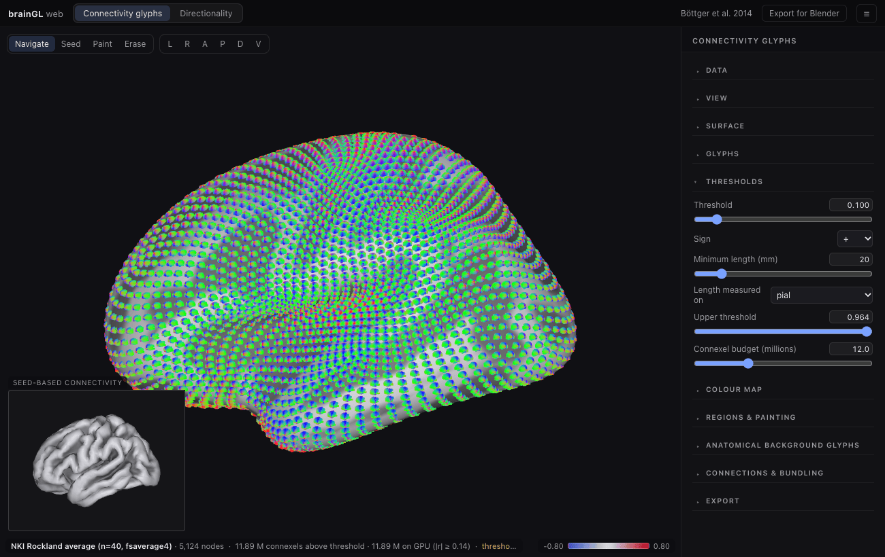

**Expected result.** After a moment the status line reads
`11.89 M connexels above threshold · 11.89 M on GPU (|r| ≥ 0.14)`, still with the warning,
now at 0.14.

**How to read the status line.**

| Part | Meaning |
|---|---|
| `445 k connexels above threshold` | how many connexels pass the threshold and sign (the minimum length is not counted). For pies: `shown`, the exact number of slices drawn. |
| `3.92 M on GPU (|r| ≥ 0.28)` | how many connexels were sent to the graphics card, and the weakest value among them |
| `threshold limited to 0.28 by the connexel budget` | your threshold is lower than what was sent, so the limit, not the slider, decides the picture |
| `node 645 (-51, 1, 57)` | the selected node and its position |

**Why a budget.** brainGL asked you to write a minimum threshold into the `.glyphset` file
before loading, and to edit the file and reload to change it. The budget does the same job
while the app runs: it is the number of connexels your graphics card should handle, and the
app derives the threshold from it. There are three ways to reach lower thresholds: raise the
budget (a larger budget needs more graphics memory and makes every change slower), show one
hemisphere, or restrict the glyphs to a painted region
([Manual parcellation](parcellation.md)). Details are in
[Limits](../reference/limits.md#connexel-budget).

Set the budget back to 4, the threshold to 0.5, **Hemispheres** to *left*.

## 12. Colour by value, colour maps and glyph alpha

1. Go back to the border of step 6 (`braingl.glyphs.selectNode(1809)`, then
   `braingl.glyphs.focusNode(1809, 5)`), with **Scale** 0.03 and **Point / line size** 3.
2. Set **Glyphs → Colour mode** to *value*.
3. In **Colour map**, choose *hot* and set **Min** to 0.3 and **Max** to 0.9.

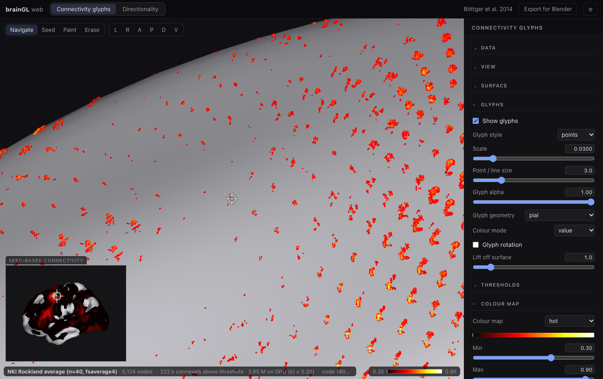

**Expected result.** The points go from dark red (correlations near the threshold) to yellow
(the strongest). The legend at the lower right shows the range. The surface map in the second
view uses the same colour map and range, so it changes too.

**Why this works.** *Orientation* colour tells you where connections go; *value* colour tells
you how strong they are, in the same colours as the seed-based map. Use it to compare a glyph
with the map in the second view. The ten colour maps are listed in
[Parameters](../reference/parameters.md#colour-maps); *green - red* is the scale of the
figures in the 2014 paper.

4. Set **Colour mode** back to *orientation*, the colour map to *cool - warm* and **Min** /
   **Max** to −0.8 / 0.8.
5. Set **Thresholds → Threshold** to 0.25 and **Glyphs → Glyph alpha** to 0.5.

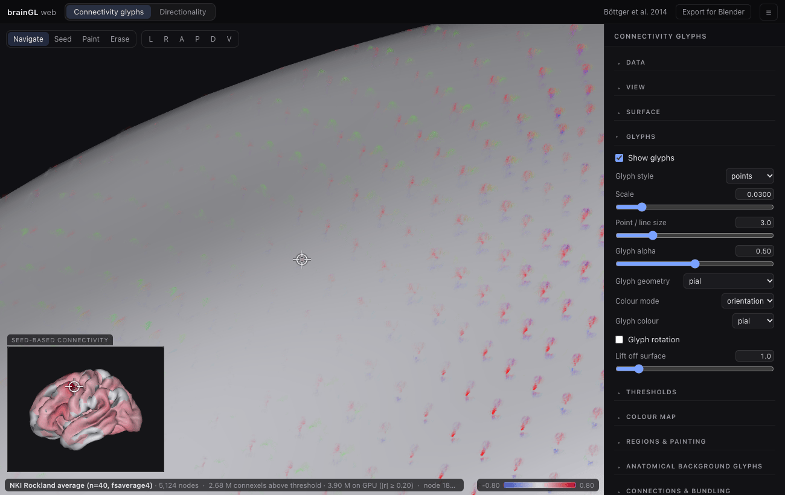

**Expected result.** Many more points appear than at 0.5, but the weak ones are faint, so the
strong structure of each glyph stays readable.

**Why this works.** With **Glyph alpha** below 1, the opacity of a point falls with the
strength of its connection: a soft threshold in place of a hard one. At 1 every point is
opaque. Glyph alpha has no effect on pies. Set the alpha back to 1 and the threshold to 0.5.

## 13. Glyph rotation

1. Tick **Glyphs → Glyph rotation**. Three sliders appear.
2. Set **z rotation** to 90.

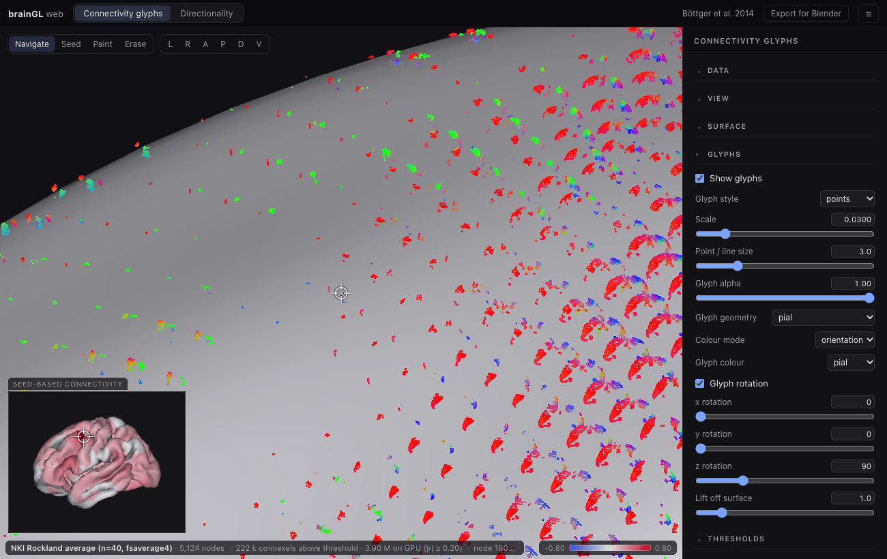

**Expected result.** Every glyph turns by a quarter about its vertical axis. The glyphs near
the central sulcus now show a red arc that was hidden before.

**Why this works.** A glyph is a three-dimensional miniature brain, and in a lateral view its
right hemisphere lies behind its left one. Rotating all glyphs, without moving the brain,
brings the targets on the far side into view. Untick **Glyph rotation** to continue. The
rotation is not available for pies and for the polar projection.

## 14. The polar projection

The polar projection removes the problem of hidden points altogether.

1. Set **Glyphs → Glyph geometry** to *polar projection (sphere)*. The option is offered when
   the data contain a spherical surface.
2. Set **Glyph colour** to *sphere*, **Scale** to 0.026 and **Point / line size** to 2.
3. Set **Thresholds → Threshold** to 0.3 and **Minimum length (mm)** to 0.
4. Zoom in further (`braingl.glyphs.focusNode(1809, 9)`).

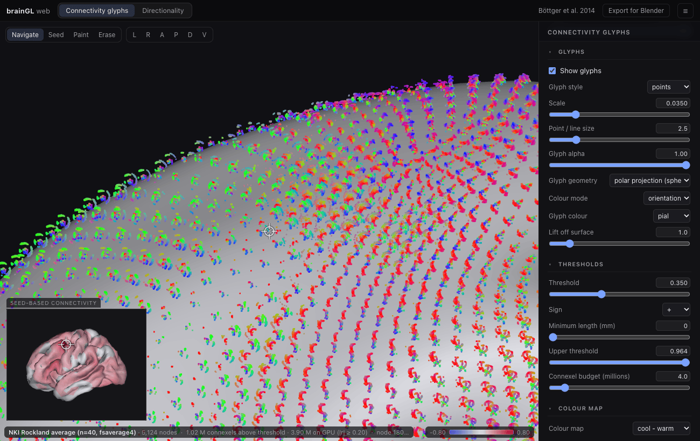

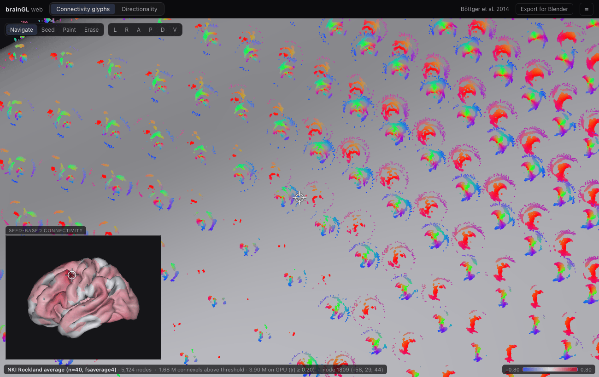

**How to read a polar glyph.** Each glyph is two flat discs side by side that always face you:

- one disc per hemisphere: the left disc holds the targets in the left hemisphere, the right
  disc those in the right hemisphere;
- the disc of the node's own hemisphere is centred on the node: the centre of the disc is the
  node itself, the rim is the point of the hemisphere farthest from it, and the direction from
  the centre is the direction on the cortex;
- the disc of the other hemisphere is centred on the homotopic point, the mirror image of the
  node, so a connection to the same area on the other side appears in the middle of that disc.

**Expected result.** The left discs show a patch around their centre, the local
neighbourhood of the node, in all colours because the directions on the sphere go all round.
Near the central sulcus (right half of the picture) the right discs carry a large red patch
in their middle: the homotopic connections of the motor cortex. In the prefrontal glyphs
(left half) the right disc is much sparser.

**Why this works.** The sphere is unrolled around each node into a flat map, so every target
has its own place and no point hides another. Distances from the centre are distances on the
sphere, not in the folded brain. The projection was described with the first glyph paper
(Böttger et al. 2013) but was not part of brainGL. See
[Glyph types](../reference/glyph-types.md#polar-projection-glyph-geometry-polar-projection-sphere)
for the formula.

Set **Glyph geometry** and **Glyph colour** back to *pial*, **Threshold** to 0.5 and
**Minimum length** to 20.

## 15. Difference glyphs

1. Click **L** for the whole hemisphere.
2. Set **Glyph style** to *diffpoints* (key ++4++).

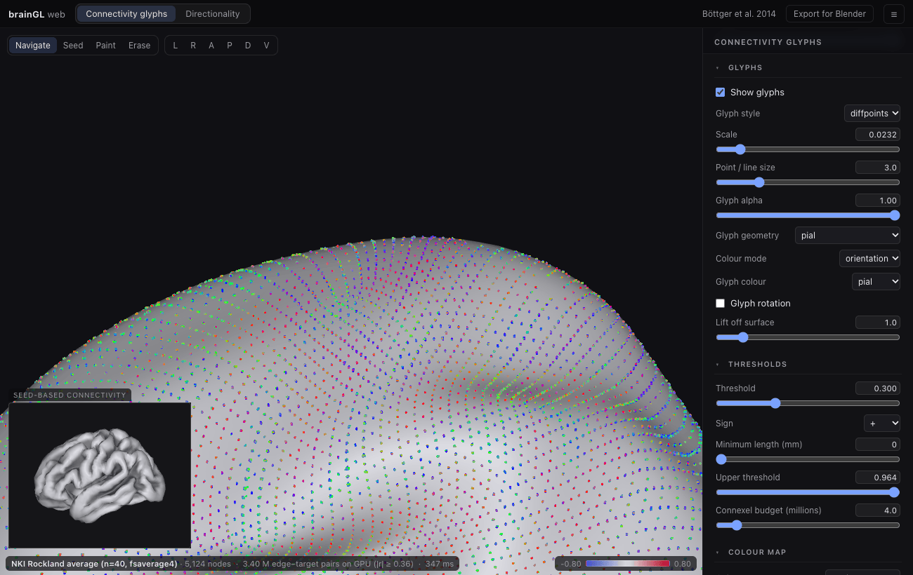

**Expected result.** A small glyph sits on every mesh edge, between two nodes. Look at
**Thresholds**: the app has set **Threshold** to 0.193 and **Minimum length** to 0 for you.
The status line counts `edge–target pairs on GPU`.

**What changed, and why.** A difference glyph shows, for the two nodes joined by an edge,
the targets to which their connectivity *differs* by more than the threshold. Differences
between neighbours are much smaller than the connections themselves, so with the threshold
of 0.5 and the minimum length of 20 mm that suit the other styles almost nothing would be
drawn. When you select *diffpoints* and the threshold is above 0.3 times the largest value
of the matrix, the app therefore switches to a threshold of 0.2 times that value (0.193 for
the demo) and a minimum length of 0. Your previous values come back when you choose
another style.

3. Set **Minimum length (mm)** to 20, **Scale** to 0.03 and **Point / line size** to 2.5.

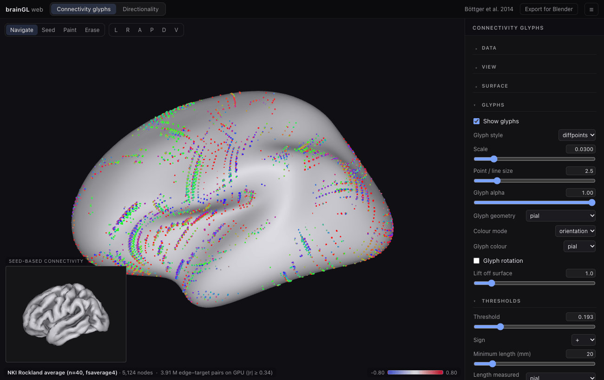

**Expected result.** Most edges lose their glyph. The remaining ones form lines, for example
along both sides of the motor belt and around the auditory cortex.

**Why this works.** With a minimum length of 0, every edge shows the differences in the
immediate neighbourhood of its two nodes, which exist everywhere. A minimum length of 20 mm
removes them and leaves the edges across which the *long-range* connectivity changes: the
borders that you found by comparing neighbouring glyphs in step 6, now drawn directly.

Press ++1++ to return to points; threshold and minimum length return to 0.5 and 20.

## 16. Anatomical background glyphs

1. Go to the border once more (`braingl.glyphs.focusNode(1809, 10)`).
2. Choose the **Paint** tool (key ++p++), set **Regions & painting → Brush size (mm)** to 9
   and click once on node 1809. Press ++n++ to return to the Navigate tool.
3. Set **Regions & painting → Glyphs at** to *painted nodes only* and untick **Show paint**.
4. Set **Glyphs → Scale** to 0.036, **Point / line size** to 3 and **Thresholds → Threshold** to 0.4.
5. Open **Anatomical background glyphs** and tick **Show little brains**.

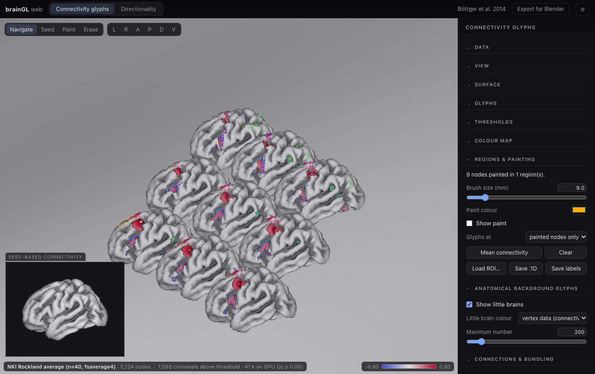

**Expected result.** Nine nodes are painted. Behind each glyph there is a miniature brain,
in the shape chosen by **Glyph geometry**, on which the connected areas are coloured by
connection strength. The points of the glyph lie on the areas they belong to.

**Why this works.** A point glyph is a map without a coastline. The "little brain" adds the
anatomy, so a cluster of points can be read as "the supramarginal gyrus" and not just "a
green cluster below and behind the node". Böttger et al. (2014) recommend this combination for
finding subtle shifts in connectivity between adjacent regions. Three details:

- The little brains are drawn for the painted nodes, or for the selected node if nothing is
  painted, up to **Maximum number** (200).
- **Little brain colour** chooses between the node's connectivity, the anatomy (sulcal
  shading) and one colour.
- They follow every change of geometry, threshold or surface by themselves. brainGL needed a
  click on "create little brains" after each change. They are not available with the polar
  projection.

Click **Regions & painting → Clear** and set **Glyphs at** back to *all nodes* when you are
done, or **Export → Reset to defaults** to undo everything.

## Troubleshooting

| Symptom | Cause and remedy |
|---|---|
| The number keys or ++p++, ++n++, ++s++ do nothing | The keyboard focus is in a field or a drop-down of the panel. Click once in the view. Keys are also ignored while ++ctrl++, ++cmd++ or ++alt++ is held. |
| No glyphs at all | **Glyphs → Show glyphs** is off, the style is *off* (key ++0++), or the threshold is above every value. With *painted nodes only* and nothing painted, the status line says "paint a region to create glyphs". |
| Lowering the threshold changes nothing | The status line shows "threshold limited to … by the connexel budget" (step 11). |
| Difference glyphs show nothing | You raised the threshold or the minimum length by hand after selecting the style. Set **Minimum length** to 0 and **Threshold** to about 0.2. |
| Glyphs are tiny or overlap | Adjust **Scale** to the zoom (step 7). |
| The right-click opens nothing, or selects nothing | The pointer was not on the surface. In the second view, right-click on the small brain itself. |
| "Polar projection (sphere)" is missing from **Glyph geometry** | The data set has no spherical surface. |
| The little brains do not appear | **Glyph geometry** is set to the polar projection (the panel says so), or the style is *pies* with a large scale that covers them. |
| The view looks different from the pictures after a restart | Settings are remembered. Use **Export → Reset to defaults**. |
| Everything is slow | Lower the **Connexel budget**, show one hemisphere, or close other tabs that use the graphics card. See [Limits](../reference/limits.md). |

## Where next

- [Manual parcellation](parcellation.md): paint regions and use the glyphs to find a border.
- [Connections and bundling](bundling.md): turn the long connections of step 9 into bundled lines.
- [Glyph types](../reference/glyph-types.md): the exact placement and colour of every style.
- [Parameters](../reference/parameters.md) and [Mouse and keyboard](../reference/mouse-keyboard.md):
  every control, key and gesture.
- [Make publication figures](../how-to/figures.md) and [Blender export](blender.md): from
  the screen to a figure.
- [Your own data](own-data.md): the same steps on your connectivity matrix.
