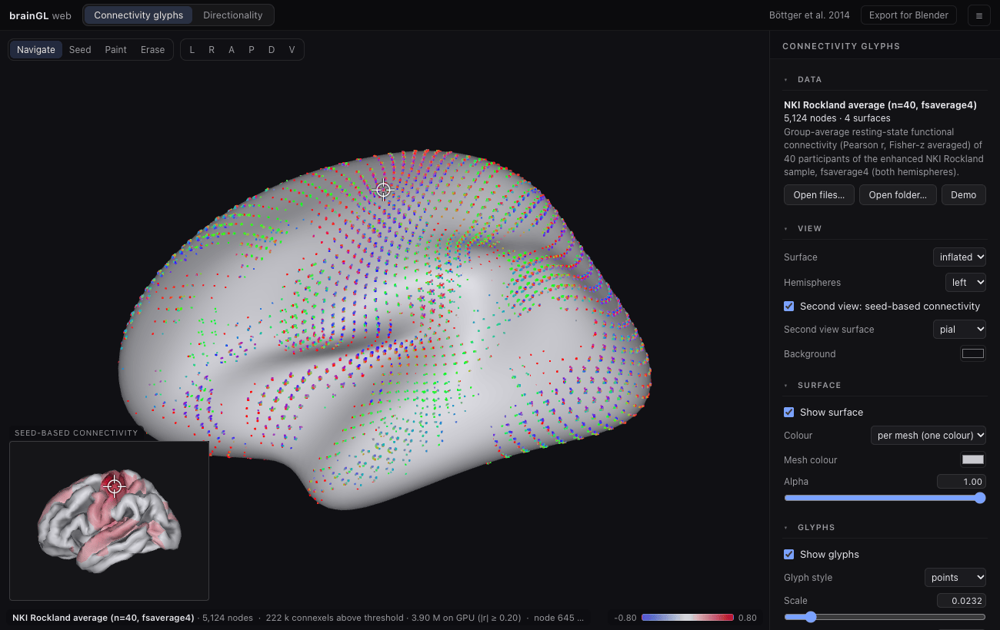
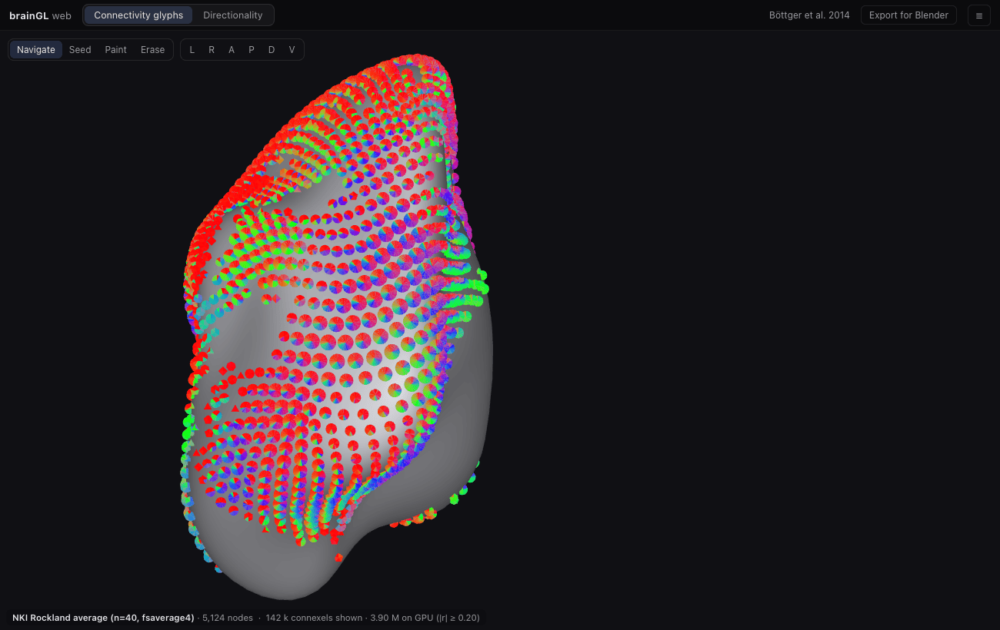
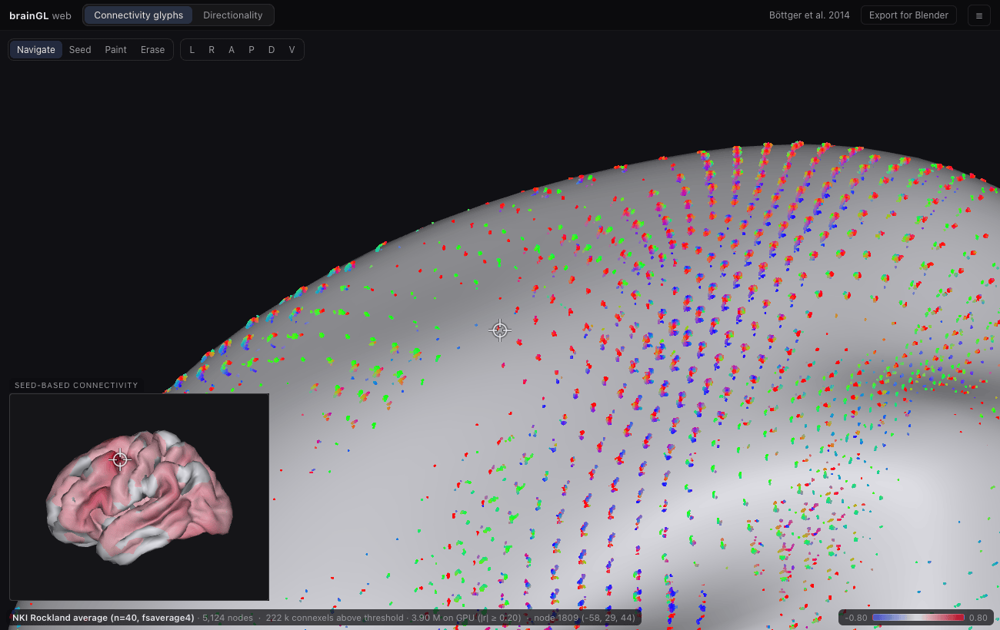

# Connectivity glyphs

<!-- TODO(restart): expand, add more detail per step -->

**Goal:** learn the glyph styles and their controls with the demo data. This is the web
equivalent of brainGL's "Surface connectivity and glyph tutorial".
**You need:** the app running ([Installation](../getting-started/installation.md)); no data of your own.
**Result:** you can read point, vector, pie, difference and anatomical background glyphs and
know which control changes what.

!!! note "Differences from the original tutorial"
    No NIfTI volume is loaded first. Glyphs exist for all nodes as soon as the data are
    loaded; you do not paint a region and press "create glyphs". Thresholds are live for pies too.
    The load-time minimum threshold of the `.glyphset` file is replaced by the **Connexel budget**.
    The second view is an inset, not a separate window. See
    [Differences from brainGL](../explanation/differences-from-braingl.md).

## 1. Load the demo and set up the two views

1. Open the app. The demo (40 participants of the enhanced NKI Rockland sample, fsaverage4)
   loads by itself; **Data → Demo** reloads it.
2. In **View**, set **Hemispheres** to *left*. Only the left hemisphere is drawn and only its
   glyphs are computed, which also lets the threshold go lower (see the status line).
3. In **Surface**, set **Colour** to *per mesh (one colour)* so that the glyphs stand out.
   **View → Surface** is already *inflated*.
4. Right-click on the surface to select a node.

The main view shows glyphs on the inflated surface. The second view (**Second view:
seed-based connectivity**, on the surface chosen in **Second view surface**) shows the
connectivity map of the selected node. The cross-hair is shared: selecting a node in either
view moves it in both. Adjust the contrast of the map with **Colour map → Min / Max**, and hide
weak values with **Surface map lower threshold**.

## 2. Pie glyphs

Set **Glyphs → Glyph style** to *pies* (key ++3++).

Each pie summarises all supra-threshold connections of its node: one slice per connection,
coloured by the orientation of the connection (red left–right, green anterior–posterior, blue
superior–inferior) and sorted by hue. **Scale** sets the size; **Pie normalisation** goes from
equal radii (0) to an area proportional to the number of connections (1).

- The **red belt** around the central sulcus is the somatomotor cortex: its strongest
  long connections go to the same region of the other hemisphere, that is left–right.
- The **red and blue** pies at the back of the brain are the visual cortex.

## 3. Zoom to a border and switch to points

1. Right-click on the anterior edge of the red belt.
2. Set **Glyph style** to *points* (key ++1++) and scroll to zoom in on the cross-hair.
3. Raise **Point / line size** and **Scale** until single glyphs are readable.

A point glyph is a miniature map: each point is one connection, placed where its target lies
relative to the node. Glyphs towards the central sulcus (right) are dominated by red and blue
points; those further anterior (left) by green ones. The place where neighbouring glyphs
change is a border between two connectivity profiles.

## 4. Glyph geometry and glyph colour surface

**Glyph geometry** chooses the surface whose shape each glyph copies; **Glyph colour** chooses
the surface in which orientations are measured. Both are independent of the displayed surface.
With *sphere* for both, glyphs are regular and the colour range is largest; with *pial* they
follow the folding.

## 5. Vectors and minimum length

Set **Glyph style** to *vectors* (key ++2++) and **Thresholds → Minimum length (mm)** to 40.
Each connection is now a line from the node to its point, which emphasises long-range
connections. **Length measured on** selects the surface used for the length test.

## 6. Colour by value

Set **Glyphs → Colour mode** to *value* and choose a **Colour map** and its **Min** and **Max**.
Points are coloured by connection strength instead of orientation. The same colour map and
range are used for the surface map in the second view.

## 7. Glyph alpha

With **Glyph alpha** below 1, weaker connections become gradually more transparent. Lower the
**Threshold** and reduce the alpha as an alternative to a hard threshold. (Not available for pies.)

## 8. Polar projection

Set **Glyph geometry** to *polar projection (sphere)* (available when the data contain a
spherical surface). Every glyph becomes two flat discs that face the viewer, one per target
hemisphere: the sphere is unrolled around the node, so no point hides another. Set
**Minimum length** to 0 to see the whole map.

## 9. Difference glyphs

Set **Glyph style** to *diffpoints* (key ++4++). One glyph is drawn on every mesh edge and
shows the difference between the connectivity profiles of the two nodes it joins. **Threshold**
is now the minimum difference. Set **Minimum length** to 0: with the default 20 mm almost
nothing remains.

## 10. Anatomical background glyphs

1. Choose the **Paint** tool (key ++p++) and paint a small region.
2. Set **Regions & painting → Glyphs at** to *painted nodes only* and raise **Scale**.
3. Open **Anatomical background glyphs** and tick **Show little brains**.

A miniature surface (in the shape chosen by **Glyph geometry**) appears behind every glyph of
the painted region, or behind the selected node if nothing is painted. **Little brain colour**
can show the node's connectivity, the anatomy or one colour. They update by themselves when you
change a setting. They are not available with the polar projection.

## Next

[Manual parcellation](parcellation.md) uses these glyphs to find a border.
[Glyph types](../reference/glyph-types.md) and [Parameters](../reference/parameters.md) give the exact definitions.
