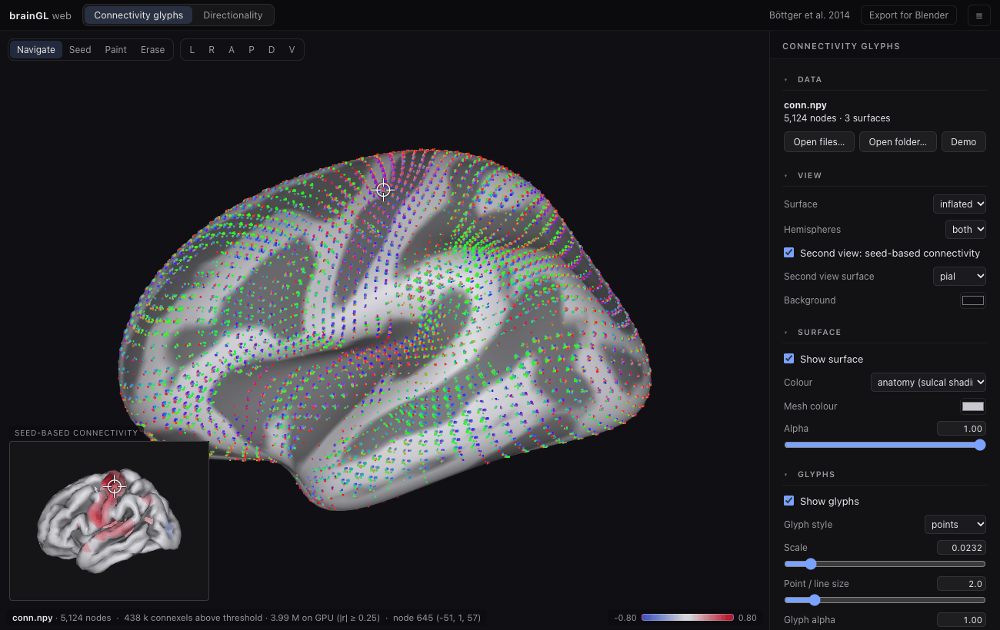
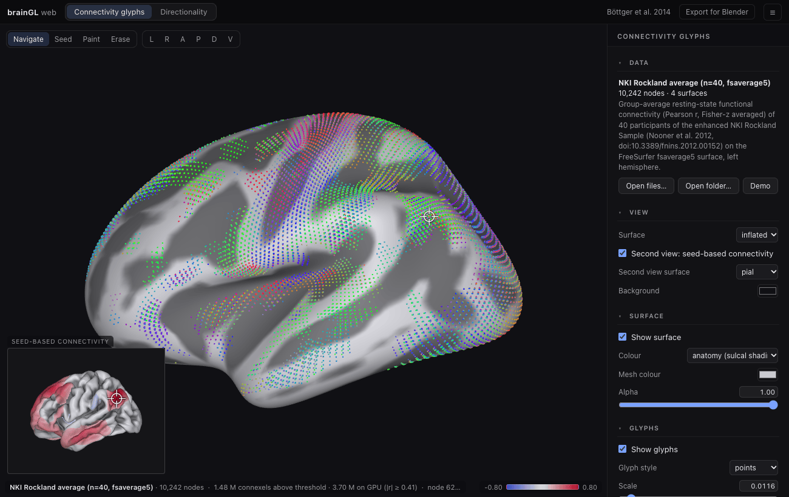
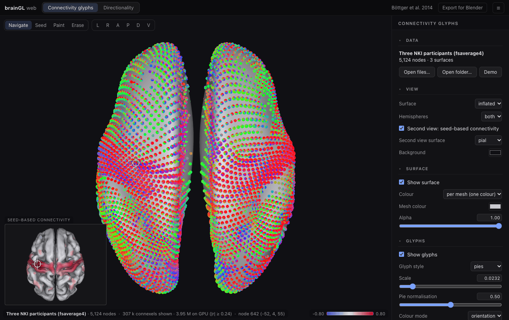
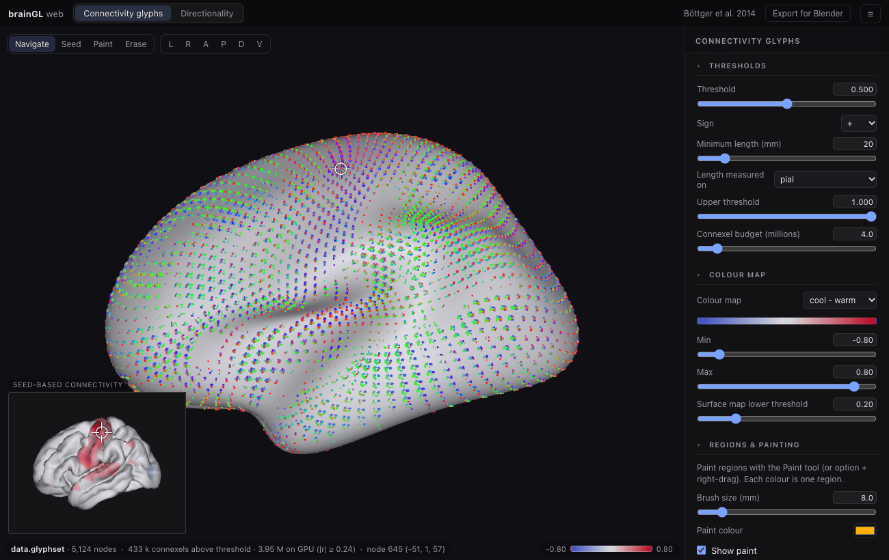
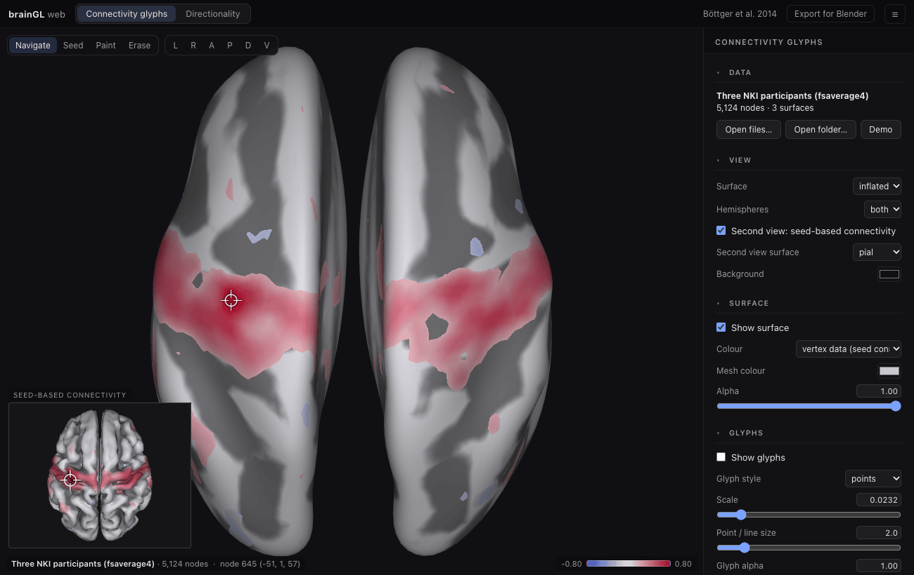

# Your own data

**What you will learn:** how to get your own surfaces and connectivity matrix into the viewer
by three routes: (a) dropping loose files, (b) converting them to a compact *web glyphset* with
`tools/make_glyphset.py`, and (c) opening a glyphset made for the original brainGL. You will
also see how the bundled demo was made, how to host a glyphset next to the app, and how to check
that the result is right.

**Time:** about 30 minutes, most of it for the example data to download.

**Prerequisites:**

- the app running locally ([Installation](../getting-started/installation.md)); routes (a) and
  (c) also work in the [hosted app](https://neuroanatomyandconnectivity.github.io/braingl-web/);
- Python 3 with `numpy` and `nibabel` for the conversion tool, plus `scipy` and `nilearn` for
  the example (`pip install numpy scipy nibabel nilearn`);
- surfaces and a matrix that use the same node numbering. If you have none at hand, the example
  in step 1 produces a set from public data.

All commands are run from the repository root.

## Before you start: what the viewer expects

**One row per surface node.** The matrix is square, n × n, and row *i* belongs to node *i* of
the surfaces. All surfaces of a dataset (pial, inflated, sphere and so on) share one node
numbering and one set of triangles. The matrix does not have to be a correlation matrix: any
symmetric node-by-node measure works, and the sliders adapt to its range.

**Left hemisphere first.** With two hemispheres, the nodes of the left hemisphere come first,
then those of the right one, in the matrix and in every per-node file. The surfaces are given
per hemisphere and the viewer (or the tool) stacks them in that order. A dataset with a single
hemisphere or a single mesh is fine: the **Hemispheres** control is then hidden.

**Medial wall and other nodes without data.** Give them rows and columns of zeros. NaN and
infinite values are read as 0. Which nodes carry data is recorded in a *mask*:

| Route | Where the mask comes from |
|---|---|
| Loose files, brainGL glyphset | the viewer derives it: a node whose row is zero everywhere off the diagonal gets no glyph |
| `from-timeseries`, `nki-demo` | the tool writes `mask.u8`: nodes with a constant time series are masked |
| `from-matrix` | the tool writes `mask.u8` by the same rule as the viewer: a node whose row and column are zero everywhere off the diagonal is masked (no mask file when every node has data) |

**Size.** A glyphset can have at most 65,535 nodes. The practical limit is lower, because the
browser holds the whole matrix as 16-bit integers:

| Nodes | Example | Memory in the browser (2·n² bytes) | `int8` glyphset file | Raw float32 or `.npy` file |
|---|---|---|---|---|
| 5,124 | fsaverage4, both hemispheres (the demo) | 52 MB | 13 MB | 105 MB |
| 10,242 | fsaverage5, one hemisphere | 210 MB | 52 MB | 420 MB |
| 16,384 | | 0.5 GB | 134 MB | 1.1 GB |
| 20,484 | fsaverage5, both hemispheres | 0.8 GB | 210 MB | 1.7 GB |

About 16,000 nodes is the practical size; see [Limits](../reference/limits.md). NIfTI volumes
and CIFTI dense connectomes are not read. Save a CIFTI matrix as `.npy` first, for example with
`numpy.save("conn.npy", nibabel.load("my.dconn.nii").get_fdata(dtype="float32"))`, after
restricting it to the surface nodes.

## Route (a): drop loose files

This is the quickest route: no conversion, the files stay as they are.

### 1. Prepare a folder with surfaces and a matrix

If you already have a matrix, skip to the table of file names below. Otherwise save the
following script as `prepare_my_data.py` in the repository root. It goes from surface time
series to a connectivity matrix on disk: three participants of the enhanced NKI Rockland
sample (fetched by nilearn on fsaverage5, about 100 MB) are down-sampled to fsaverage4, each
participant's time series are correlated, and the correlation matrices are averaged in Fisher z.

```python
"""From surface time series to a connectivity matrix on disk, ready for brainGL web.

Three participants of the enhanced NKI Rockland sample (resting state, on
fsaverage5) are down-sampled to fsaverage4, correlated, and averaged.
Run from the repository root:  python prepare_my_data.py [output folder]
"""
import sys
from pathlib import Path

import nibabel as nib
import numpy as np
from nilearn import datasets

sys.path.insert(0, "tools")                      # the repository's tools/ folder
from make_glyphset import ico_neighbour_average  # 1-ring average before sub-sampling

N_SUBJECTS = 3
N4 = 2562                                        # nodes per hemisphere of fsaverage4
out = Path(sys.argv[1] if len(sys.argv) > 1 else "my_data")
(out / "loose").mkdir(parents=True, exist_ok=True)
(out / "timeseries").mkdir(parents=True, exist_ok=True)

nki = datasets.fetch_surf_nki_enhanced(n_subjects=N_SUBJECTS)
fs5 = datasets.fetch_surf_fsaverage("fsaverage5")   # mesh of the time series
fs4 = datasets.fetch_surf_fsaverage("fsaverage4")   # mesh we want to look at
tri5 = {h: nib.load(fs5[f"pial_{h}"]).agg_data("triangle") for h in ("left", "right")}


def timeseries(subject):
    """Time series [nodes, time] of one participant: left hemisphere first, then right."""
    parts = []
    for hemi in ("left", "right"):
        gii = nib.load(nki[f"func_{hemi}"][subject])
        ts = np.stack([d.data for d in gii.darrays], axis=1).astype(np.float32)  # [10242, time]
        parts.append(ico_neighbour_average(ts, tri5[hemi], N4))                  # [2562, time]
    return parts


# 1. one correlation matrix per participant, averaged in Fisher z
n = 2 * N4
z_sum = np.zeros((n, n), dtype=np.float32)
valid = np.ones(n, dtype=bool)                   # nodes with signal in every participant
for s in range(N_SUBJECTS):
    lh, rh = timeseries(s)
    if s == 0:                                   # kept for `make_glyphset.py from-timeseries`
        np.save(out / "timeseries" / "lh.timeseries.npy", lh)
        np.save(out / "timeseries" / "rh.timeseries.npy", rh)
    ts = np.concatenate([lh, rh], axis=0)        # [5124, time]
    valid &= ts.std(axis=1) > 1e-6               # the medial wall has constant time series
    with np.errstate(invalid="ignore", divide="ignore"):
        r = np.corrcoef(ts).astype(np.float32)   # Pearson r between all pairs of nodes
    r = np.nan_to_num(r)                         # constant time series give NaN
    z_sum += np.arctanh(np.clip(r, -0.999999, 0.999999))   # Fisher r-to-z
    print(f"participant {s + 1}/{N_SUBJECTS}: {ts.shape[1]} time points")

conn = np.tanh(z_sum / N_SUBJECTS)               # back to r
conn[~valid, :] = 0                              # medial wall: rows and columns of zeros
conn[:, ~valid] = 0
np.fill_diagonal(conn, 0)
np.save(out / "loose" / "conn.npy", conn.astype(np.float32))

# 2. surfaces and a sulcal-depth overlay, under file names the viewer recognises
for hemi, h in (("left", "lh"), ("right", "rh")):
    for key, name in (("pial", "pial"), ("infl", "inflated"), ("sphere", "sphere")):
        nib.save(nib.load(fs4[f"{key}_{hemi}"]), out / "loose" / f"{h}.{name}.surf.gii")
    nib.save(nib.load(fs4[f"sulc_{hemi}"]), out / "loose" / f"{h}.sulc.shape.gii")

print(f"{n} nodes, {int((~valid).sum())} without data, r from {conn.min():.2f} to {conn.max():.2f}")
print(f"wrote {out}/loose (drop this folder on the viewer) and {out}/timeseries")
```

Run it:

```bash
python prepare_my_data.py
```

```text
participant 1/3: 895 time points
participant 2/3: 895 time points
participant 3/3: 895 time points
5124 nodes, 437 without data, r from -0.68 to 0.97
wrote my_data/loose (drop this folder on the viewer) and my_data/timeseries
```

Three things in the script apply to any data:

- **Fisher z for the group average.** Correlations are not averaged directly. Each
  participant's r is converted with `arctanh`, the z values are averaged, and the mean is
  converted back with `tanh`. The clipping keeps `arctanh` finite for values of exactly ±1.
- **Zeros for nodes without signal.** The 437 nodes are the medial wall. A node that is empty in
  any participant is set to zero in the average.
- **Down-sampling.** The fsaverage meshes are nested: the first 2,562 nodes of an fsaverage5
  hemisphere are the nodes of fsaverage4. `ico_neighbour_average` from `tools/make_glyphset.py`
  averages each kept node with its direct neighbours on the finer mesh before the other nodes
  are dropped, which reduces noise and aliasing. Use it only for nested icosahedral meshes; for
  anything else, resample with your usual tools first.

The folder `my_data/loose` now holds:

```text
conn.npy                  5124 x 5124 float32, 105 MB
lh.pial.surf.gii          rh.pial.surf.gii
lh.inflated.surf.gii      rh.inflated.surf.gii
lh.sphere.surf.gii        rh.sphere.surf.gii
lh.sulc.shape.gii         rh.sulc.shape.gii
```

The viewer sorts loose files by name and content:

| File | Accepted | How it is recognised |
|---|---|---|
| Surface, one per hemisphere and kind | GIFTI `.surf.gii`, FreeSurfer binary (`lh.pial`, `lh.inflated`), FreeSurfer ASCII `.asc` | hemisphere from `lh` / `rh` / `L` / `R` / `left` / `right` set off by a dot, dash or underscore; kind from `pial`, `white`, `midthickness`, `inflated`, `very_inflated`, `sphere`, `flat`, `smoothwm` or `orig` in the name |
| Matrix | square `.npy` (float32, float64 or integer), or raw little-endian float32 (`.bin`, `.dat`, `.data`, `.raw`, `.f32`, or no extension) | the largest candidate file is taken as the matrix |
| Per-node scalars (optional overlays) | `.shape.gii` / `.func.gii`, FreeSurfer `lh.sulc` / `lh.curv` / `lh.thickness`, `.1D` text | one file with n values, or a left and a right file that add up to n |

Files ending in `.gz`, `.nii`, `.json`, `.txt` and `.md` are skipped, so unpack compressed
files first. The exact rules are in [Data formats](../reference/data-formats.md#loose-files).

### 2. Drop the folder onto the view

1. Open the app.
2. Drag the folder `my_data/loose` from your file manager onto the view, or click
   **Data → Open folder…** and choose it. With **Open files…**, select all files together.
3. Wait for "Reading conn.npy…" to finish, then right-click on the surface to select a node.



Expected result: the **Data** section shows `conn.npy`, 5,124 nodes and 3 surfaces. The three
surfaces appear in the **Surface** menus in the order pial, inflated, sphere, the two inflated
hemispheres are moved apart so that they do not overlap, and **Surface → Colour** offers
*overlay: sulc*. The medial wall has no glyphs.

A FreeSurfer subject folder works the same way, without any conversion: select `lh.pial`,
`rh.pial`, `lh.inflated`, `rh.inflated`, `lh.sphere`, `rh.sphere`, optionally `lh.sulc` and
`rh.sulc`, and a matrix on that subject's mesh. Mind the node limit: a native FreeSurfer mesh
has well over 100,000 nodes per hemisphere, so this is practical only for down-sampled meshes
such as fsaverage4 or fsaverage5.

## Route (b): convert with `tools/make_glyphset.py`

A *web glyphset* is a folder with a manifest `glyphset.json` and compact binary files: the
surfaces as float32 and the upper triangle of the matrix as 8- or 16-bit integers. Compared with
loose files it is 4 to 8 times smaller, loads faster, keeps a name, a description and a mask,
and can be served next to the app. The tool has four sub-commands; all options are listed in
[Command-line tools](../reference/cli.md#toolsmake_glyphsetpy).

### 3. From an existing matrix: `from-matrix`

```bash
python tools/make_glyphset.py from-matrix \
  --left  my_data/loose/lh.pial.surf.gii my_data/loose/lh.inflated.surf.gii my_data/loose/lh.sphere.surf.gii \
  --right my_data/loose/rh.pial.surf.gii my_data/loose/rh.inflated.surf.gii my_data/loose/rh.sphere.surf.gii \
  --matrix my_data/loose/conn.npy \
  --overlay sulc=my_data/loose/lh.sulc.shape.gii,my_data/loose/rh.sulc.shape.gii \
  --name "Three NKI participants (fsaverage4)" \
  --out public/data/local/my_set
```

```text
wrote public/data/local/my_set  (5124 nodes, 13.5 MB)
```

- Give the surfaces of `--left` and `--right` in the same order. The first surface should be
  an anatomical one (pial, white or midthickness): it decides the orientation of the triangles.
- The surface names shown in the panel are taken from the file names (`pial`, `inflated`,
  `sphere`). Set them yourself with `--names a,b,c`. If two files give the same name, the second
  becomes `pial_2`, and so on.
- With one hemisphere or a single mesh, omit `--right`.
- `--matrix` takes a `.npy` file or a raw float32 file.
- `--overlay name=left[,right]` may be repeated.
- Inflated and spherical hemispheres are moved 5 mm apart unless you pass `--no-separate`.

The folder `public/data/local/` is ignored by git and meant for exactly this.

### 4. From time series: `from-timeseries`

If you have surface time series instead of a matrix, the tool computes the Pearson correlation
between all nodes itself. The time series are `.func.gii` files or `.npy` arrays of shape
nodes × time, on the same mesh as the surfaces (the tool does not resample), left hemisphere
first:

```bash
python tools/make_glyphset.py from-timeseries \
  --left  my_data/loose/lh.pial.surf.gii my_data/loose/lh.inflated.surf.gii my_data/loose/lh.sphere.surf.gii \
  --right my_data/loose/rh.pial.surf.gii my_data/loose/rh.inflated.surf.gii my_data/loose/rh.sphere.surf.gii \
  --timeseries my_data/timeseries/lh.timeseries.npy my_data/timeseries/rh.timeseries.npy \
  --dtype int16 \
  --out public/data/local/one_participant
```

```text
time series (5124, 895)
wrote public/data/local/one_participant  (5124 nodes, 26.6 MB)
```

Nodes whose time series is constant get zero correlation and are masked (`mask.u8`). This
sub-command handles one set of time series, that is, one participant or one concatenated run.
For a group average, compute the matrix yourself as in step 1 and use `from-matrix`.

### 5. Choose the storage type

`--dtype` sets how the matrix is stored in the file. In the browser it always becomes a 16-bit
matrix, so the choice affects file size and precision, not memory.

| `--dtype` | Bytes per node pair | File at 5,124 nodes | Precision for correlations | Use it when |
|---|---|---|---|---|
| `int8` (default) | 1 | 13 MB | steps of max/127, about 0.008 | viewing and sharing; the steps are invisible at the usual thresholds |
| `int16` | 2 | 26 MB | steps of max/32767, about 0.00003 | you want everything the browser can hold, for example for values exported as `.cxls` |
| `float32` | 4 | 53 MB | exact in the file | another program reads the file too; the browser gains nothing over `int16` |

The largest absolute value of the matrix is mapped to the top of the integer range, so the
precision is relative to that maximum. One extreme outlier therefore costs resolution for all
other values; clip outliers before converting.

### 6. How the bundled demo was made: `nki-demo`

The demo in `public/data/nki_fsaverage4/` was built with:

```bash
python tools/make_glyphset.py nki-demo --subjects 40 --mesh fsaverage4 --out public/data/nki_fsaverage4
```

```text
  subject 1/40
  ...
  subject 40/40
wrote public/data/nki_fsaverage4  (5124 nodes, 13.5 MB)
```

The sub-command does, for 40 participants, what the script in step 1 does for three:

1. nilearn downloads the surface time series of the enhanced NKI Rockland sample (fsaverage5,
   10,242 nodes per hemisphere; several gigabytes for 40 participants) and the fsaverage
   surfaces.
2. Each hemisphere's time series are averaged over the direct neighbours of every node and
   reduced from fsaverage5 to the 2,562 nodes of fsaverage4 (`ico_neighbour_average`; empty
   medial-wall time series are left out of the average).
3. The Pearson correlation between all 5,124 nodes is computed per participant, converted to
   Fisher z, averaged over participants and converted back to r.
4. Nodes without a valid time series in any participant are zeroed and masked; the diagonal is
   set to 0.
5. The pial, inflated, sphere and white surfaces, the overlays `sulc` and `curv`, the mask and
   the matrix (`int8`) are written, with the description and the credit for the data in
   `glyphset.json`.

Run again with the same nilearn data, the command reproduces the bundled files byte for byte.

The same command builds a variant at the resolution of the time series, without the
down-sampling step. One hemisphere of fsaverage5 has 10,242 nodes, twice the node count of
the demo and four times the matrix:

```bash
python tools/make_glyphset.py nki-demo --mesh fsaverage5 --hemi lh --out public/data/local/nki_fsaverage5_lh
```

```text
wrote public/data/local/nki_fsaverage5_lh  (10242 nodes, 53.3 MB)
```



It needs about 210 MB in the browser. Both hemispheres of fsaverage5 (20,484 nodes, 0.8 GB)
are beyond what is comfortable. If you redistribute data made this way, credit the enhanced
NKI Rockland Sample (Nooner et al. 2012,
[doi:10.3389/fnins.2012.00152](https://doi.org/10.3389/fnins.2012.00152)).

### 7. Open the web glyphset

Either drop the folder `public/data/local/my_set` onto the view (or use **Open folder…**), or,
because the folder lies next to the app, give its address relative to the page:

```text
http://localhost:5173/?data=data/local/my_set
```



Expected result: the **Data** section and the status line show the name you gave with
`--name`. All glyph styles and controls work as with the demo.

`?data=` accepts only folders on the **same origin** as the app, that is, the same server and
port. An address on another server is ignored with a warning in the browser console and the
demo loads instead. To put a glyphset on a public site, copy it to `public/data/<name>/` before
`npm run build` and link to `…/?data=data/<name>`:
[Deploy your own copy](../how-to/deploy.md) has the steps.

## Route (c): an existing brainGL glyphset

Glyphsets made for the original brainGL (`.glyphset`, `.set`, FreeSurfer `.asc` surfaces and a
raw float32 matrix) open without conversion.

### 8. Open or create a brainGL glyphset

1. Click **Data → Open files…** and select the `.glyphset` file together with every file it
   refers to, or drop the folder that contains them.
2. Wait for the matrix to be read.

If you have no such glyphset, convert the web glyphset of step 3 back. This is also how you
take data from the web version to the desktop program:

```bash
python tools/make_glyphset.py to-braingl public/data/local/my_set --out my_data/braingl_set --min-threshold 0.5
```

```text
wrote brainGL glyphset to my_data/braingl_set/data.glyphset
```

The folder then holds `data.glyphset`, `L.set`, `R.set`, one `.asc` file per surface and
hemisphere (`L.pial.asc`, `R.pial.asc`, …) and `connectivity.bin` (105 MB). Overlays and the
mask are not part of the brainGL format and are not written.



Expected result: the dataset is named after the `.glyphset` file, and **Thresholds →
Threshold** starts at or above the minimum threshold on the third line of that file (0.5 here).
The surface has no sulcal shading, because the format carries no overlays.
[Load a brainGL glyphset](../how-to/load-braingl-glyphset.md) explains the three lines of the
file and what the web version does with each.

## Check the result

Whatever the route, check these four things before you trust the picture.

1. **Counts.** The **Data** section shows the number of nodes and surfaces. The status line
   shows the number of nodes and how many connexels pass the threshold.
2. **Hemisphere order.** Set **View → Hemispheres** to *left*. The left hemisphere must remain.
   Then set it back to *both*, set **Surface → Colour** to *vertex data (seed connectivity)*,
   untick **Glyphs → Show glyphs**, click **D** in the toolbar for the dorsal view, and
   right-click a node in the left motor cortex. In functional connectivity data the map has a
   second peak at the mirror position in the right hemisphere.

    

    If the peak is elsewhere or the map looks like noise, the node order of the matrix does not
    match the surfaces: most often the hemispheres are swapped, or the matrix was computed on
    another mesh.
3. **Medial wall.** Tick **Show glyphs** again, set **Hemispheres** to *left* and click **R** to
   see the medial side. The medial wall should be free of glyphs. If sparse glyphs fill it, its
   rows are not zero.
4. **Values on disk.** For a web glyphset, compare the file with the matrix you started from:

    ```python
    import json
    import numpy as np

    folder = "public/data/local/my_set"
    man = json.load(open(f"{folder}/glyphset.json"))
    n, c = man["nodes"], man["connectivity"]
    dtype = {"int8": "<i1", "int16": "<i2", "float32": "<f4"}[c["dtype"]]
    raw = np.fromfile(f"{folder}/{c['file']}", dtype=dtype)
    assert raw.size == n * (n - 1) // 2, "not the upper triangle of an n x n matrix"

    m = np.zeros((n, n), dtype=np.float32)
    m[np.triu_indices(n, k=1)] = raw * c["scale"]   # row-major upper triangle
    m += m.T

    original = np.load("my_data/loose/conn.npy")
    print(man["name"], n, "nodes, surfaces:", [s["name"] for s in man["surfaces"]])
    print("largest difference from the original matrix:", float(np.abs(m - original).max()))
    ```

    ```text
    Three NKI participants (fsaverage4) 5124 nodes, surfaces: ['pial', 'inflated', 'sphere']
    largest difference from the original matrix: 0.0038246512413024902
    ```

    The difference is at most half a quantisation step (0.004 for `int8` correlations).

## Troubleshooting

| Message or symptom | Meaning and remedy |
|---|---|
| "No surface found. Drop a glyphset.json folder, …" | No file was recognised as a surface. Check the extensions and unpack `.gz` files. |
| "No connectivity matrix found (expected a square .npy or raw float32 file …)" | Only surfaces were selected, or the matrix has an extension that is skipped (`.txt`, `.gz`). |
| "conn.npy is 5124 x 5124 but the surfaces have 2562 nodes" | The matrix and the surfaces are not on the same mesh, or only one hemisphere's surfaces were selected. |
| `make_glyphset.py`: "the matrix has shape (…), the surfaces have N nodes (expected N x N)" | The same problem, found by the tool. |
| `make_glyphset.py`: "note: there is more than one "pial"; one of them is stored as "pial_2"" | Two surface files gave the same name. Give distinct names with `--names`. |
| "… expected a square 2-D array, got shape […]" | The `.npy` file is not an n × n matrix, for example a time series. |
| "… save the matrix as float32 (.npy or raw) to stay below 2 GB" | A float64 `.npy` above 2 GB. Save it with `astype("float32")`. |
| "… is referenced but was not among the selected files" | A web or brainGL glyphset was opened without all of its files. Select them together or drop the folder. |
| "This dataset has N nodes; the viewer supports up to 65,535 nodes per glyphset." | Down-sample the data. |
| Only one hemisphere appears, or the hemispheres overlap | The hemisphere was not recognised in the file names. Use names such as `lh.pial.surf.gii` and `rh.pial.surf.gii`. |
| A surface is missing from the **Surface** menus | It has another node count than the first surface and was skipped (a note in the browser console says so). |
| An overlay does not appear under **Surface → Colour** | Its length is not n, or the left and right files do not add up to n. |
| The address with `?data=` shows the demo | The folder is on another origin. The browser console says "?data=… ignored: only folders on … can be loaded this way." |
| "demo data not found at …" after `?data=` | There is no `glyphset.json` at that address. Check the spelling; the folder is given relative to the page. The development server (`npm run dev`) answers a wrong address with the app's own page instead, and the message then reads "Unexpected token '<', "<!doctype "... is not valid JSON". |
| A red message in the status line disappears | Error messages are shown for 8 seconds. They are also written to the browser console (F12). |
| `make_glyphset.py`: "overlay sulc has … values, the surfaces have … nodes" | The overlay files are on another mesh, or one hemisphere is missing after the `=`. |
| `make_glyphset.py`: "… not a square float32 matrix" | The raw file's size is not 4·n² bytes. Check the data type; float64 files must be converted. |
| The browser tab runs out of memory | See the table of sizes above; reduce the number of nodes. |

## Where next

- [Connectivity glyphs](glyphs.md): the glyph styles, now on your data.
- [Deploy your own copy](../how-to/deploy.md): publish the app with your glyphset.
- [Data formats](../reference/data-formats.md): every file format in detail.
- [Command-line tools](../reference/cli.md): all options of `make_glyphset.py`.
- [Limits](../reference/limits.md): memory, the node limit and the connexel budget.
