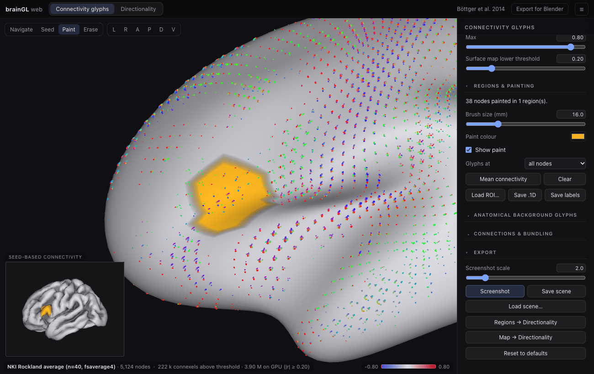
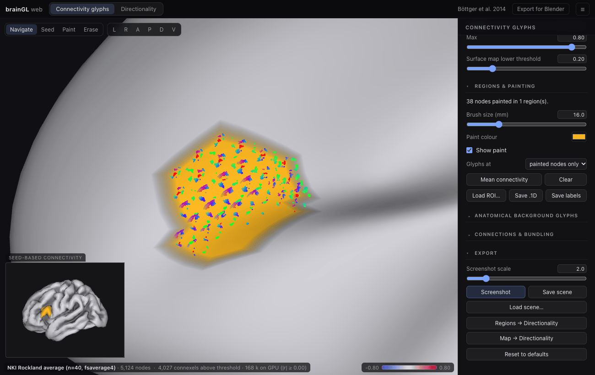
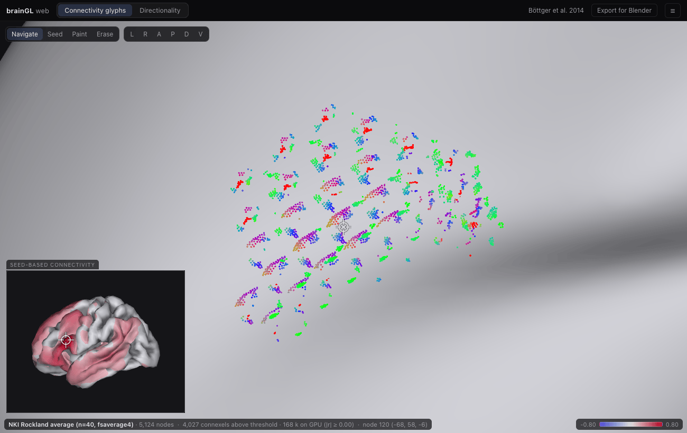
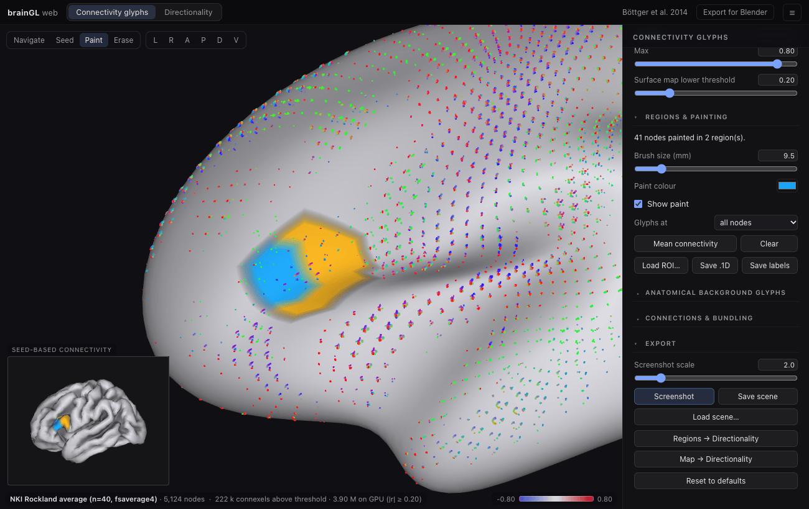
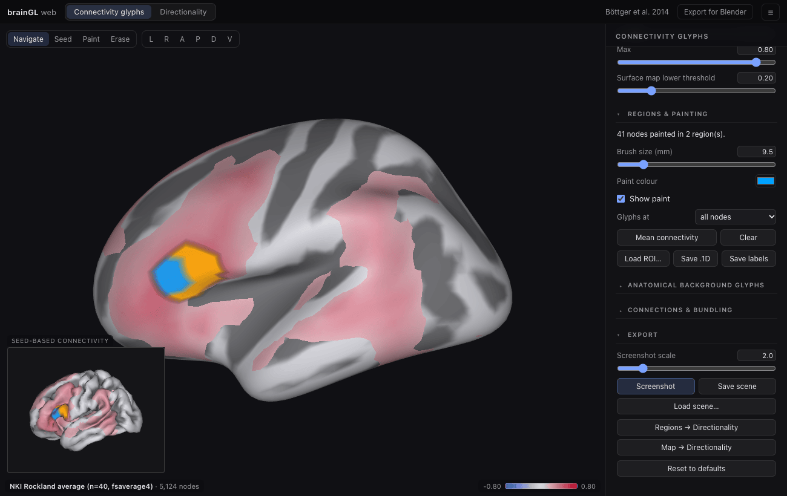

# Manual parcellation

<!-- TODO(restart): expand, add more detail per step -->

**Goal:** paint a region, show glyphs only there, find where the connectivity profile changes,
and save the resulting regions. This is how glyphs were used to subdivide Broca's region into
areas 44 and 45 in individual brains (Jakobsen et al. 2016,
[doi:10.1111/ejn.13140](https://doi.org/10.1111/ejn.13140)).
**You need:** the demo data, and the [glyph tutorial](glyphs.md).
**Result:** two painted regions on either side of a border, their mean connectivity, and ROI files.

The demo is a coarse group average (fsaverage4), so the example shows the procedure, not an
anatomical result.

## 1. Paint a region of interest

1. Set **View → Hemispheres** to *left* and **Surface → Colour** to *per mesh (one colour)*.
2. Choose the **Paint** tool (key ++p++). In **Regions & painting** set **Brush size (mm)**
   (about 16) and a **Paint colour**.
3. Drag over the inferior frontal gyrus. Shift + drag (or the **Erase** tool, key ++e++) removes paint.
   The brainGL gestures also work: Ctrl + right-drag paints, Ctrl + Shift + right-drag erases.

The paint is shown in both views. The panel reports the number of painted nodes and regions.

## 2. Restrict the glyphs to the region

Set **Glyphs at** to *painted nodes only*, raise **Glyphs → Scale** and zoom in. Lower the
**Threshold**: with fewer glyphs the connexel budget allows a lower limit.

## 3. Compare neighbouring glyphs

Untick **Show paint** and look for the line across which neighbouring glyphs differ.

Aids:

- right-click nodes on either side and compare their maps in the second view;
- switch to *diffpoints* (key ++4++, **Minimum length** 0), which draws the difference between neighbours;
- tick **Anatomical background glyphs → Show little brains** to see which areas the points belong to.

## 4. Paint the two sides as two regions

Choose a second **Paint colour** and paint over one side of the border. Each colour is one
region; new paint replaces old paint.

## 5. Mean connectivity of the painted nodes

Click **Mean connectivity**. The Fisher-z averaged connectivity of **all** painted nodes is
shown as the surface map (set **Surface → Colour** to *vertex data (seed connectivity)* to see
it in the main view too). To get the map of one region, erase or clear the other first.

## 6. Save and load regions

| Button | File | Content |
|---|---|---|
| **Save .1D** | `roi.1D` | one line per node: 1 if painted (any region), else 0 |
| **Save labels** | `regions.1D.roi` | one line per painted node: node id and region number |
| **Load ROI…** | `.1D`, `.rgb` or a list of node ids | the nodes are added as a region in the current paint colour |
| **Clear** | | removes all paint |

**Export → Save scene** stores the regions with their colours together with all settings.
To see arrows between adjacent regions, send them to the
[Directionality](directionality.md) workspace.
