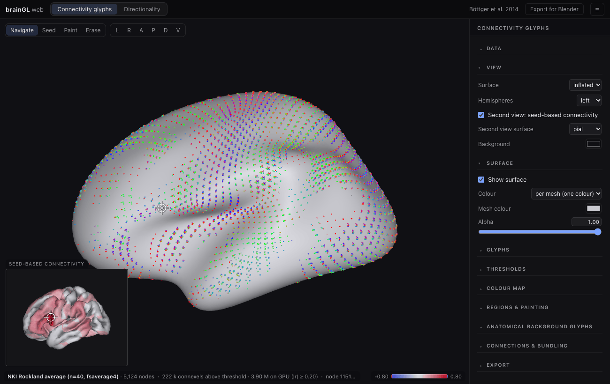
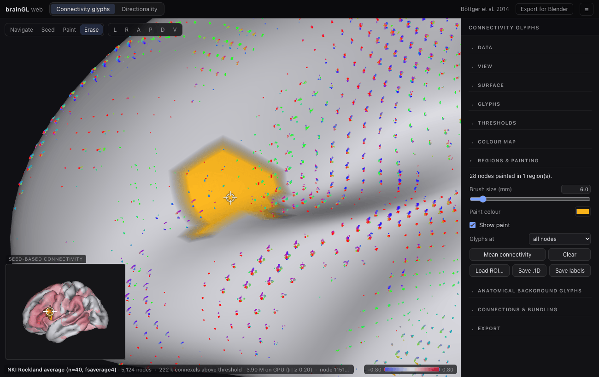
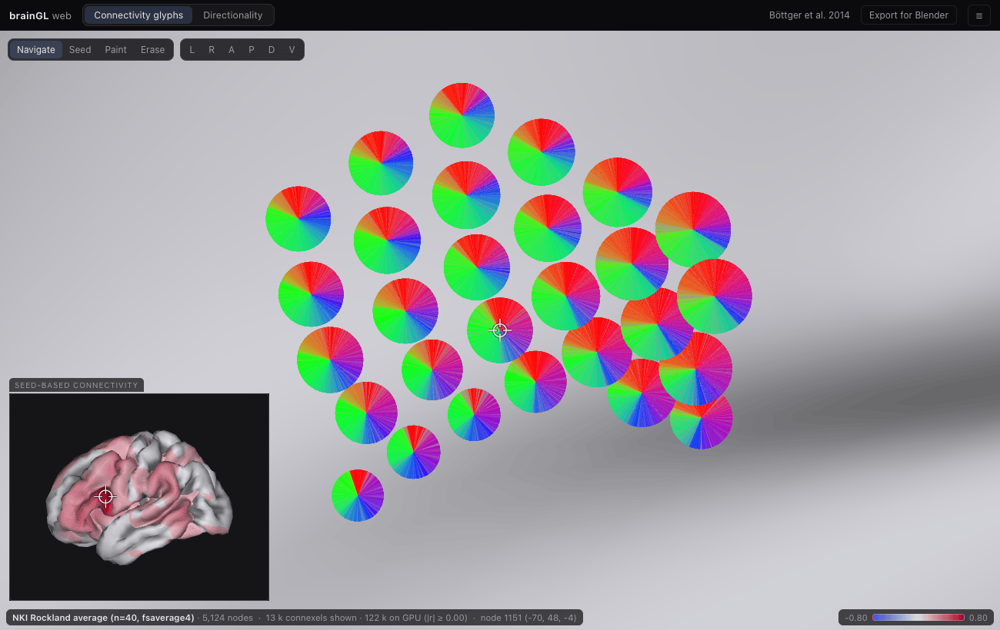
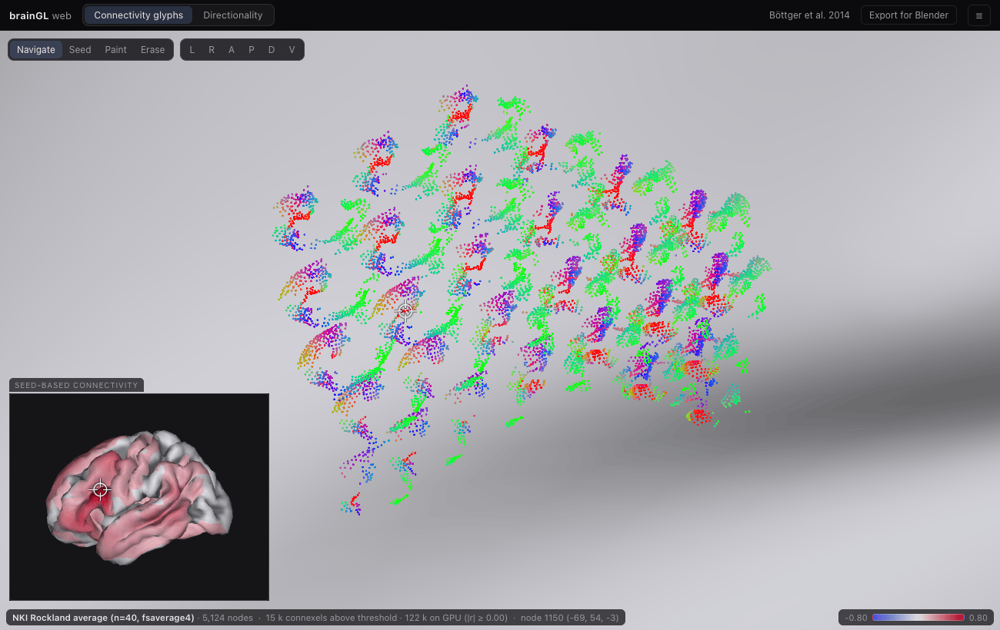
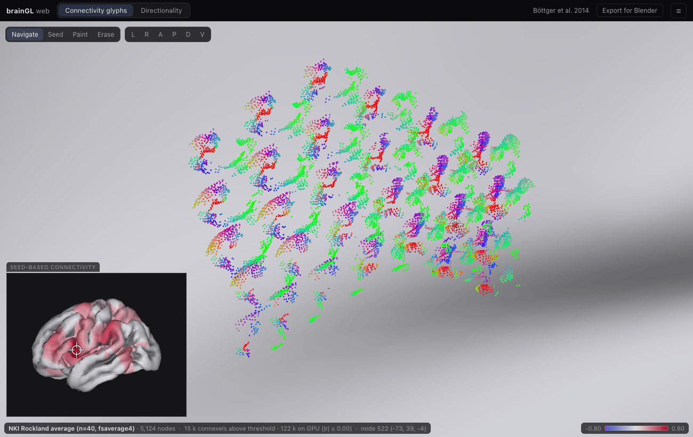
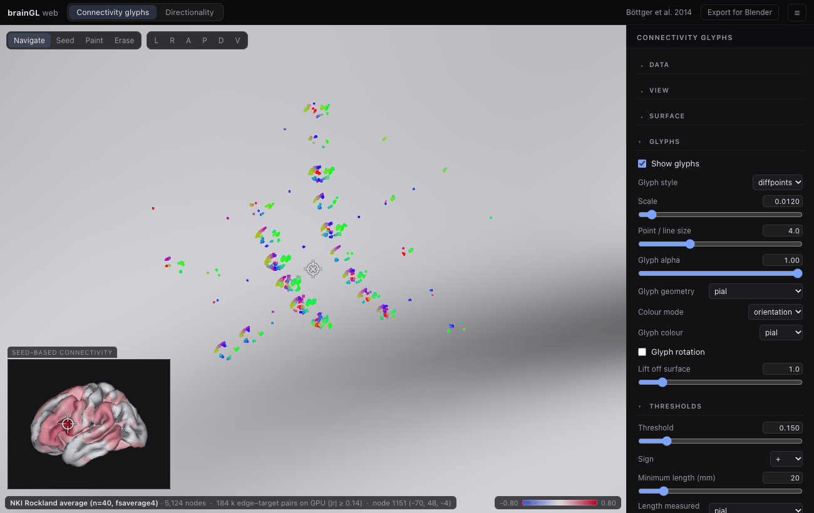
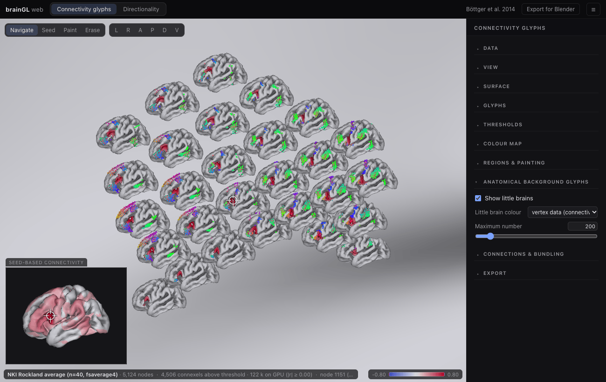
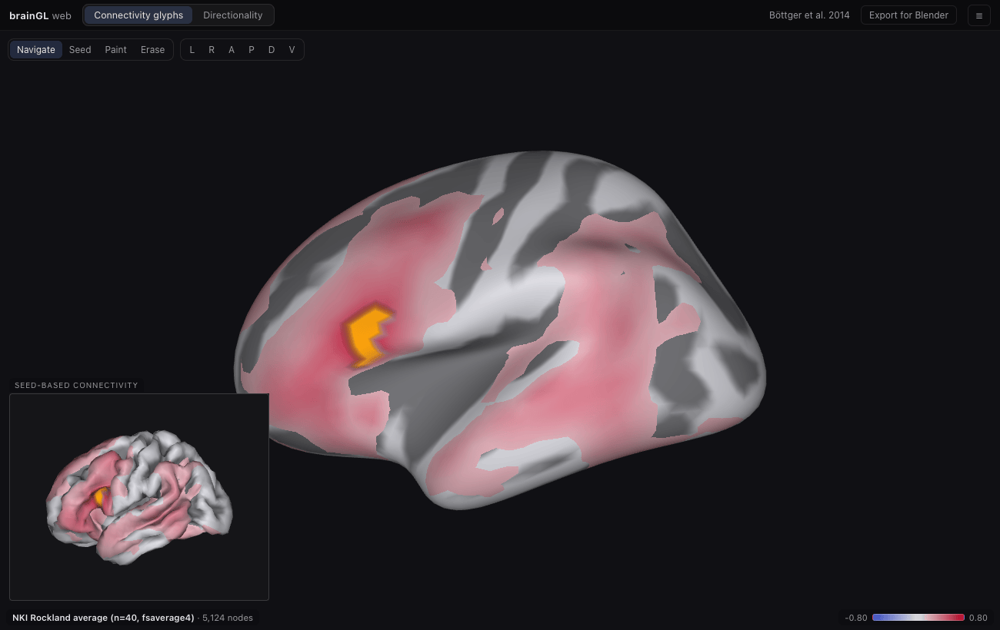
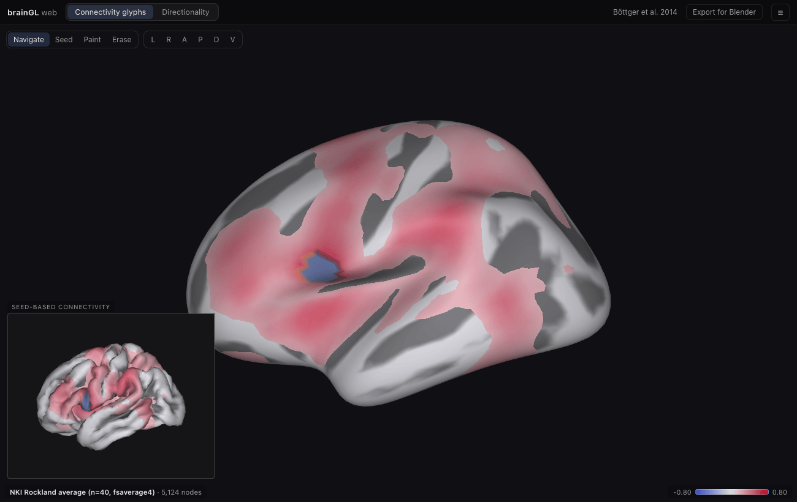
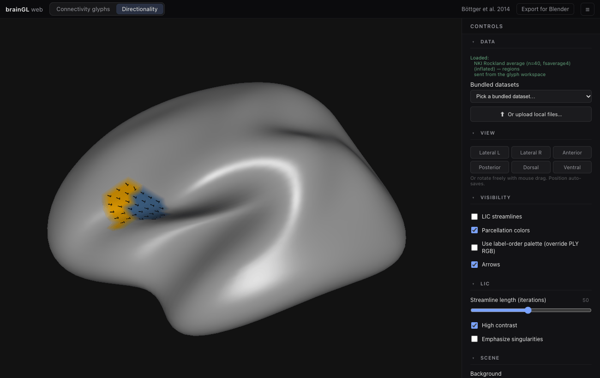

# Manual parcellation

Connectivity glyphs were designed for one task above all: finding the place where the
connectivity profile of the cortex changes, and drawing a border there by hand. This is how
Broca's region was divided into areas 44 and 45 in individual brains by Jakobsen et al. (2016,
[doi:10.1111/ejn.13140](https://doi.org/10.1111/ejn.13140)). This tutorial follows the same
procedure on the demo data.

**What you will learn**

- painting regions in several colours, erasing, and the brush size;
- restricting the glyphs to the painted nodes, which also lowers the reachable threshold;
- finding a border by comparing neighbouring glyphs, with three aids;
- the mean connectivity of a region;
- saving regions, loading them again, and sending them to the Directionality workspace.

**Time needed:** about 30 minutes.

**Prerequisites:** the app with the demo data, and the [glyph tutorial](glyphs.md) (how to
read point, pie and difference glyphs).

**Expected result:** two painted regions on either side of a border in the left inferior
frontal cortex, a connectivity map for each, and files that hold the regions.

!!! note "What the demo can and cannot show"
    The demo is a group average on a coarse surface (`fsaverage4`, node spacing about 6 mm).
    Areas 44 and 45 cannot be separated at this resolution and in an average; Jakobsen et al.
    worked in individual brains at a finer resolution. The border found below, between the
    inferior frontal gyrus and the opercular and ventral premotor cortex behind it, shows the
    procedure and is not an anatomical result.

Nodes are given by number. Type `braingl.glyphs.selectNode(1151)` in the browser console
(++f12++) to put the cross-hair on a node, and `braingl.glyphs.focusNode(1151, 7)` to centre
and zoom the view on it.

## 1. Set up and find the place

1. Click **Export → Reset to defaults** if you changed settings before.
2. Set **View → Hemispheres** to *left* and **Surface → Colour** to *per mesh (one colour)*.
3. Select node 1151, on the opercular part of the left inferior frontal gyrus
   (`braingl.glyphs.selectNode(1151)`), or right-click there.

**Expected result.** The cross-hair sits in front of the lower end of the central sulcus; the
status line ends with `node 1151 (-70, 48, -4)`. The second view shows the node on the pial surface.

## 2. Paint a region of interest

1. Choose the **Paint** tool in the toolbar (key ++p++).
2. In **Regions & painting** set **Brush size (mm)** to 14. The **Paint colour** is orange.
3. Click once on the cross-hair, or drag to paint a larger area.

**Expected result.** The panel reports about `34 nodes painted in 1 region(s)`. The paint
also appears in the second view.

Ways to paint and erase:

| Action | How |
|---|---|
| Paint | **Paint** tool and drag. |
| Erase | **Erase** tool (key ++e++) and drag, or ++shift++ + drag with the Paint tool. |
| Paint without changing the tool, macOS | ++option++ + right-drag; with ++shift++ it erases. ++ctrl++ + click selects a node on macOS, so it cannot paint. |
| Paint without changing the tool, Windows and Linux | ++ctrl++ + right-drag, as in brainGL; ++ctrl++ + ++shift++ + right-drag erases. ++alt++ works in place of ++ctrl++. |
| Remove everything | **Clear**. |

The brush is a radius in millimetres on the displayed surface and grows along the mesh, so it
does not jump across a sulcus. Regions are painted in the main view only. All gestures are
listed in [Mouse and keyboard](../reference/mouse-keyboard.md#pointer-gestures).

4. Choose the **Erase** tool, set **Brush size** to 6 and remove the lower tip of the region,
   which lies in the insula (nodes 26 and 1893). Press ++n++ for the Navigate tool.

**Expected result.** About 28 nodes remain.

## 3. Restrict the glyphs to the region

1. Set **Regions & painting → Glyphs at** to *painted nodes only*.
2. Set **Thresholds → Threshold** to 0.3.
3. Set **Glyphs → Scale** to 0.04 and **Point / line size** to 3, and zoom in
   (`braingl.glyphs.focusNode(1151, 7)`).

**Expected result.** Only the painted nodes carry glyphs. The status line reads
`15 k connexels above threshold · 122 k on GPU (|r| ≥ 0.00)`.

**Why this works.** The connexel budget is shared by all glyphs. With 28 glyphs in place of
2,562, every connection of these nodes fits (`|r| ≥ 0.00`), so the threshold can go as low as
you like. In brainGL a region of interest was required before glyphs could be made; here it is
a way to see more detail.

## 4. Compare neighbouring glyphs

1. Untick **Regions & painting → Show paint**.
2. Look across the region for the place where neighbouring glyphs stop looking alike.

**Expected result.** In this view anterior is to the left. The glyphs on the left consist of
a red and blue column with a green arc beside it. Towards the right, the glyphs become denser
and gain a compact red cluster at their lower edge. Red points are connections to the other
hemisphere: for the nodes on the right about 45 % of the connections end there, for those on
the left about 20 %. The step lies near the cross-hair, between nodes 1150, 1152 and 1153 in
front and nodes 1151, 523 and 2212 behind.

Pies give the same answer at a glance (key ++3++, **Scale** 0.022): green dominates on the
left, red and purple grow towards the right.

Press ++1++ and set **Scale** back to 0.04 before you continue.

**Why this works.** Nodes of one area share their connections, so their glyphs look alike. A
border is where the glyphs of neighbours differ. The change is rarely a clean line, and
deciding where to draw it is the manual part of manual parcellation. Three aids help.

**Aid 1: the seed maps.** Right-click a node on either side and compare the maps in the
second view (nodes 1150 and 522):

**Aid 2: difference glyphs.** Select node 1151 again and press ++4++. The app sets the
threshold to 0.193 and the minimum length to 0. Set **Threshold** to 0.15, **Minimum length**
to 20, **Scale** to 0.012 and **Point / line size** to 4.

A difference glyph sits on a mesh edge and shows the targets to which the two nodes of the
edge differ. Edges inside a homogeneous patch stay empty; the filled edges line up along the
border, here through the edges 1150–1151, 1151–1152 and 523–1152. Press ++1++ to return to points.

**Aid 3: anatomical background glyphs.** Set **Threshold** to 0.4, **Scale** to 0.03 and
**Point / line size** to 3, open **Anatomical background glyphs** and tick **Show little brains**.

Each glyph now lies on a small brain on which the connected areas are coloured, so you can
name what changes: the glyphs at the upper left reach the lateral prefrontal and inferior
parietal cortex, those at the lower right the cortex around the Sylvian fissure. Untick
**Show little brains** when you are done.

## 5. Paint the two sides as two regions

1. Tick **Show paint**. Click the **Paint colour** swatch and choose a second colour, for
   example blue.
2. With the **Paint** tool and a **Brush size** of 8 to 9, paint over the posterior part, from
   node 2212 to node 522.

**Expected result.** The panel reports two regions (in the picture 34 nodes, 15 orange and 19
blue). Each paint colour is one region, up to 255. New paint replaces old paint, so painting
over a region with another colour moves the border. To continue an existing region, select
exactly its colour again.

## 6. Mean connectivity of a region

**Mean connectivity** shows the average connectivity (Fisher z) of **all** painted nodes as
the surface map. To get the map of one region, the other must be removed first, so keep a copy
of both regions.

1. Click **Regions & painting → Save labels**. The browser saves `regions.1D.roi`.
2. Erase the blue region (**Erase** tool).
3. Click **Mean connectivity** and set **Surface → Colour** to *vertex data (seed connectivity)*
   to see the map in the main view. Press ++0++ to hide the glyphs and click **L** to see the
   whole hemisphere.

4. Click **Clear**, set **Paint colour** back to orange, click **Load ROI…** and choose
   `regions.1D.roi`. Both regions come back: the first in the paint colour (orange), the second
   in a new colour (a steel blue).
5. Erase the orange region and click **Mean connectivity** once more.

**Expected result.** The anterior region is connected with the lateral prefrontal cortex,
the inferior parietal lobule and the middle temporal gyrus. The posterior region is connected
with the insula and operculum, the supramarginal gyrus, the ventral motor cortex and the
superior temporal gyrus. Two regions with different maps are the evidence that the border
separates two connectivity profiles. Jakobsen et al. used the same logic for areas 44 and 45.

## 7. Save and reload regions

| Button | File | Content |
|---|---|---|
| **Save .1D** | `roi.1D` | one line per node: 1 if painted (any region), else 0 |
| **Save labels** | `regions.1D.roi` | one line per painted node: node number and region number |
| **Export → Save scene** | `braingl-scene-….scn.json` | all settings, both views and the regions with their colours |
| **Load ROI…** | `regions.1D.roi`, a list of node numbers, `.1D` or `.rgb` | the regions of the file, added to what is painted (see below) |
| **Export → Load scene…** | a scene file | restores the regions with their colours if the node count matches |

Region numbers follow the order in which the colours were first used. **Load ROI…** reads:

- a labels file such as `regions.1D.roi` (`<node number> <region number>` per line): one region
  per region number. The lowest number gets the current paint colour, every further one a new
  colour from a fixed palette, because the file holds numbers, not colours;
- a list of node numbers alone, or a `.1D` file: one region, in the current paint colour;
- an `.rgb` file: one region per colour, in that colour (white means unpainted).

The nodes of the file replace any paint they had; all other nodes keep theirs. A loaded region
whose colour is already painted joins that region. To get the original colours back as well,
load a scene instead.

File formats are described in [Data formats](../reference/data-formats.md#roi-files).

## 8. Send the regions to the Directionality workspace

If you erased a region in step 6, click **Clear** and load `regions.1D.roi` again. Then click
**Export → Regions → Directionality**.

**Expected result.** The Directionality workspace opens with the displayed surface and your
regions as its parcellation. Arrows appear where the regions touch, pointing from the first
region to the second. If the painted regions do not share a border, nothing is sent and the
status line says "The painted regions do not touch" for eight seconds. See
[Directionality](directionality.md).

## Troubleshooting

| Symptom | Cause and remedy |
|---|---|
| Dragging rotates the brain and does not paint | The Navigate tool is active. Press ++p++, or use the modifier of your system (step 2). |
| ++ctrl++ + click selects a node on a Mac | That is intended: it is the system's right-click. Paint with ++option++ + right-drag or the Paint tool. |
| The paint appears in the wrong place or not at all | Painting works in the main view only, and only on the visible hemisphere. |
| All glyphs vanish after choosing *painted nodes only* | Nothing is painted; the status line says "paint a region to create glyphs". |
| A second colour extends the first region | The colour is identical. Pick a visibly different colour. |
| **Mean connectivity** shows a mixture | It averages all painted nodes (step 6). |
| A reloaded labels file has other colours | The file stores region numbers, not colours: the first region takes the current paint colour, the others new colours (step 7). A scene keeps the colours. |
| The key shortcuts do nothing | The focus is in a panel field. Click in the view first. |

## Where next

- [Directionality](directionality.md): arrows and streamlines on a parcellation.
- [Connections and bundling](bundling.md): lines for the strongest connections.
- [Glyph types](../reference/glyph-types.md#difference-glyphs-diffpoints): how difference
  glyphs are computed.
- [Your own data](own-data.md): the procedure needs individual, finer data to give anatomical results.
